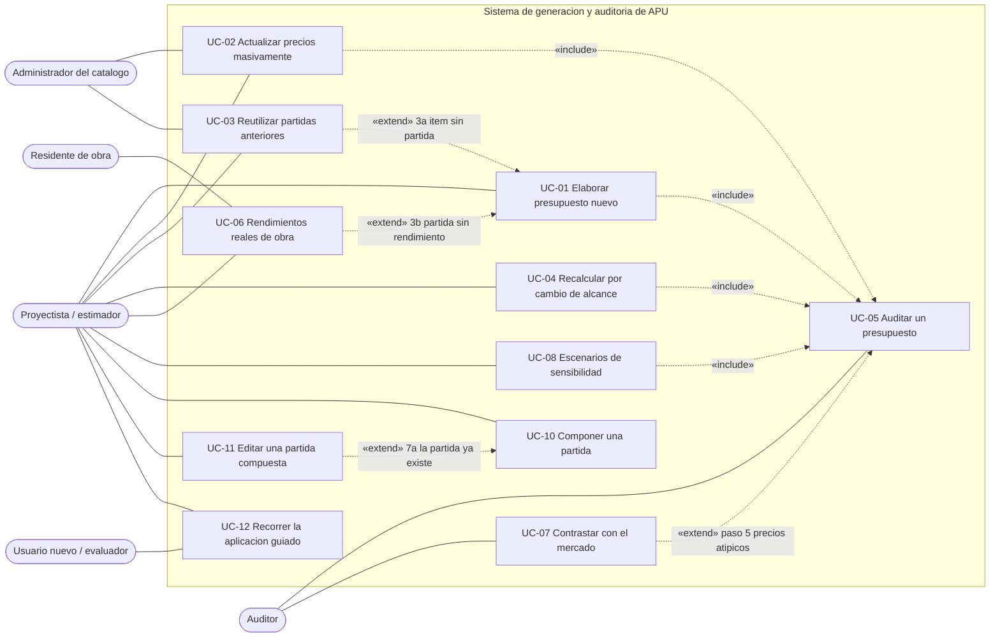
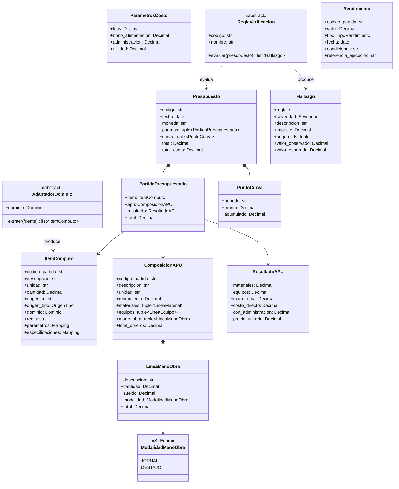
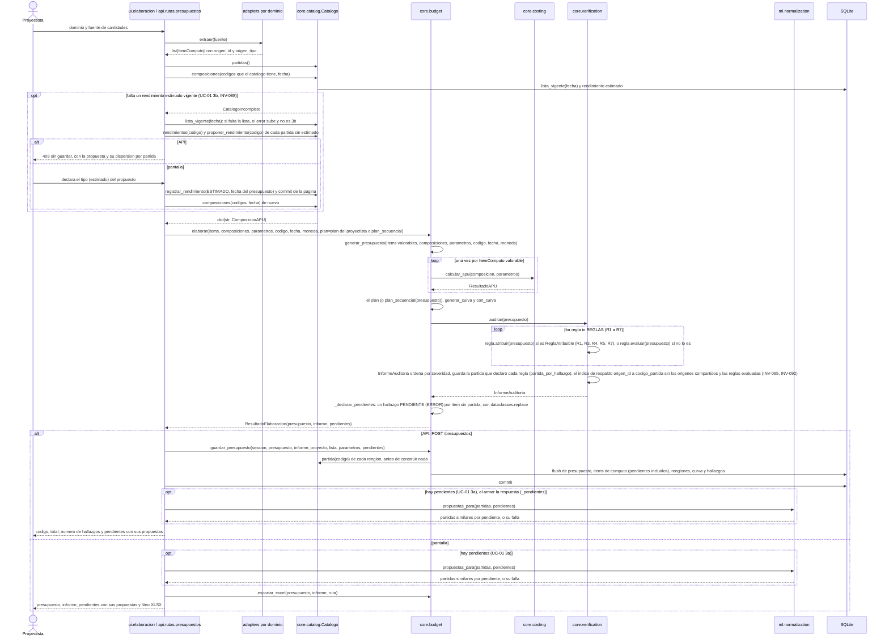
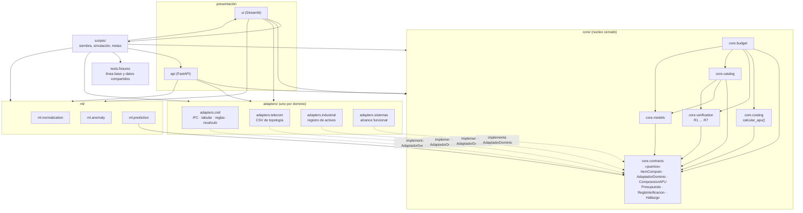
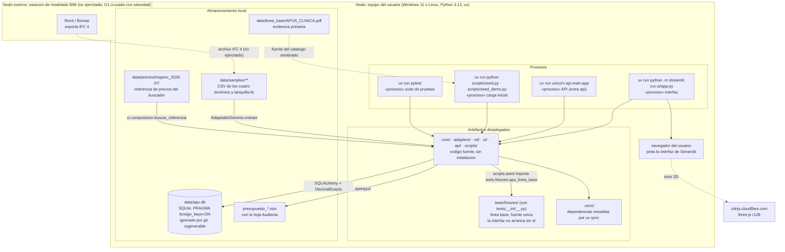

# Arquitectura del sistema (vistas 4+1 de Kruchten)

> Estado: **completo, pendiente de revisión del tutor (compuerta G0,
> [docs/metodologia.md §2.2](metodologia.md#22-compuertas))**. Completado en la Sesión 0.3 de
> [PLAN_DESARROLLO.md](../PLAN_DESARROLLO.md); criterio de cierre exigido: cinco vistas documentadas.
> Regenerado contra el código en la fase C4 del cierre (2026‑09‑28; filas INV‑028, INV‑029, INV‑057,
> INV‑058, INV‑059, INV‑070 e INV‑082 del [inventario](auditoria/2026-09-inventario.md)).
> Las cinco vistas describen **el código que existe** en `main` tras la fase C3 del cierre
> (`ceb6b8e`): las firmas de la vista lógica y los mensajes de la vista de proceso se copiaron de los
> módulos, no se diseñaron aquí. **Actualizado en la fase C5** contra `f629f94` (rama
> `inc/cierre-C5`; el código de la compuerta GC5 es el de `e5a8209`, y el retoque `340be62`–`dcd59e6` no cambia nada de lo descrito): el plan de trabajo del proyectista y el flujo 3b de UC‑01 (INV‑087, INV‑088),
> la atribución de la partida que declara la regla y las reglas evaluadas del informe (INV‑095,
> INV‑092, las dos excepciones de `core/` de C5), y dos deudas nuevas en §6.1 (el lector de CSV
> de los adaptadores y el criterio del estimado vigente). **Actualizado en la fase C6** contra
> `e6c84c1` (rama `inc/cierre-C6`, con las pistas N, R, U y A integradas): el módulo nuevo
> `core/budget/importacion.py` (INV‑076), el puerto `MarcaAtipica`/`DetectorAtipicos` por el que la
> revaloración recibe el detector de `ml` sin importarlo (INV‑099), el alta de desconocidos
> (INV‑090), la justificación del rendimiento (INV‑093), `crear_proyecto` (INV‑086), las dos rutas
> nuevas y tres deudas en §6.1. Lo que no está implementado se dice como tal y no se dibuja como si
> existiera. El **estado** de cada caso de uso, paso a paso y con su prueba, no se repite aquí: vive
> solo en [docs/plan_pruebas.md §8](plan_pruebas.md#8-especificación-de-casos-trazabilidad-rf--prueba).
> Este documento no reproduce datos que tienen fuente única: enlaza [CLAUDE.md](../CLAUDE.md),
> [docs/ERS.md](ERS.md), [docs/modelo_datos.md](modelo_datos.md) y
> [docs/linea_base.md](linea_base.md) (principio DRY,
> [metodologia.md §5](metodologia.md#5-dry)).

| Campo | Valor |
|---|---|
| Versión | 1.3 (actualización de C6; la 1.2 es la de C5 y la 1.1, la regeneración de C4) |
| Fecha | 2026‑09‑29 (versión 1.0: 2026‑08‑29) |
| Autor | [tesista] |
| Revisor | [tutor académico] |

## 0. Estilo arquitectónico

Núcleo cerrado con adaptadores de dominio (puertos y adaptadores): `core/contracts/` define los
puertos; `adapters/*` los implementan y `ml.prediction` los consume (`ml.normalization` y
`ml.anomaly` trabajan con datos planos y no importan nada de `core`); `ui/` y `api/` orquestan. El
motor de costos es una función pura; la verificación es independiente del aprendizaje automático.
Las capas de procesamiento (Bases del anteproyecto §9.1) se mapean así:

| Capa | Paquete |
|---|---|
| Modelado paramétrico e intercambio IFC | externo (Revit / Bonsai); la muestra del repositorio, `data/samples/tanquilla.ifc`, la genera `scripts/generar_tanquilla_ifc.py` |
| Extracción de cantidades | `adapters/<dominio>`, uno por dominio (civil: IFC y tabular) |
| Base de datos de APU | `core/models`, `core/catalog` |
| Motor de costos | `core/costing` |
| Presupuesto y curva | `core/budget` |
| Aprendizaje automático | `ml/normalization`, `ml/anomaly`, `ml/prediction` |
| Verificación | `core/verification` |
| Presentación | `ui/` (Streamlit), `api/` (FastAPI) |

## 1. Vista de casos de uso

Actores y casos de uso están definidos en [ERS §2.2](ERS.md#22-funciones-del-producto-casos-de-uso) y
[ERS §2.3](ERS.md#23-características-de-los-usuarios); esta vista **no los redefine**: los dibuja con
sus relaciones y dice qué código realiza cada uno. UC‑09 está vacante (reservado por
[PLAN_ASISTENTE.md](../PLAN_ASISTENTE.md)) y no se dibuja.



**Por qué UC‑05 es `«include»` y no `«extend»`.** No es una decisión de modelado: el código lo impone.
`core.budget.elaborar` llama siempre a `core.verification.auditar` y devuelve un
`ResultadoElaboracion` que lleva presupuesto **e** informe, de modo que no existe forma de obtener uno
sin el otro (principio 7 de [CLAUDE.md §2](../CLAUDE.md#2-principios)). UC‑02
(`core.budget.actualizar_precios`), UC‑04 (quien llama a `adapters.civil.recalculo.recalcular` vuelve a
elaborar) y UC‑08 (`core.budget.generar_escenario`, cuyo `Escenario` lleva su `informe`) producen su
versión por la misma función, así que heredan la inclusión.

Las cuatro relaciones `«extend»` son flujos alternativos del ERS; no todas se realizan igual:

- **UC‑03 → UC‑01 (3a), realizada.** `elaborar` deja fuera del presupuesto el ítem cuya partida no
  tiene composición, lo devuelve en `ResultadoElaboracion.pendientes` y el informe lo declara con un
  hallazgo `CODIGO_PENDIENTE`; después, `ml.normalization.propuestas_para` propone partidas similares
  y `ui.elaboracion.aceptar_propuesta` reasigna el ítem y se vuelve a elaborar. El orden real es
  **elaborar primero y proponer después**, no el que redacta el ERS («propone… y si no se acepta
  ninguna»); la corrección de la redacción es de la ERS (ruling C3‑10 de la
  [bitácora del cierre](bitacora/2026-09-23-cierre.md)).
- **UC‑06 → UC‑01 (3b), realizada en `ui/` y `api/`, sin `core/`** (INV‑088, fase C5). Una partida
  sin rendimiento estimado vigente hace que `Catalogo.composicion` lance `CatalogoIncompleto`. La
  pantalla y la API lo capturan y clasifican: primero `Catalogo.lista_vigente(fecha)`, porque
  sin lista vigente el error es de la lista y no de 3b, y se deja subir; después, las partidas sin
  un ESTIMADO de fecha no posterior a la del presupuesto, cada una con
  `core.catalog.proponer_rendimiento` (el rendimiento del histórico y su dispersión). La pantalla
  las lleva al bloque «Rendimientos por declarar» (`ui.elaboracion.rendimientos_por_declarar`),
  exige el tipo, registra el propuesto declarado ESTIMADO con `core.catalog.registrar_rendimiento`
  (`ui.elaboracion.declarar_rendimiento`, sin confirmar: el `commit` es de la página) y vuelve a
  elaborar. La API responde 409 sin guardar, con la propuesta por partida
  (`api.rutas.presupuestos._rendimientos_por_declarar`); el tipo se declara con
  `POST /partidas/{codigo}/rendimientos` y el presupuesto se reenvía. Un MEDIDO declarado no
  desbloquea la elaboración: la política de `Catalogo._rendimiento_estimado` es de `core/` y C5 no
  la toca (ERS, UC‑01 3b). El criterio «estimado vigente» queda repetido en las dos capas (deuda
  U‑5, §6.1).
- **UC‑07 → UC‑05 (paso 5), realizada solo en la revaloración** (INV‑099, fase C6; alcance vigente
  de la [ERS](ERS.md#22-funciones-del-producto-casos-de-uso), UC‑07 5). `core.budget.actualizar_precios`
  recibe el detector como parámetro (`detectar_atipicos: DetectorAtipicos | None`): un invocable
  cuyo resultado cumple el protocolo `MarcaAtipica` de `core/budget/presupuesto.py`, que
  `ml.anomaly.precios_atipicos` cumple por estructura sin que `core/` importe `ml` (ADR 5). La
  pantalla «Actualizar precios» y `POST /presupuestos/{codigo}/actualizacion` son la raíz de
  composición: le pasan `ml.anomaly.precios_atipicos` con importación perezosa (§2.4). Los atípicos
  de la lista nueva entran al informe de la versión revalorada como hallazgos `CODIGO_ATIPICO`
  (ADVERTENCIA), que `guardar_presupuesto` persiste y `cargar_elaboracion` vuelve a declarar. En
  cualquier otro informe (elaborar, componer, importar) no entran, y el contraste AACE
  (`ml.prediction.contrastar_aace`, que devuelve un `Hallazgo`) sigue solo en la pantalla de
  componer.
- **UC‑11 → UC‑10 (7a), realizada.** `ui.elaboracion.guardar_composicion` decide: si la partida no
  existe, `Catalogo.cargar_composicion` (UC‑10); si existe, `Catalogo.reemplazar_composicion`
  (UC‑11), salvo que `ui.composicion.motivo_para_no_reemplazar` lo impida.

Dos reutilizaciones más que el ERS menciona no se dibujan porque son de un paso, no entre casos de uso
completos: UC‑04 *2a* reimporta el modelo con el paso 2 de UC‑01 (`adapters.civil.recalculo.emparejar`
conserva la correspondencia por `origen_id`), y UC‑08 *2a* usa el mecanismo de precios de UC‑02 sin
persistir la lista. UC‑12 tampoco tiene relaciones: es el recorrido guiado que lleva a las pantallas
de los demás.

| UC | Realizado por | Pantalla (`ui/app.py`, `PAGINAS`) y ruta HTTP |
|---|---|---|
| UC‑01 | Paso 1 (INV‑086, C6): `api.rutas.presupuestos.crear_proyecto_de_presupuestos` → `core.budget.crear_proyecto`. `AdaptadorDominio.extraer` del dominio → `ui.elaboracion.elaborar_desde_catalogo` o `api.rutas.presupuestos.crear_presupuesto` → `Catalogo.composiciones` de las partidas existentes → `core.budget.elaborar(..., plan=...)` con el plan del proyectista o, sin él, `plan_secuencial` (`ui.elaboracion.plan_de` y `plan_desde_filas`; `api.rutas.presupuestos._plan`; paso 6, INV‑087) → `core.budget.exportar_excel`. Flujo 3b: `ui.elaboracion.rendimientos_por_declarar` y `declarar_rendimiento`, o el 409 de `api.rutas.presupuestos._rendimientos_por_declarar` (INV‑088). Persiste (`core.budget.guardar_presupuesto`) la API y los sembradores; la pantalla elabora, muestra y exporta, pero no guarda el presupuesto | «Elaborar un presupuesto» (`ui/paginas/elaborar.py`; civil solo tabular; tabla «Plan de trabajo» y bloque «Rendimientos por declarar») y «Componer una partida»; `POST /proyectos` (paso 1; la interfaz no crea proyectos), `POST /computos/{dominio}` (civil: `.ifc` o tabular) y `POST /presupuestos` (campo `plan`; 409 de 3b) |
| UC‑02 | `core.catalog.crear_lista_desde_archivo` → `core.budget.actualizar_precios` → `Comparativo`; 7a: `core.budget.descartar_version`. Flujo 2a (INV‑090, C6): la vista previa `core.catalog.insumos_desconocidos` (no escribe) y el argumento `dar_de_alta` de `crear_lista_desde_archivo`, que da de alta con `Catalogo.dar_de_alta_insumo`; los ignorados (2a) y los rechazados (2b) los separa quien llama, comparando `ResumenLista.desconocidos` con la vista previa. Paso 5 de UC‑07 (INV‑099): el detector de atípicos entra como `detectar_atipicos` | «Actualizar precios» (`ui/paginas/actualizacion.py`, con «Dar de alta») e «Historico de cambios de precio» (`core.catalog.cambios_precio`); `POST /listas-precios` (campo `dar_de_alta`), `POST /presupuestos/{codigo}/actualizacion`, `GET /cambios-precio` |
| UC‑03 | `ml.normalization` (`NormalizadorPartidas`, `proponedor`, `propuestas_para`) sobre pares código–descripción que la capa de presentación lee de `core.catalog`; la persistencia de la partida nueva es UC‑10 | «Partidas similares» (`ui/paginas/similares.py`, vía `ui.composicion.sugerir_partidas_similares`); dentro de UC‑01 3a en «Elaborar un presupuesto» y en `POST /presupuestos` |
| UC‑04 | `adapters.civil.recalculo` (`recalcular`, `emparejar`) y `core.budget.elaborar` por quien llama. El paso 5 (diferencial, RF‑20) no está implementado | sin pantalla ni ruta HTTP |
| UC‑05 | `core.verification.auditar` sobre un `Presupuesto`. En las pantallas y la API corre siempre dentro de `core.budget.elaborar` y de `core.budget.cargar_elaboracion`. La excepción son los resúmenes impresos de tres sembradores, que arman `ResultadoElaboracion(presupuesto, auditar(presupuesto))` sobre `core.budget.generar_presupuesto` y llaman a `auditar` directamente, sin pendientes: `scripts/seed_telecom.py:580` (el presupuesto de un tercero), `scripts/seed_industrial.py:260` y `scripts/seed_sistemas.py:253`. El hallazgo `PENDIENTE` no lo emite `auditar`: lo agrega la elaboración (`_declarar_pendientes`), así que quien llame a `auditar` directamente no lo ve | el informe acompaña a toda elaboración en pantalla y en la hoja «Auditoria» del libro; `GET /presupuestos/{codigo}/informe`. El archivo tabular de un tercero (RF‑24, INV‑076, C6) entra por `POST /presupuestos/importar` → `core.budget.importar_presupuesto` (`core/budget/importacion.py`: lee, audita siempre y guarda con su informe; §3.3), sin pantalla (ruling C6‑3); los presupuestos de terceros de los sembradores y de las pruebas se siguen armando en código (`scripts/seed_telecom.py`, `tests/fixtures/presupuesto_auditado.py`) |
| UC‑06 | `core.catalog.rendimientos` (`registrar_ejecucion`, `registrar_rendimiento`, `dispersion_rendimientos`, `proponer_rendimiento`, `advertencia_rendimiento` y, desde C6, `justificar_rendimiento`, flujo 4a, INV‑093) y, con el extra `ml`, `ml.anomaly.evaluar_rendimiento` | propuesta, advertencia y, desde C6, la justificación de la advertencia por rango en «Componer una partida»; la justificación, también en el campo `justificacion` de `POST /partidas/{codigo}/rendimientos`; la propuesta, también en el flujo 3b de «Elaborar un presupuesto» y en el 409 de `POST /presupuestos`; el registro de un rendimiento medido, solo por HTTP: `POST /ejecuciones`, `GET /ejecuciones`, `GET` y `POST /partidas/{codigo}/rendimientos` |
| UC‑07 | `ml.anomaly.precios_atipicos` y `ml.prediction` (`tecnica_para`, `predecir_por_reglas`, `metricas`, `contrastar_aace`) | ayudas 2 y 4 de «Componer una partida» (`ui.composicion.advertencia_precio_atipico`, `ui.composicion.contrastar_precio_con_reglas`; para una partida nueva, sin PU anterior del que partir, la ayuda 4 avisa que el contraste no es posible, flujo 3a, INV‑094); `scripts/generar_resultados_ml.py` escribe `docs/resultados_ml.md`. Paso 5 (INV‑099, C6): `ml.anomaly.precios_atipicos` como `DetectorAtipicos` de `core.budget.actualizar_precios`, en «Actualizar precios» y en `POST /presupuestos/{codigo}/actualizacion`; ninguna otra ruta HTTP |
| UC‑08 | `core.budget.escenarios` (`generar_escenario`, `comparar_escenarios`, `comparar_por_partida`). Nada se persiste; el informe de un escenario no declara los pendientes del base (ruling C4‑3 de la bitácora del cierre, a limitaciones) | «Escenarios de sensibilidad» (`ui/paginas/escenarios.py`, que lee el base con `cargar_elaboracion` y avisa de sus pendientes); `POST /presupuestos/{codigo}/escenarios`, cuya respuesta los declara en `pendientes_base` (INV‑083, pista C de C4) |
| UC‑10, UC‑11 | `ui.composicion` (`composicion_desde_tablas`; `desglose` → `core.costing.calcular_apu`) y `ui.elaboracion.guardar_composicion` → `Catalogo.cargar_composicion` o `Catalogo.reemplazar_composicion` | «Componer una partida» (`ui/paginas/componer.py`); sin ruta HTTP |
| UC‑12 | `ui.app` (`PAGINAS`, `paginas_visibles`, `marco`), `ui.caso` (`ruta_caso`, `estado_caso`) y `ui.recorridos` (`RECORRIDOS`, `paso_siguiente`); el caso vacío se siembra con `scripts.seed_demo.main` | «Inicio» (`ui/paginas/inicio.py`) y el marco común de las diez pantallas; sin ruta HTTP |

Las pantallas «Catalogo de partidas e insumos», «Simulador de listas» y «Visor 3D del modelo» no
realizan un caso de uso propio: la primera consulta el catálogo, la segunda genera listas de precios
de ensayo (`scripts.simular_lista.simular`) y la tercera muestra el modelo IFC que lee
`AdaptadorCivilIFC`, como apoyo a UC‑01.

## 2. Vista lógica

### 2.1 Contratos (`core/contracts`, estables)

La tabla de módulos y tipos es la de [CLAUDE.md §5](../CLAUDE.md#5-contratos-de-interfaz-corecontracts);
el diagrama muestra sus atributos. El único cambio de los contratos desde la Sesión I0.1 es aditivo:
`ModalidadManoObra` y el campo `LineaManoObra.modalidad`, con `JORNAL` por defecto (decisión D9 de
[dossier_g0.md](dossier_g0.md#d9-modalidad-de-mano-de-obra-por-linea-cambio-a-un-contrato-declarado-estable),
pendiente del aval del tutor; `ComposicionAPU.total_obreros` cuenta solo las líneas a jornal). Las
enumeraciones `Dominio`, `OrigenTipo`, `TipoRendimiento` y `Severidad` se omiten del dibujo.



`LineaMaterial` (`descripcion`, `unidad`, `cantidad`, `precio`) y `LineaEquipo` (`descripcion`,
`cantidad`, `precio`, `depreciacion`) completan `ComposicionAPU` y se omiten por brevedad.

### 2.2 Clases y funciones del núcleo

El núcleo es en su mayor parte **funciones sobre contratos inmutables**, no jerarquías de objetos: los
módulos se dibujan con el estereotipo `<<module>>`; las clases propias son `Catalogo`, las siete reglas,
las entidades de `core.models` y unos pocos resultados congelados (`ResultadoElaboracion`,
`Comparativo`, `Escenario`, `InformeAuditoria`, `ResumenCarga`, `ResumenLista`,
`PresupuestoImportado` y los de `core.catalog.rendimientos`), más un protocolo, `MarcaAtipica`
(C6). En los diagramas los genéricos usan la notación de Mermaid (`list~X~`)
y se omiten los valores por defecto; las **firmas literales**, copiadas del código, están en los
listados que siguen a cada diagrama.

#### Cálculo, presupuesto y catálogo

```mermaid
classDiagram
    class costing {
        <<module>>
        +calcular_apu(composicion ComposicionAPU, parametros ParametrosCosto) ResultadoAPU
    }
    class presupuesto {
        <<module>>
        +generar_presupuesto(items, composiciones, parametros, codigo, fecha, moneda) Presupuesto
        +elaborar(items, composiciones, parametros, codigo, fecha, moneda, plan) ResultadoElaboracion
        +exigir_composiciones(items, composiciones) None
        +CODIGO_PENDIENTE: str
        +CODIGO_ATIPICO: str
        +GeneradorPlan: TypeAlias
        +DetectorAtipicos: TypeAlias
    }
    class MarcaAtipica {
        <<Protocol>>
        +id: str
        +valor: Decimal
        +puntaje: float
    }
    class importacion {
        <<module>>
        +leer_presupuesto_tabular(ruta Path) PresupuestoImportado
        +importar_presupuesto(session, ruta, proyecto) ResultadoElaboracion
        +HOJA_DATOS ... HOJA_CURVA: str
    }
    class ResultadoElaboracion {
        <<frozen dataclass>>
        +presupuesto: Presupuesto
        +informe: InformeAuditoria
        +pendientes: tuple~ItemComputo~
    }
    class curva {
        <<module>>
        +generar_curva(presupuesto Presupuesto, plan, cuantizar) tuple~PuntoCurva~
        +con_curva(presupuesto Presupuesto, curva) Presupuesto
        +plan_secuencial(presupuesto Presupuesto, formato str) list~PeriodoPlan~
        +PeriodoPlan: TypeAlias
        +PlanInvalido: ValueError
    }
    class persistencia {
        <<module>>
        +guardar_presupuesto(session, presupuesto, informe, proyecto, lista, parametros, pendientes) models_Presupuesto
        +cargar_presupuesto(session, proyecto_nombre, codigo, catalogo) Presupuesto
        +cargar_elaboracion(session, proyecto_nombre, codigo, catalogo) ResultadoElaboracion
        +crear_proyecto(session, nombre, descripcion, dominio) models_Proyecto
        +TOLERANCIA_RECONSTRUCCION: Decimal
    }
    class actualizacion {
        <<module>>
        +actualizar_precios(session, proyecto_nombre, codigo_presupuesto, lista_nueva, codigo_nuevo, plan, detectar_atipicos) tuple
        +descartar_version(session, proyecto_nombre, codigo_presupuesto, fecha) models_DescarteVersion
        +Comparativo: frozen dataclass
    }
    class escenarios {
        <<module>>
        +generar_escenario(nombre, base, composiciones, parametros, precios) Escenario
        +comparar_escenarios(base, escenarios) DataFrame
        +comparar_por_partida(base, escenario) Comparativo
        +Escenario: frozen dataclass
    }
    class excel {
        <<module>>
        +exportar_excel(presupuesto Presupuesto, informe InformeAuditoria, ruta Path) Path
    }
    class Catalogo {
        +partidas(dominio) list~models_Partida~
        +partida(codigo str) models_Partida
        +insumos(tipo) list~models_Insumo~
        +rendimientos(codigo_partida str) list~Rendimiento~
        +lista_vigente(fecha) models_ListaPrecios
        +composicion(codigo_partida, fecha, lista) ComposicionAPU
        +composiciones(codigos, fecha) dict~str, ComposicionAPU~
        +cargar_composicion(composicion, lista, dominio, fecha_rendimiento, condiciones) ResumenCarga
        +reemplazar_composicion(composicion, lista, dominio, fecha_rendimiento, condiciones) ResumenCarga
        +registrar_rendimiento(rendimiento Rendimiento) models_Rendimiento
        +dar_de_alta_insumo(tipo, descripcion, unidad) models_Insumo
    }
    class precios {
        <<module>>
        +leer_lista_precios(ruta Path) list~PrecioLeido~
        +leer_tabla(ruta Path, hoja) DataFrame
        +tipo_insumo(texto str) TipoInsumo
        +insumos_desconocidos(session, ruta) tuple~PrecioLeido~
        +crear_lista_desde_archivo(session, ruta, nombre, moneda, fecha_vigencia, origen, dar_de_alta) ResumenLista
        +insumos_afectados(session, lista_anterior, lista_nueva) list~CambioDetectado~
        +registrar_cambios(session, lista_anterior, lista_nueva) list~models_CambioPrecio~
        +cambios_precio(session, insumo, desde, hasta) list~models_CambioPrecio~
        +variacion_relativa(anterior Decimal, nuevo Decimal) Decimal
    }
    class rendimientos {
        <<module>>
        +registrar_ejecucion(session, referencia, fecha_inicio, fecha_fin, descripcion, proyecto) models_Ejecucion
        +registrar_rendimiento(session, codigo_partida, valor, tipo, fecha, condiciones, referencia_ejecucion) Rendimiento
        +dispersion_rendimientos(session, codigo_partida) DispersionRendimiento
        +proponer_rendimiento(session, codigo_partida) PropuestaRendimiento
        +advertencia_rendimiento(dispersion, valor) str
        +justificar_rendimiento(session, codigo_partida, texto, advertencia, fecha) models_JustificacionRendimiento
    }
    class mapeo {
        <<module>>
        +a_composicion(partida, lista, rendimiento) ComposicionAPU
        +a_rendimiento(rendimiento) Rendimiento
        +lineas_de(composicion ComposicionAPU) list~LineaCatalogo~
        +a_modelo_partida(composicion, dominio) models_Partida
        +a_modelo_insumo(linea, codigo) models_Insumo
        +a_modelo_lineas(lineas, partida, insumos) list~models_ComposicionAPU~
        +a_modelo_rendimiento(rendimiento, partida, ejecucion) models_Rendimiento
        +a_modelo_rendimiento_estimado(composicion, partida, fecha, condiciones) models_Rendimiento
    }
    class sesion {
        <<module>>
        +crear_motor(url str) Engine
        +crear_esquema(motor Engine) None
        +abrir_sesion(motor Engine) Session
        +URL_POR_DEFECTO: str
    }
    class entidades {
        <<module>>
        +Base: DeclarativeBase
        +diecisiete entidades SQLAlchemy
        +TipoInsumo: StrEnum
    }
    class DecimalExacto {
        <<TypeDecorator>>
        +impl: String~40~
        +process_bind_param(value, dialect) str
        +process_result_value(value, dialect) Decimal
    }

    presupuesto ..> costing : calcular_apu por renglon
    presupuesto ..> curva : con_curva + generar_curva
    presupuesto ..> ResultadoElaboracion : construye
    presupuesto ..> InformeAuditoria : auditar siempre y declara pendientes
    curva ..> directivas : etiqueta_con_codigos
    persistencia ..> costing : reconstruye y verifica
    persistencia ..> presupuesto : _declarar_pendientes + _declarar_atipicos
    presupuesto ..> MarcaAtipica : DetectorAtipicos devuelve marcas
    persistencia ..> Catalogo : composicion a fecha
    persistencia ..> directivas : CLAVE_UNIDAD_ORIGINAL
    persistencia ..> entidades : unica frontera del presupuesto
    actualizacion ..> persistencia : cargar, guardar y pendientes guardados
    actualizacion ..> presupuesto : exigir_composiciones + elaborar
    actualizacion ..> precios : registrar_cambios + cambios_precio + variacion_relativa
    actualizacion ..> MarcaAtipica : detectar_atipicos(historico)
    importacion ..> presupuesto : generar_presupuesto
    importacion ..> curva : con_curva
    importacion ..> persistencia : guardar_presupuesto
    importacion ..> Catalogo : lista_vigente + cargar_composicion
    importacion ..> precios : leer_tabla + tipo_insumo
    importacion ..> entidades : lista Importada y sus precios
    escenarios ..> actualizacion : Comparativo y su tabla
    escenarios ..> presupuesto : exigir_composiciones + elaborar
    excel ..> InformeAuditoria : hoja Auditoria
    precios ..> Catalogo : lista_vigente
    precios ..> texto : normalizar_texto
    rendimientos ..> Catalogo : registrar_rendimiento y rendimientos
    rendimientos ..> mapeo : a_rendimiento
    Catalogo ..> mapeo : unica frontera modelo-contrato del catalogo
    mapeo ..> entidades : construye models.X
    sesion ..> entidades : Base.metadata.create_all
    entidades ..> DecimalExacto : toda columna monetaria o dimensional
```



`Catalogo` recibe una `Session` ya abierta y **no** importa `core.catalog.sesion`: quien la abre es
`abrir_sesion(motor)`, y quien decide confirmar o deshacer la transacción es siempre el llamador.
Ninguna función del núcleo confirma: `guardar_presupuesto`, `actualizar_precios`,
`descartar_version`, `crear_lista_desde_archivo`, `registrar_cambios`, las cargas del catálogo y,
desde C6, `crear_proyecto`, `importar_presupuesto`, `justificar_rendimiento` y
`Catalogo.dar_de_alta_insumo` hacen `flush` y dejan el `commit` a la pantalla, a la ruta HTTP o al
sembrador.

Firmas literales (`core/costing/motor.py`, `core/budget/*.py`, `core/catalog/*.py`,
`core/models/tipos.py`):

```python
# core.costing
def calcular_apu(composicion: ComposicionAPU, parametros: ParametrosCosto) -> ResultadoAPU

# core.budget.presupuesto
MONEDA_POR_DEFECTO = "USD"
CODIGO_PENDIENTE = "PENDIENTE"
CODIGO_ATIPICO = "ATIPICO"

class MarcaAtipica(Protocol):
    @property
    def id(self) -> str: ...
    @property
    def valor(self) -> Decimal: ...
    @property
    def puntaje(self) -> float: ...

DetectorAtipicos = Callable[[Mapping[str, Decimal]], Sequence[MarcaAtipica]]
GeneradorPlan = Callable[[Presupuesto], Sequence[PeriodoPlan]]

@dataclass(frozen=True, slots=True)
class ResultadoElaboracion:
    presupuesto: Presupuesto
    informe: InformeAuditoria
    pendientes: tuple[ItemComputo, ...] = ()

def generar_presupuesto(
    items: Sequence[ItemComputo],
    composiciones: Mapping[str, ComposicionAPU],
    parametros: ParametrosCosto,
    codigo: str,
    fecha: date,
    moneda: str = MONEDA_POR_DEFECTO,
) -> Presupuesto

def elaborar(
    items: Sequence[ItemComputo],
    composiciones: Mapping[str, ComposicionAPU],
    parametros: ParametrosCosto,
    codigo: str,
    fecha: date,
    moneda: str = MONEDA_POR_DEFECTO,
    plan: Sequence[PeriodoPlan] | GeneradorPlan | None = None,
) -> ResultadoElaboracion

def exigir_composiciones(
    items: Sequence[ItemComputo], composiciones: Mapping[str, ComposicionAPU]
) -> None

# core.budget.curva
PeriodoPlan = tuple[str, Sequence[tuple[str, Decimal]]]

class PlanInvalido(ValueError): ...

def generar_curva(
    presupuesto: Presupuesto,
    plan: Sequence[PeriodoPlan],
    cuantizar: Decimal | None = None,
) -> tuple[PuntoCurva, ...]
def con_curva(presupuesto: Presupuesto, curva: Sequence[PuntoCurva]) -> Presupuesto
def plan_secuencial(presupuesto: Presupuesto, formato: str = FORMATO_PERIODO) -> list[PeriodoPlan]

# core.budget.persistencia
TOLERANCIA_RECONSTRUCCION = Decimal("0.000001")

def crear_proyecto(
    session: Session,
    nombre: str,
    descripcion: str = "",
    dominio: Dominio | str = "",
) -> models.Proyecto

def guardar_presupuesto(
    session: Session,
    presupuesto: Presupuesto,
    informe: InformeAuditoria,
    proyecto: models.Proyecto,
    lista: models.ListaPrecios,
    parametros: ParametrosCosto,
    pendientes: Sequence[ItemComputo] = (),
) -> models.Presupuesto

def cargar_presupuesto(
    session: Session, proyecto_nombre: str, codigo: str, catalogo: Catalogo
) -> Presupuesto

def cargar_elaboracion(
    session: Session, proyecto_nombre: str, codigo: str, catalogo: Catalogo
) -> ResultadoElaboracion

# core.budget.actualizacion
@dataclass(frozen=True, slots=True, eq=False)
class Comparativo:
    tabla: DataFrame                 # columnas de COLUMNAS_COMPARATIVO, celdas Decimal
    total_anterior: Decimal
    total_nuevo: Decimal
    insumos_afectados: int
    @property
    def variacion(self) -> Decimal
    @property
    def variacion_pct(self) -> Decimal

def actualizar_precios(
    session: Session,
    proyecto_nombre: str,
    codigo_presupuesto: str,
    lista_nueva: models.ListaPrecios,
    codigo_nuevo: str,
    plan: Sequence[PeriodoPlan] | GeneradorPlan | None = None,
    detectar_atipicos: DetectorAtipicos | None = None,
) -> tuple[ResultadoElaboracion, Comparativo]

def descartar_version(
    session: Session, proyecto_nombre: str, codigo_presupuesto: str, fecha: date
) -> models.DescarteVersion

# core.budget.escenarios
@dataclass(frozen=True, slots=True)
class Escenario:
    nombre: str
    presupuesto: Presupuesto
    informe: InformeAuditoria
    parametros: ParametrosCosto
    insumos_variados: int = 0

def generar_escenario(
    nombre: str,
    base: Presupuesto,
    composiciones: Mapping[str, ComposicionAPU],
    parametros: ParametrosCosto,
    *,
    precios: Mapping[str, Decimal] | None = None,
) -> Escenario
def comparar_escenarios(base: Presupuesto, escenarios: Sequence[Escenario]) -> DataFrame
def comparar_por_partida(base: Presupuesto, escenario: Escenario) -> Comparativo

# core.budget.excel
def exportar_excel(presupuesto: Presupuesto, informe: InformeAuditoria, ruta: Path) -> Path

# core.budget.importacion (C6, INV-076); con COLUMNAS_* y CLAVES_DATOS, fuente única del formato
HOJA_DATOS = "Datos"
HOJA_PRESUPUESTO = "Presupuesto"
HOJA_APU = "APU"
HOJA_INSUMOS = "Insumos"
HOJA_CURVA = "Curva"

@dataclass(frozen=True, slots=True)
class PresupuestoImportado:
    presupuesto: Presupuesto
    parametros: ParametrosCosto
    composiciones: Mapping[str, ComposicionAPU]
    dominio: Dominio

def leer_presupuesto_tabular(ruta: Path) -> PresupuestoImportado
def importar_presupuesto(
    session: Session, ruta: Path, proyecto: models.Proyecto
) -> ResultadoElaboracion

# core.catalog.repositorio
@dataclass(slots=True)
class ResumenCarga:
    partida: models.Partida
    insumos_nuevos: list[models.Insumo]
    variantes: list[models.Insumo]

class Catalogo:
    def __init__(self, sesion: Session) -> None
    def partidas(self, dominio: Dominio | str | None = None) -> list[models.Partida]
    def partida(self, codigo: str) -> models.Partida
    def insumos(self, tipo: models.TipoInsumo | str | None = None) -> list[models.Insumo]
    def rendimientos(self, codigo_partida: str) -> list[Rendimiento]
    def lista_vigente(self, fecha: date | None = None) -> models.ListaPrecios
    def composicion(
        self,
        codigo_partida: str,
        fecha: date | None = None,
        lista: models.ListaPrecios | None = None,
    ) -> ComposicionAPU
    def composiciones(
        self, codigos: Iterable[str], fecha: date | None = None
    ) -> dict[str, ComposicionAPU]
    def cargar_composicion(
        self,
        composicion: ComposicionAPU,
        lista: models.ListaPrecios,
        dominio: Dominio,
        fecha_rendimiento: date,
        condiciones: str,
    ) -> ResumenCarga
    def reemplazar_composicion(
        self,
        composicion: ComposicionAPU,
        lista: models.ListaPrecios,
        dominio: Dominio,
        fecha_rendimiento: date,
        condiciones: str,
    ) -> ResumenCarga
    def registrar_rendimiento(self, rendimiento: Rendimiento) -> models.Rendimiento
    def dar_de_alta_insumo(
        self, tipo: models.TipoInsumo, descripcion: str, unidad: str | None
    ) -> models.Insumo

class CatalogoIncompleto(LookupError): ...   # core.catalog.errores

# core.catalog.precios
@dataclass(frozen=True, slots=True)
class ResumenLista:
    lista: models.ListaPrecios
    desconocidos: tuple[PrecioLeido, ...] = ()
    dados_de_alta: tuple[models.Insumo, ...] = ()

def variacion_relativa(anterior: Decimal, nuevo: Decimal) -> Decimal
def leer_lista_precios(ruta: Path) -> list[PrecioLeido]
def leer_tabla(ruta: Path, hoja: str | None = None) -> pd.DataFrame
def tipo_insumo(texto: str) -> models.TipoInsumo
def insumos_desconocidos(session: Session, ruta: Path) -> tuple[PrecioLeido, ...]
def crear_lista_desde_archivo(
    session: Session,
    ruta: Path,
    nombre: str,
    moneda: str,
    fecha_vigencia: date,
    origen: str = "",
    dar_de_alta: Collection[PrecioLeido] = (),
) -> ResumenLista
def insumos_afectados(
    session: Session, lista_anterior: models.ListaPrecios, lista_nueva: models.ListaPrecios
) -> list[CambioDetectado]
def registrar_cambios(
    session: Session, lista_anterior: models.ListaPrecios, lista_nueva: models.ListaPrecios
) -> list[models.CambioPrecio]
def cambios_precio(
    session: Session,
    insumo: str | None = None,
    desde: date | None = None,
    hasta: date | None = None,
) -> list[models.CambioPrecio]

# core.catalog.rendimientos
MINIMO_OBSERVADO_PARA_ADVERTIR = 2

def registrar_ejecucion(
    session: Session,
    referencia: str,
    fecha_inicio: date,
    fecha_fin: date | None = None,
    descripcion: str = "",
    proyecto: models.Proyecto | None = None,
) -> models.Ejecucion
def registrar_rendimiento(
    session: Session,
    codigo_partida: str,
    valor: Decimal,
    tipo: TipoRendimiento,
    fecha: date,
    condiciones: str = "",
    referencia_ejecucion: str | None = None,
) -> Rendimiento
def dispersion_rendimientos(session: Session, codigo_partida: str) -> DispersionRendimiento | None
def proponer_rendimiento(session: Session, codigo_partida: str) -> PropuestaRendimiento | None
def advertencia_rendimiento(dispersion: DispersionRendimiento | None, valor: Decimal) -> str | None
def justificar_rendimiento(
    session: Session, codigo_partida: str, texto: str, advertencia: str, fecha: date
) -> models.JustificacionRendimiento

# core.catalog.sesion
URL_POR_DEFECTO = "sqlite:///data/apu.db"

def crear_motor(url: str = URL_POR_DEFECTO) -> Engine
def crear_esquema(motor: Engine) -> None      # crea las diecisiete tablas que falten y sus indices
def abrir_sesion(motor: Engine) -> Session

# core.models.tipos
class DecimalExacto(TypeDecorator[Decimal]):
    impl = String(LONGITUD_DECIMAL)           # LONGITUD_DECIMAL = 40
    def process_bind_param(self, value: Any, dialect: Dialect) -> str | None
    def process_result_value(self, value: Any, dialect: Dialect) -> Decimal | None
```

Las diecisiete entidades persistentes (`core/models/entidades.py`) no se repiten aquí: su diagrama
entidad‑relación y la justificación de la normalización están en
[docs/modelo_datos.md §3](modelo_datos.md#3-diagrama-entidadrelación).

#### Verificación

Es la única parte del núcleo con jerarquía de clases: siete reglas que implementan el mismo puerto.
Cinco de ellas (R1, R3, R4, R5 y R7) implementan además el protocolo `ReglaAtribuible`
(INV‑095, fase C5), que no es un contrato de `core/contracts/`: vive en
`core/verification/reglas.py` y declara la partida de cada hallazgo que la regla emite.

```mermaid
classDiagram
    class ReglaVerificacion {
        <<abstract>>
        +codigo: ClassVar~str~
        +nombre: ClassVar~str~
        +evaluar(presupuesto Presupuesto) list~Hallazgo~
    }
    class TrazabilidadGeometrica {
        +codigo = R1
        +__init__(tolerancia_relativa Decimal)
        +evaluar(presupuesto Presupuesto) list~Hallazgo~
        +atribuir(presupuesto Presupuesto) list~Atribucion~
    }
    class CierreCurvaInversion {
        +codigo = R2
        +evaluar(presupuesto Presupuesto) list~Hallazgo~
    }
    class CoherenciaDimensional {
        +codigo = R3
        +evaluar(presupuesto Presupuesto) list~Hallazgo~
        +atribuir(presupuesto Presupuesto) list~Atribucion~
    }
    class CorrespondenciaEspecificaciones {
        +codigo = R4
        +evaluar(presupuesto Presupuesto) list~Hallazgo~
        +atribuir(presupuesto Presupuesto) list~Atribucion~
    }
    class BalanceVolumetrico {
        +codigo = R5
        +__init__(tolerancia_relativa Decimal)
        +evaluar(presupuesto Presupuesto) list~Hallazgo~
        +atribuir(presupuesto Presupuesto) list~Atribucion~
    }
    class CriterioDepreciacion {
        +codigo = R6
        +evaluar(presupuesto Presupuesto) list~Hallazgo~
    }
    class ConciliacionPresupuestoPlan {
        +codigo = R7
        +__init__(tolerancia Decimal)
        +evaluar(presupuesto Presupuesto) list~Hallazgo~
        +atribuir(presupuesto Presupuesto) list~Atribucion~
    }
    class ReglaAtribuible {
        <<protocol>>
        +atribuir(presupuesto Presupuesto) list~Atribucion~
    }
    class informe {
        <<module>>
        +auditar(presupuesto Presupuesto, reglas) InformeAuditoria
        +DECIMALES_PRESENTACION: int
    }
    class InformeAuditoria {
        <<frozen dataclass>>
        +codigo_presupuesto: str
        +hallazgos: tuple~Hallazgo~
        +partida_por_origen: Mapping~str, str~
        +partida_por_hallazgo: Mapping~Hallazgo, str~
        +reglas_evaluadas: tuple~tuple~
        +cumple: bool
        +por_severidad() dict~Severidad, int~
        +por_regla() dict~str, Hallazgos~
        +cuenta_por_regla_evaluada() tuple~tuple~
        +partida_de(hallazgo Hallazgo) str
        +a_markdown() str
    }
    class expresiones {
        <<module>>
        +evaluar(expresion str, valores) Decimal
        +nombres_de(expresion str) frozenset~str~
        +codigos_de(expresion str) tuple~str~
        +sustituir_codigos(expresion str, cantidades) str
        +ExpresionInvalida: ValueError
        +ParametroFaltante: KeyError
    }
    class directivas {
        <<module>>
        +es_directiva(clave str) bool
        +etiqueta_con_codigos(etiqueta str, codigos) str
        +codigos_en_etiqueta(periodo str) tuple~str~
        +CLAVE_BALANCE: str
        +CLAVE_TOLERANCIA: str
        +CLAVE_UNIDAD_ORIGINAL: str
    }
    class texto {
        <<module>>
        +normalizar_texto(texto str) str
        +tokens(texto str) list~str~
        +es_numero(token str) bool
        +pares_numero_unidad(tokens_del_texto) list~tuple~
        +formatear_decimal(valor Decimal, decimales int) str
    }

    ReglaVerificacion <|-- TrazabilidadGeometrica
    ReglaVerificacion <|-- CierreCurvaInversion
    ReglaVerificacion <|-- CoherenciaDimensional
    ReglaVerificacion <|-- CorrespondenciaEspecificaciones
    ReglaVerificacion <|-- BalanceVolumetrico
    ReglaVerificacion <|-- CriterioDepreciacion
    ReglaVerificacion <|-- ConciliacionPresupuestoPlan
    informe ..> ReglaVerificacion : corre REGLAS en orden
    informe ..> ReglaAtribuible : si la regla lo implementa, atribuir en vez de evaluar
    ReglaAtribuible <|.. TrazabilidadGeometrica
    ReglaAtribuible <|.. CoherenciaDimensional
    ReglaAtribuible <|.. CorrespondenciaEspecificaciones
    ReglaAtribuible <|.. BalanceVolumetrico
    ReglaAtribuible <|.. ConciliacionPresupuestoPlan
    informe ..> InformeAuditoria : construye
    TrazabilidadGeometrica ..> expresiones : reevalua item.regla
    BalanceVolumetrico ..> expresiones : evalua el balance
    BalanceVolumetrico ..> directivas : _balance y _tolerancia
    CoherenciaDimensional ..> directivas : _unidad_original
    CorrespondenciaEspecificaciones ..> directivas : ignora toda clave con prefijo _
    CorrespondenciaEspecificaciones ..> texto : normaliza y compara
    CriterioDepreciacion ..> texto : normaliza descripciones
    ConciliacionPresupuestoPlan ..> directivas : codigos_en_etiqueta
    ConciliacionPresupuestoPlan ..> texto : heuristica textual si no hay codigos
    InformeAuditoria ..> texto : formatear_decimal
```



Firmas literales (`core/verification/*.py`):

```python
# core.verification.informe
DECIMALES_PRESENTACION = 2

@dataclass(frozen=True, slots=True)
class InformeAuditoria:
    codigo_presupuesto: str
    hallazgos: tuple[Hallazgo, ...] = ()
    partida_por_origen: Mapping[str, str] = field(default_factory=dict)
    partida_por_hallazgo: Mapping[Hallazgo, str | None] = field(default_factory=dict)
    reglas_evaluadas: tuple[tuple[str, str], ...] = ()

    @property
    def cumple(self) -> bool
    def por_severidad(self) -> dict[Severidad, int]
    def por_regla(self) -> dict[str, list[Hallazgo]]
    def cuenta_por_regla_evaluada(self) -> tuple[tuple[str, str, int], ...]
    def partida_de(self, hallazgo: Hallazgo) -> str | None
    def a_markdown(self) -> str

def auditar(
    presupuesto: Presupuesto, reglas: Sequence[ReglaVerificacion] = REGLAS
) -> InformeAuditoria

# core.verification.reglas  (codigo y nombre son ClassVar[str] en cada clase)
Atribucion = tuple[Hallazgo, str | None]              # el hallazgo y el codigo de su partida

@runtime_checkable
class ReglaAtribuible(Protocol):                       # R1, R3, R4, R5 y R7 (INV-095)
    def atribuir(self, presupuesto: Presupuesto) -> list[Atribucion]

class TrazabilidadGeometrica(ReglaVerificacion):        # R1
    def __init__(self, tolerancia_relativa: Decimal = Decimal("0.001")) -> None
    def evaluar(self, presupuesto: Presupuesto) -> list[Hallazgo]
class CierreCurvaInversion(ReglaVerificacion): ...      # R2
class CoherenciaDimensional(ReglaVerificacion): ...     # R3
class CorrespondenciaEspecificaciones(ReglaVerificacion): ...  # R4
class BalanceVolumetrico(ReglaVerificacion):            # R5
    def __init__(self, tolerancia_relativa: Decimal = Decimal("0.05")) -> None
class CriterioDepreciacion(ReglaVerificacion): ...      # R6
class ConciliacionPresupuestoPlan(ReglaVerificacion):   # R7
    def __init__(self, tolerancia: Decimal = Decimal("0.01")) -> None

REGLAS: tuple[ReglaVerificacion, ...] = (               # el orden del informe
    TrazabilidadGeometrica(), CierreCurvaInversion(), CoherenciaDimensional(),
    CorrespondenciaEspecificaciones(), BalanceVolumetrico(), CriterioDepreciacion(),
    ConciliacionPresupuestoPlan(),
)

# core.verification.expresiones
class ExpresionInvalida(ValueError): ...
class ParametroFaltante(KeyError): ...

def evaluar(expresion: str, valores: Mapping[str, Decimal]) -> Decimal
def nombres_de(expresion: str) -> frozenset[str]
def codigos_de(expresion: str) -> tuple[str, ...]
def sustituir_codigos(expresion: str, cantidades: Mapping[str, Decimal]) -> str

# core.verification.directivas
PREFIJO_DIRECTIVA = "_"
CLAVE_BALANCE = "_balance"
CLAVE_TOLERANCIA = "_tolerancia"
CLAVE_UNIDAD_ORIGINAL = "_unidad_original"

def es_directiva(clave: str) -> bool
def etiqueta_con_codigos(etiqueta: str, codigos: Sequence[str]) -> str
def codigos_en_etiqueta(periodo: str) -> tuple[str, ...]

# core.verification.texto
def normalizar_texto(texto: str) -> str
def tokens(texto: str) -> list[str]
def es_numero(token: str) -> bool
def pares_numero_unidad(tokens_del_texto: list[str]) -> list[tuple[str, str]]
def formatear_decimal(valor: Decimal, decimales: int | None = None) -> str
```

Qué comprueba cada regla y qué hallazgo de la línea base detecta: [CLAUDE.md
§7](../CLAUDE.md#7-siete-reglas-de-verificación-coreverification-sesión-i4) y
[docs/linea_base.md](linea_base.md). Ninguna regla nombra un dominio, una unidad concreta ni un código
del caso de estudio: lo que necesitan saber se lo dice el propio `Presupuesto` (ADR 8).

**`InformeAuditoria` es una interfaz pública del núcleo, no un contrato de
[CLAUDE.md §5](../CLAUDE.md#5-contratos-de-interfaz-corecontracts).** Cruza a `api/`
(`api/rutas/presupuestos.py`), a `ui/` (`a_markdown()`, `por_severidad()` y `hallazgos`), a `scripts/` y a los módulos de
`core.budget` (`presupuesto`, `persistencia`, `escenarios`, `excel`), pero no vive en
`core/contracts/`, depende de `core.verification` (un contrato solo depende de la biblioteca
estándar) y ningún paquete externo lo construye: su único constructor es `auditar`, con argumentos
por nombre. Por eso **crece solo añadiendo campos al final, con valor por defecto**: así entraron
en C5 `partida_por_hallazgo` (INV‑095) y `reglas_evaluadas` (INV‑092), sin que ningún consumidor
cambiara. Quien lo copie con campos nuevos usa `dataclasses.replace`, como
`core.budget.presupuesto._declarar_pendientes` desde C5, y no un constructor campo por campo, que
perdería en silencio lo que el informe gane.

### 2.3 Los adaptadores

Cinco adaptadores de cuatro dominios implementan el mismo puerto y ninguno aparece en los diagramas
del núcleo, porque el núcleo no los conoce. De `core` importan **solo** `core.contracts`; además
pueden importar su propio paquete, la biblioteca estándar y los terceros que les declara
`TERCEROS_POR_ADAPTADOR` en `tests/unit/test_arquitectura.py`, que es la fuente única de esa lista
(la hace cumplir `test_un_adaptador_solo_importa_contratos_su_paquete_y_sus_terceros`).

| Adaptador | Clase | `dominio` | Fuente | `origen_id` | `origen_tipo` |
|---|---|---|---|---|---|
| `adapters/civil/ifc.py` | `AdaptadorCivilIFC()` | `Dominio.CIVIL` | `data/samples/tanquilla.ifc` (elementos con `Pset_APU`) | `GlobalId` del elemento IFC | `IFC` |
| `adapters/civil/tabular.py` | `AdaptadorCivilTabular(codigos: Mapping[str, str])` | `Dominio.CIVIL` | `data/samples/civil/tanquillas_y_zanja.csv` | columna `id`; el relleno cita todas las filas que balancea | `REGLA` |
| `adapters/telecom` | `AdaptadorTelecom()` | `Dominio.TELECOM` | `data/samples/telecom/topologia_arenaza.csv` | columna `id` | `CSV` (nodo) · `REGLA` (enlace) |
| `adapters/industrial` | `AdaptadorIndustrial()` | `Dominio.INDUSTRIAL` | `data/samples/industrial/activos_planta.csv` | columna `id_activo` | `REGLA` |
| `adapters/sistemas` | `AdaptadorSistemas()` | `Dominio.SISTEMAS` | `data/samples/sistemas/alcance_funcional.csv` | columna `id` | `REGLA` |

Todos exponen la misma operación, la del contrato: `extraer(self, fuente: Path | str) -> list[ItemComputo]`.
`AdaptadorCivilIFC` es la entrada de la compuerta G1, **cruzada con salvedad**: reproduce exacto el
cálculo manual sobre `tanquilla.ifc`, pero ese modelo lo generó `scripts/generar_tanquilla_ifc.py`, no
un modelador BIM real ([bitácora F.1](bitacora/2026-08-31-F1-api-3d.md)). Es el único adaptador con
tercero declarado (`ifcopenshell`, extra `civil`), y la API (`api/rutas/computos.py::_adaptador`) y
el visor (`ui/paginas/visor.py`) lo importan de forma perezosa.

El adaptador civil añade sus reglas paramétricas como texto trazable
(`REGLA_CONCRETO_TANQUILLA`, `REGLA_ENCOFRADO_TANQUILLA`, `REGLA_EXCAVACION_TANQUILLA`,
`REGLA_EXCAVACION_ZANJA`, `REGLA_TUBERIA`, `REGLA_VOLUMEN_TUBERIA`, `REGLA_RELLENO` en
`adapters/civil/reglas.py`) y el recálculo de UC‑04 (`adapters/civil/recalculo.py`: `recalcular`,
`emparejar`). Cada adaptador evalúa sus expresiones con su **propio** `adapters/<dominio>/evaluador.py::evaluar_regla`:
civil e industrial admiten suma, resta, producto, división, potencia y signo negativo; telecom, las
cuatro operaciones; sistemas, solo suma y producto. Son cuatro de las cinco copias del evaluador
declaradas en la ADR 8.

### 2.4 Composición y elaboración en la interfaz (`ui/`, Sesión P2.1 y fase C3)

Debajo de las diez pantallas de `ui/paginas/` hay una capa sin pantalla (INV‑043, fase C3):

| Módulo | Qué hace | Qué no importa (`PROHIBIDOS_EN_UI`) |
|---|---|---|
| `ui/composicion.py` | lógica pura: arma y valida una `ComposicionAPU` a partir de las tablas que teclea el proyectista (`composicion_desde_tablas`, con la modalidad por línea de la decisión D9) y calcula su desglose (`desglose` → `core.costing.calcular_apu`); envuelve las ayudas de `ml/` con importación perezosa | `streamlit`, `pandas`, `ui.caso`, `sqlalchemy`, `core.catalog`, `core.budget` |
| `ui/elaboracion.py` | orquesta «cantidades → elaborar → exportar» (`items_desde_filas`, `elaborar_desde_catalogo`, `libro_excel`), guarda composiciones sin confirmar (`guardar_composicion`) y resuelve UC‑01 3a (`propuestas_de_pendientes`, `aceptar_propuesta`), 6 (el plan del proyectista: `plan_de`, `plan_desde_filas`, `filas_desde_plan`, `filas_del_plan_por_defecto`) y 3b (`rendimientos_por_declarar`, `declarar_rendimiento`, este último sin confirmar) | `streamlit`, `pandas`, `ui.caso` |
| `ui/resultado.py` | el fragmento de Streamlit que pinta un presupuesto elaborado, su informe y sus pendientes (`mostrar_elaboracion`), compartido por componer y elaborar | `sqlalchemy.orm`, `core.costing`, `core.catalog` |
| `ui/recorridos.py` | declara una sola vez los recorridos guiados de UC‑12 (`RECORRIDOS`, `Paso`, `Recorrido`, `recorrido_por_nombre`, `paso_siguiente`), sin Streamlit ni base de datos: solo importa `dataclasses` | `streamlit`, `sqlalchemy`, `core.catalog`, `ui.caso`, `ui.app` |

Completan la capa dos módulos sin lista propia en `PROHIBIDOS_EN_UI`: `ui/caso.py` (el caso abierto de
la sesión y el recorrido activo: `ruta_caso`, `estado_caso`, `resumen_caso`) y `ui/visor3d.py`
(`mallas`, la teselación del IFC que pinta el «Visor 3D del modelo»). La tabla es, fila por fila, el
diccionario `PROHIBIDOS_EN_UI` (`tests/unit/test_arquitectura.py:196-209`) salvo las dos páginas,
`ui/paginas/componer.py` y `ui/paginas/elaborar.py`, que se tratan en el párrafo siguiente.

`ui/paginas/componer.py` **pinta y confirma**: arma las tablas y el formulario, llama a
`ui.composicion` para el cálculo en vivo, a `ui.elaboracion` para guardar y elaborar, y es quien hace
`sesion.commit()` tras un guardado con resultado. En tiempo de ejecución no importa `core.budget`,
`core.costing`, `sqlalchemy.orm` ni `tempfile`: lo vigila
`tests/unit/test_arquitectura.py::test_ui_respeta_sus_importaciones_prohibidas`, parametrizada con
`PROHIBIDOS_EN_UI`. Sí lee el catálogo (`core.catalog`) para precargar tablas, proponer rendimientos
(UC‑06) y mostrar el histórico de precios. `ui/elaboracion.py` es el único módulo de `ui/` sin pantalla
que **escribe filas** en la base (`guardar_composicion` y, desde C5, `declarar_rendimiento`, los dos
sin confirmar: el `sesion.commit()` es de la página, `componer.py` o `elaborar.py`);
`ui.caso.estado_caso` solo crea el esquema si falta (`crear_esquema`, DDL). Desde C5 (U‑6 de la
revisión de la pista U), `ui/paginas/elaborar.py` tampoco importa `core.budget`, y lo vigila
`PROHIBIDOS_EN_UI` (A‑2 de GC5): el plan por defecto lo decide `ui.elaboracion.plan_de`. El grafo de `ui/` es acíclico:
`ui.app` → `ui.paginas.*` → `ui.elaboracion` → `ui.composicion` → `core`, y `ui.paginas.*` →
`ui.resultado`; ninguna página importa `ui.app`.

El hallazgo `PENDIENTE` de UC‑01 3a vive **fuera** de `auditar`: lo agrega `core.budget.elaborar`
(`_declarar_pendientes`, en `core/budget/presupuesto.py`) y lo repite `core.budget.cargar_elaboracion`
al recargar. Quien llame a `core.verification.auditar` directamente sobre un `Presupuesto` no lo ve,
porque el `Presupuesto` no lleva los ítems pendientes.

Las ayudas de aprendizaje automático (las cuatro de componer: partidas similares, precio atípico,
rendimiento atípico y contraste AACE; el buscador de la referencia de mercado de RF‑35 no usa `ml`) se invocan **desde `ui/`, con importación perezosa, nunca desde `core/`**:
`ui/composicion.py` las carga con `_importar_normalizacion`, `_importar_anomalia` e
`_importar_prediccion`, y la API hace lo mismo con `ml.anomaly` en `api/rutas/rendimientos.py`
(`docs/bitacora/2026-08-31-sprint-i6.md`). Desde C6 hay dos raíces de composición más para el
detector de atípicos de la revaloración (UC‑07 5): `ui/paginas/actualizacion.py::_detector_de_atipicos`
y `api/rutas/presupuestos.py::_detector_de_atipicos`, copia literal una de la otra (deuda, §6.1).
Las dos preguntan primero por `scikit-learn` con `importlib.util.find_spec("sklearn")`, porque
`ml.anomaly` se importa solo con `numpy` y el bosque importa `sklearn` al evaluar; sin el extra el
detector es `None` y el informe no lleva `ATIPICO`. `api/rutas/rendimientos.py::_veredicto_bosque`
usa la misma guarda. `core/` no importa `ml` (ADR 5, CLAUDE.md §2); si
`ui/composicion.py` llegara a necesitar que el núcleo conociera `ml`, sería un hallazgo para
documentar en `docs/bitacora/`, no un import que se agrega en silencio.

## 3. Vista de proceso

El sistema es de **un solo proceso y un solo hilo**: no hay concurrencia que documentar, y esa es una
decisión (ADR 9). Lo que sí importa es el orden real de las llamadas y dónde empieza y termina una
transacción de base de datos.

### 3.1 UC‑01 con UC‑05 incluido — elaborar y auditar un presupuesto

Mensajes tomados de `ui/elaboracion.py::elaborar_desde_catalogo`,
`api/rutas/presupuestos.py::crear_presupuesto`, `core/budget/presupuesto.py::elaborar`,
`core/verification/informe.py::auditar` y `core/budget/persistencia.py::guardar_presupuesto`. La
pantalla y la API siguen el mismo protocolo hasta el `ResultadoElaboracion`; difieren al final.
El flujo 3b (partida sin rendimiento estimado vigente) se dibuja como la rama `opt` tras
`composiciones`; su detalle está en §1 (UC‑06 → UC‑01).



Cinco detalles del orden real que el diagrama fija y que conviene no perder:

1. **`auditar` es el último paso del presupuesto, no una llamada aparte del usuario.** El informe
   existe antes de que nadie lo pida; lo único que `elaborar` le agrega después son los hallazgos
   `PENDIENTE` de los ítems sin partida (§2.4).
2. **Ninguna regla aborta el informe.** `auditar` recorre las siete y concatena sus hallazgos; una
   expresión inevaluable produce un `Hallazgo`, no una excepción.
3. **Primero se elabora y después se propone** (UC‑01 3a). La pantalla propone antes de exportar
   (`ui.elaboracion.propuestas_de_pendientes`); la API, **después de confirmar**: la ruta hace
   `elaborar`, `guardar_presupuesto` y `sesion.commit()`, y solo al construir la respuesta llama a
   `_pendientes`, que invoca `propuestas_para` (`api/rutas/presupuestos.py:160-184` y `:476-503`), de
   modo que el presupuesto queda guardado aunque el modelo de propuestas falle. Si el usuario acepta
   una propuesta, `ui.elaboracion.aceptar_propuesta` reasigna el ítem y la pantalla vuelve a llamar a
   `elaborar_desde_catalogo`: una elaboración completa nueva, con su informe.
4. **`guardar_presupuesto` hace `flush`, no `commit`**: la transacción pertenece a quien llama, de
   modo que el presupuesto puede formar parte de una operación mayor (la de UC‑02, §3.2). Rechaza con
   `ValueError` un informe cuyo `codigo_presupuesto` no sea el del presupuesto, y exige que los
   `pendientes` y los hallazgos `PENDIENTE` del informe se correspondan uno a uno.
5. **`cargar_presupuesto` es la operación inversa y verifica**: revalora cada renglón con
   `Catalogo.composicion` sobre la lista que el presupuesto referencia, lo pasa por `calcular_apu` y
   compara con la instantánea guardada; si difieren en más de `TOLERANCIA_RECONSTRUCCION`
   (1 × 10⁻⁶) lanza `ValueError` en vez de devolver un documento adulterado. Devuelve la
   **instantánea**, no el recálculo. `cargar_elaboracion` añade los pendientes guardados y reaudita,
   de modo que el informe recargado es el del documento emitido (INV‑080).

### 3.2 UC‑02 — Actualizar masivamente los precios

Mensajes tomados de `ui/paginas/actualizacion.py` (`_ofrecer_alta`, `_actualizar`, `_descartar`),
`core/catalog/precios.py` y `core/budget/actualizacion.py`. La ruta
`POST /presupuestos/{codigo}/actualizacion` recorre la misma secuencia desde `actualizar_precios`,
con una lista ya cargada por `POST /listas-precios` (que en C6 gana `dar_de_alta`; sin vista previa
por API, §1).

```mermaid
sequenceDiagram
    actor Admin as Administrador del catalogo
    participant UI as ui/paginas/actualizacion.py
    participant PRE as core.catalog.precios
    participant ACT as core.budget.actualizacion
    participant PER as core.budget.persistencia
    participant CAT as core.catalog.Catalogo
    participant BUD as core.budget (presupuesto, excel)
    participant VER as core.verification
    participant DB as SQLite

    Admin->>UI: archivo de precios, nombre, moneda, vigencia, proyecto, codigo base y codigo nuevo
    UI->>PRE: insumos_desconocidos(session, ruta): vista previa, no escribe (flujo 2a)
    PRE-->>UI: desconocidos que se pueden dar de alta
    Admin->>UI: elige en «Dar de alta» (ninguno por defecto)
    UI->>PRE: crear_lista_desde_archivo(session, ruta, nombre, moneda, fecha_vigencia, origen, dar_de_alta)
    PRE->>PRE: leer_lista_precios(ruta), Decimal desde el texto, nunca desde float
    PRE->>CAT: lista_vigente(fecha_vigencia)
    PRE->>DB: lista nueva con los precios de la vigente, sobrescritos por los del archivo (flush)
    PRE-->>UI: ResumenLista(lista, desconocidos, dados_de_alta)
    UI->>ACT: actualizar_precios(session, proyecto_nombre, codigo_presupuesto, lista_nueva, codigo_nuevo, detectar_atipicos)
    ACT->>PER: cargar_presupuesto(session, proyecto_nombre, codigo, catalogo)
    PER-->>ACT: Presupuesto anterior, reconstruido y verificado a su fecha
    ACT->>CAT: composicion(codigo, fecha=vigencia nueva, lista=lista_nueva) por partida
    ACT->>BUD: exigir_composiciones(items, composiciones)
    ACT->>BUD: elaborar(items y pendientes guardados, composiciones, parametros, codigo_nuevo, fecha, moneda, plan)
    BUD->>VER: auditar(presupuesto), UC-05 incluido
    BUD-->>ACT: ResultadoElaboracion(presupuesto nuevo, informe, pendientes)
    ACT->>PRE: registrar_cambios(session, lista_anterior, lista_nueva)
    PRE->>DB: un CambioPrecio por insumo de insumos_afectados (flush)
    opt hay detector (UC-07 5, INV-099)
        ACT->>ACT: detectar_atipicos({id de cambio: variacion} de todo el historico)
        ACT->>ACT: un hallazgo ATIPICO (ADVERTENCIA) por cambio de esta lista que el detector marca y que usa alguna partida; _declarar_atipicos
    end
    ACT->>PER: guardar_presupuesto(session, presupuesto, informe, proyecto, lista_nueva, parametros, pendientes)
    ACT->>DB: una IncidenciaCambio por par cambio-partida (flush)
    ACT-->>UI: (ResultadoElaboracion, Comparativo)
    UI->>BUD: exportar_excel(presupuesto, informe, ruta)
    alt Comparativo.insumos_afectados == 0 (flujo 3a)
        UI-->>Admin: ningun precio cambio; sin commit, se descarta todo, lista y altas incluidas
    else algun insumo cambio de precio
        UI->>DB: commit
        UI-->>Admin: comparativo por partida y total, informe, libro XLSX y boton Descartar version
        opt flujo 7a
            Admin->>UI: Descartar version
            UI->>ACT: descartar_version(session, proyecto, version_guardada, fecha)
            ACT->>DB: DescarteVersion de la version guardada (flush)
            UI->>DB: commit, en la base donde se guardo la version
        end
    end
```

Lo que esta secuencia hace evidente: **actualizar precios no edita ninguna composición ni ninguna
lista usada**. Crea una lista nueva con vigencia posterior, revalora el mismo cómputo con ella y emite
una versión nueva del presupuesto; el presupuesto anterior sigue reconstruyéndose a su fecha
(RNF‑02). Es la estrategia de versionado híbrido de
[docs/modelo_datos.md §5](modelo_datos.md#5-estrategia-de-versionado). Tres precisiones:

- **La pantalla decide con `insumos_afectados`, no con `variacion`.** Un cambio de precio en un insumo
  que no participa del presupuesto deja la variación en cero, pero es real y su historial se guarda.
- **`registrar_cambios` va antes de `guardar_presupuesto`** desde C6 (INV‑099): el detector necesita
  el historial con los cambios de esta lista, y `registrar_cambios` es idempotente y solo hace `flush`.
  El detector recibe el histórico de **todos** los insumos; el `ATIPICO` cita códigos de partida, no
  `origen_id` de ítems (convención declarada en [modelo_datos.md §2.3](modelo_datos.md#23-proyecto-presupuesto-y-auditoría)).
- **Las altas de 2a viajan en la misma transacción.** Si ningún precio cambió (flujo 3a) la pantalla
  no confirma y las altas se deshacen con la lista; por la API, `POST /listas-precios` ya confirmó.
- **Los pendientes se arrastran.** Los ítems que el presupuesto anterior tenía pendientes (UC‑01 3a)
  vuelven a entrar a `elaborar`, siguen pendientes y la versión nueva los guarda (INV‑080).
- **Descartar es marcar, no borrar (7a).** `descartar_version` agrega una fila de `DescarteVersion`
  ([modelo_datos.md §2.2](modelo_datos.md#22-precios-y-su-historial)); la versión sigue cargándose
  como documento y `CambioPrecio` e `IncidenciaCambio` se conservan. Solo se descarta la última
  versión guardada del proyecto, si tiene al menos otra anterior; como el esquema no guarda de qué
  presupuesto salió una versión, la pantalla solo ofrece el botón para la versión que acaba de
  confirmar ([expediente C3.2](bitacora/2026-09-24-C3-expedientes.md)).

### 3.3 UC‑05 con el archivo de un tercero — importar y auditar (RF‑24, C6)

Mensajes tomados de `api/rutas/presupuestos.py::importar_presupuesto_de_tercero` y
`core/budget/importacion.py`. No hay pantalla (ruling C6‑3).

```mermaid
sequenceDiagram
    actor Aud as Auditor
    participant API as api.rutas.presupuestos
    participant IMP as core.budget.importacion
    participant BUD as core.budget (presupuesto, curva, persistencia)
    participant CAT as core.catalog.Catalogo
    participant VER as core.verification
    participant DB as SQLite

    Aud->>API: POST /presupuestos/importar (archivo XLSX, proyecto)
    API->>DB: proyecto por nombre (404 si no existe)
    API->>API: comprobar_libro_legible(ruta): 422 si openpyxl no lo abre
    API->>IMP: importar_presupuesto(session, ruta, proyecto)
    IMP->>IMP: leer_presupuesto_tabular: hojas Datos, Presupuesto, APU, Insumos y Curva (opcional); ValueError con archivo, hoja y fila
    IMP->>BUD: generar_presupuesto(items, composiciones, parametros del archivo) y con_curva(curva del autor)
    IMP->>VER: auditar(presupuesto): las siete reglas, siempre
    IMP->>DB: rechaza sin escribir: codigo de partida ya en el catalogo, presupuesto repetido, moneda distinta de la lista vigente
    IMP->>DB: lista «Importada: archivo» (copia la vigente a la fecha) (flush)
    IMP->>CAT: cargar_composicion(cada APU, «importado de archivo (presupuesto de un tercero, UC-05)»)
    IMP->>BUD: guardar_presupuesto(presupuesto, informe, proyecto, lista importada, parametros)
    IMP-->>API: ResultadoElaboracion
    API->>DB: commit (rollback si hubo ValueError)
    API-->>Aud: 201 con codigo, total y hallazgos; informe y libro por GET .../informe y .../excel
```

Tres consecuencias que el diagrama no dibuja: el presupuesto se **valora con el motor**, no con los
precios unitarios del autor; la lista «Importada» pasa a ser la **vigente desde su fecha** (ERS,
postcondición de UC‑05, y §6.1); y los APU del tercero entran al catálogo, así que cuentan en
«Elaborar», en UC‑03 y en el recuento por dominio de la ayuda 4 de «Componer».

## 4. Vista de desarrollo (definitivo)

El diagrama de componentes es el más importante del trabajo: debe hacer evidente que **agregar un
adaptador no toca el núcleo**. Las flechas son dependencias de importación: las que cruzan la
frontera de `core/` las verifica `tests/unit/test_arquitectura.py` en cada ejecución de la suite; las
internas del núcleo y las de la capa de presentación se mantienen por revisión (ver el final de esta
sección), salvo las prohibiciones de `PROHIBIDOS_EN_UI` (§2.4).



Interfaces provistas y requeridas:

| Componente | Provee | Requiere |
|---|---|---|
| `core.contracts` | todos los tipos de intercambio ([CLAUDE.md §5](../CLAUDE.md#5-contratos-de-interfaz-corecontracts)) | biblioteca estándar |
| `core.costing` | `calcular_apu` | `core.contracts` |
| `core.budget` | `generar_presupuesto`, `elaborar`, `ResultadoElaboracion`, `CODIGO_PENDIENTE`, `CODIGO_ATIPICO`, `MarcaAtipica` y `DetectorAtipicos` (el puerto que la revaloración **requiere** y `ml.anomaly` cumple por estructura, sin que ninguno importe al otro), `crear_proyecto`, `importar_presupuesto`, `leer_presupuesto_tabular`, `PresupuestoImportado`, `generar_curva`, `plan_secuencial`, `PeriodoPlan`, `GeneradorPlan`, `PlanInvalido`, `con_curva`, `guardar_presupuesto`, `cargar_presupuesto`, `cargar_elaboracion`, `exportar_excel`, `actualizar_precios`, `descartar_version`, `Comparativo`, `generar_escenario`, `comparar_escenarios`, `comparar_por_partida`, `Escenario` | `core.contracts`, `core.costing`, `core.verification`, `core.catalog`, `core.models`; `sqlalchemy`, `pandas`, `openpyxl` |
| `core.verification` | R1 … R7, `REGLAS`, `auditar`, `InformeAuditoria`, `directivas`, `evaluar` | `core.contracts` |
| `core.catalog` | `Catalogo`, `crear_motor`, `crear_esquema`, `abrir_sesion`, `CatalogoIncompleto`; listas de precios (`crear_lista_desde_archivo` con `dar_de_alta`, `insumos_desconocidos`, `leer_lista_precios`, `leer_tabla`, `insumos_afectados`, `registrar_cambios`, `cambios_precio`); rendimientos (`registrar_ejecucion`, `registrar_rendimiento`, `dispersion_rendimientos`, `proponer_rendimiento`, `PropuestaRendimiento`, `advertencia_rendimiento`, `justificar_rendimiento`) | `core.contracts`, `core.models`, `core.verification` (solo `texto.normalizar_texto`); `sqlalchemy`, `pandas`, `openpyxl` |
| `core.models` | las diecisiete entidades, `Base`, `DecimalExacto` | `core.contracts` (solo `TipoRendimiento`); `sqlalchemy` |
| `adapters.<dominio>` | una subclase de `AdaptadorDominio` | de `core`, solo `core.contracts`; además su propio paquete, la biblioteca estándar y los terceros que le declara `TERCEROS_POR_ADAPTADOR` en `tests/unit/test_arquitectura.py` (fuente única de esa lista) |
| `ml.normalization` | `NormalizadorPartidas`, `proponedor`, `propuestas_para`, `Propuesta`, `FALLAS_DE_LA_PROPUESTA` | nada de `core`; `sentence-transformers` (extra `ml`) solo al cargar el modelo |
| `ml.anomaly` | `precios_atipicos` (cumple `DetectorAtipicos` de `core.budget`), `evaluar_rendimiento` | nada de `core`; `numpy` y, al ajustar el bosque, `scikit-learn` (extra `ml`) |
| `ml.prediction` | `tecnica_para`, `predecir_por_reglas`, `metricas`, `contrastar_aace` | `core.contracts` (`Hallazgo`, `Severidad`) |
| `ui` | las diez pantallas de `ui/app.py` (§1) | `core`, `adapters`, `ml` (perezoso) y `scripts`; de forma transitiva, `tests.fixtures` (vía `scripts.seed`, ver abajo) |
| `api` | las rutas HTTP de `api/rutas/` (§1; esquema en `docs/api.json`) | `core`, `adapters` (perezoso), `ml` |
| `scripts` | siembra de las bases, simulación de listas, metas de cada sprint, `docs/resultados_ml.md` y `docs/api.json` | `core`, `adapters`, `ml`, `ui`, `api` y `tests.fixtures` (solo los fixtures) |

Regla de dependencia: ninguna flecha sale de `core/` hacia `adapters/`, `ml/`, `ui/`, `api/`,
`scripts/` ni `tests/` (`test_el_nucleo_no_conoce_a_los_demas_paquetes`, con la tupla
`PAQUETES_FUERA_DEL_NUCLEO`), y las que entran desde `adapters/` y `ml/` llegan solo a
`core.contracts` (`test_un_adaptador_solo_importa_contratos_su_paquete_y_sus_terceros`,
`test_ml_solo_importa_core_contracts_del_nucleo`). Los contratos solo usan la biblioteca estándar
(`test_los_contratos_solo_usan_la_biblioteca_estandar`).

Las dependencias **internas** de `core/` no son libres de dirección pero sí de capa: `core.budget` es
el orquestador (usa costing, verification, catalog y models), `core.catalog` usa de
`core.verification` solo la normalización de texto, y `core.contracts` es hoja. `test_arquitectura.py`
vigila las fronteras externas, no esta estratificación interna, que se mantiene por revisión.

**Puntos de composición por dominio.** Agregar un adaptador no toca `core/`, pero sí los lugares que
enumeran dominios fuera del núcleo. Son estos, y ninguno más:

| Punto | Qué enumera |
|---|---|
| `api/rutas/computos.py::_adaptador` | el adaptador de cada `Dominio` que acepta `POST /computos/{dominio}` (civil: IFC o tabular según la extensión) |
| `ui/paginas/elaborar.py` (`_ADAPTADORES_SIN_CODIGOS`, `_construir_adaptador`) | los adaptadores que la pantalla de elaborar ofrece; civil entra por `AdaptadorCivilTabular` con los códigos que elige el usuario |
| `tests/unit/test_arquitectura.py::TERCEROS_POR_ADAPTADOR` | una fila por carpeta de `adapters/`; `test_toda_carpeta_de_adapters_tiene_su_regla` falla si falta |
| `scripts/seed_telecom.py`, `scripts/seed_industrial.py`, `scripts/seed_sistemas.py` (y `scripts/seed.py` para civil) | el catálogo y el presupuesto de muestra de cada dominio |
| `core.contracts.Dominio` | los cuatro valores de la enumeración: un **quinto dominio** es un cambio de contrato, no de adaptador |

`ui/paginas/visor.py` es específica del dominio civil (lee IFC con `AdaptadorCivilIFC`), no una lista
de despacho. La guía para cablear un adaptador nuevo está en el
[manual técnico §4](manual_tecnico.md#4-escribir-un-adaptador-de-dominio-nuevo).

`scripts/` es un conjunto de utilidades de siembra, simulación y auditoría de metas, no un componente
del producto; la suite de arquitectura solo vigila que no lo importen `core/` (INV‑010,
`test_el_nucleo_no_conoce_a_los_demas_paquetes`) ni `adapters/`, cuya lista blanca rechaza todo lo
que no sea `core.contracts`, su propio paquete, la biblioteca estándar o sus terceros declarados
(`test_un_adaptador_solo_importa_contratos_su_paquete_y_sus_terceros`). Tiene dependencia en los dos
sentidos con `ui/`, sin ciclo de módulos: `ui/paginas/actualizacion.py` importa `scripts.seed`
(`sembrar`, para la demo desde la pantalla), `ui/paginas/simulador.py` importa `scripts.simular_lista`
(`simular`) e `ui/paginas/inicio.py` importa `scripts.seed_demo` (`main`, para sembrar el caso vacío
desde el Inicio); en sentido contrario, `scripts/simular_corpus.py` importa `ui.composicion`
(`buscar_referencia`, para sortear insumos del corpus simulado). No hay ciclo porque ninguno de los
módulos importados (`scripts.seed`, `scripts.simular_lista`, `scripts.seed_demo`, `ui.composicion`)
importa de vuelta al paquete que lo importa. `scripts/exportar_openapi.py` importa `api.main` para
escribir `docs/api.json`.

**`scripts` depende de `tests.fixtures`, y por eso la interfaz también.** Nueve scripts importan
`tests.fixtures`: `seed.py`, `seed_telecom.py`, `seed_industrial.py`, `seed_sistemas.py`,
`generar_resultados_ml.py`, `medir_rnf03.py`, `meta_prototipo.py`, `extraer_arenaza.py` y
`probar_precios_maprex.py` (C6).
`scripts/seed.py:42` importa `tests.fixtures.apu_linea_base` al cargarse el módulo. Es una
dependencia **deliberada**: el fixture es la única copia de la línea base
([CLAUDE.md §2](../CLAUDE.md#2-principios), principio 1; `docs/manual_tecnico.md:252`), y copiarla en
`scripts/` sería la duplicación que el principio prohíbe. La consecuencia es de despliegue: `ui.app`
importa las diez páginas al cargarse (`ui/app.py:61-72`), y tres de ellas llegan a `scripts.seed`:
`ui/paginas/actualizacion.py:44` directamente, `ui/paginas/inicio.py:18` a través de
`scripts.seed_demo` (`scripts/seed_demo.py:109`) y `ui/paginas/simulador.py:22` a través de
`scripts.simular_lista` (`scripts/simular_lista.py:30`). Por eso **la aplicación Streamlit necesita
`tests/fixtures/` para arrancar** (§5). La API no: ningún módulo de `api/` importa `scripts`, `tests` ni `ui`, e importar `api.main` no los
carga; `scripts/` importa de `tests` solo `tests.fixtures`. La garantía no alcanza a lo que la API carga
de forma perezosa (p. ej. `ml.anomaly` en `api/rutas/rendimientos.py:191` y `api/rutas/presupuestos.py:442`): ninguna guardia veda a `ml/`
importar `scripts` (sí a los adaptadores, por su lista blanca). Desde GC4 lo fijan
`test_la_api_no_importa_scripts_tests_ni_ui`, `test_importar_la_api_no_carga_scripts_tests_ni_ui` y
`test_scripts_solo_importa_de_tests_sus_fixtures` (ARQ‑5 de la revisión de arquitectura de GC4).
Ninguna prueba prohíbe la arista `ui → scripts`, que es deliberada; `tests` ya lo tenían vedado
`core/` (INV‑010) y los adaptadores, por su lista blanca (`_import_permitido`,
`tests/unit/test_arquitectura.py:110-123`).

## 5. Vista física

Ejecución **local, sin servidor y sin credenciales** (RNF‑08 de
[ERS §3.3](ERS.md#33-requisitos-no-funcionales-isoiec-25010)): un solo equipo, procesos que arrancan y
terminan con el usuario, y un archivo SQLite como toda la base de datos. Hay dos accesos de red en
tiempo de ejecución, ambos declarados: la descarga inicial del modelo de `sentence-transformers`
(Sesión I2, extra `ml`), que se cachea localmente, y la carga de three.js desde `cdnjs.cloudflare.com`
que hace el navegador cada vez que pinta el «Visor 3D del modelo» (`ui/paginas/visor.py`, versión
fija `r128`).

La **compuerta G1 está cruzada con salvedad**
([CLAUDE.md §8.2](../CLAUDE.md#8-compuertas-y-criterios-de-degradación);
[bitácora F.1](bitacora/2026-08-31-F1-api-3d.md)): `AdaptadorCivilIFC` extrae de
`data/samples/tanquilla.ifc` las cantidades exactas del cálculo manual, pero ese archivo lo genera
`scripts/generar_tanquilla_ifc.py`; ningún modelador BIM real (Revit, Bonsai) forma parte todavía del
despliegue. Lo punteado del diagrama es ese nodo externo, que el sistema admite pero no ha
ejercitado. La entrada tabular (`adapters/civil/tabular.py` sobre
`data/samples/civil/tanquillas_y_zanja.csv`) sigue disponible y es la que usa la pantalla de elaborar.



Decisiones de despliegue y sus consecuencias:

| Aspecto | Decisión | Consecuencia |
|---|---|---|
| Base de datos | SQLite en `data/apu.db`, URL por defecto de `core.catalog.sesion.crear_motor`; la interfaz abre el caso que fija el Inicio (`ui.caso.ruta_caso`) | sin instalación de servidor; `.gitignore` ignora `*.db` (en cualquier carpeta) y la base se regenera con `uv run python scripts/seed.py` o `scripts/seed_demo.py` |
| Integridad referencial | `PRAGMA foreign_keys=ON` en cada conexión SQLite | sin él, el motor ignora las claves foráneas y el esquema deja de ser el documentado |
| Portabilidad del motor | PostgreSQL se activa cambiando la URL y sustituyendo `DecimalExacto` por `Numeric(18, 6)` | ningún modelo cambia (ADR 7) |
| Artefactos | el código se ejecuta desde el checkout, sin instalar paquete; `tests/fixtures/` (con `tests/__init__.py` y `tests/fixtures/__init__.py`) se despliega junto al código | la interfaz importa `scripts.seed`, que importa la línea base de `tests/fixtures/apu_linea_base.py` (§4): un despliegue que podara `tests/` dejaría a Streamlit sin arrancar. La API no lo necesita |
| Entorno | `uv sync` (RNF‑07), extras por capa: `ui`, `api`, `civil`, `ml` | el equipo del proyectista no necesita `ifcopenshell` ni `torch` para presupuestar; sin el extra, las ayudas de `ml` y la entrada IFC degradan con un aviso |
| Pruebas | SQLite **en memoria**; ninguna prueba escribe en `data/` salvo con `tmp_path` | la base del usuario nunca se altera al correr la suite |
| Seguridad | sin credenciales y sin datos fuera del equipo; los dos accesos de red declarados arriba | RNF‑08; el respaldo es copiar un archivo |
| Escalado | ninguno: un usuario, un proceso | si el trabajo se colaboriza, `api/` (existe desde F.1) más PostgreSQL es el camino, y solo cambia `crear_motor` |

## 6. Decisiones de arquitectura

| ADR | Decisión | Motivo | Consecuencia |
|---|---|---|---|
| 1 | Procesar IFC, nunca el formato nativo del modelador | independencia tecnológica, reproducibilidad | compuerta G1 vigila la pérdida de información en la exportación |
| 2 | Núcleo cerrado; dominios solo por `AdaptadorDominio` | es la hipótesis central del trabajo | `test_arquitectura.py` y `git diff --stat core/` como evidencia |
| 3 | `Decimal` en todo número del dominio | errores de redondeo invisibles en presupuestos | los adaptadores convierten en la frontera |
| 4 | Motor de costos como función pura | verificable contra la línea base sin infraestructura | persistencia y presentación son capas aparte |
| 5 | Verificación independiente del aprendizaje automático | resultado defendible aunque falten datos para ML | Fase 3 antes que Fase 5 |
| 6 | Tipos de presupuesto y hallazgo dentro de los contratos | las reglas se escriben contra una forma estable en memoria | los modelos SQLAlchemy mapean desde y hacia esos tipos |
| 7 | `DecimalExacto`: los `Decimal` se persisten como **texto** en SQLite (`TypeDecorator` con `impl = String(40)`), no con `Float` ni con `Numeric` | SQLite no tiene decimal nativo: `Numeric` almacena `REAL` y reconvierte **pasando por `float`**, lo que emite `SAWarning` y admite pérdida de precisión, contra el principio 3 | el texto conserva dígitos y escala (`Decimal("0.415")` vuelve idéntico) y la suite corre sin advertencias; a cambio, ordenar o filtrar por importe en SQL sería lexicográfico (ninguna consulta lo hace). El mismo criterio rige los `Decimal` dentro de las columnas JSON‑texto. En PostgreSQL se sustituye por `Numeric(18, 6)` sin tocar los modelos. Detalle en [modelo_datos.md §7.1](modelo_datos.md#71-decimalexacto-el-tipo-monetario-y-dimensional) |
| 8 | **El balance y la regla que produjo una cantidad son datos del ítem, no código del núcleo.** La expresión viaja en `ItemComputo.regla` con sus `parametros`; el balance volumétrico y su tolerancia, en las directivas `_balance` y `_tolerancia` de `especificaciones`; la unidad tal como la escribió el autor, en `_unidad_original` | Si R1 y R5 conocieran las fórmulas del drenaje, el núcleo conocería el dominio civil y la hipótesis central sería falsa. El núcleo solo sabe **evaluar aritmética** (`core.verification.expresiones`) y **leer una convención de claves** (`core.verification.directivas`) | agregar un dominio no añade una rama al núcleo: el adaptador declara sus expresiones y el núcleo las reevalúa. Precio pagado: el evaluador de AST existe en **cinco copias**, `core/verification/expresiones.py` y un `evaluador.py` en cada adaptador (civil e industrial idénticos salvo el docstring; telecom y sistemas con subconjuntos menores de operadores), porque la regla de dependencia impide compartirlo entre adaptadores y con el núcleo. `tests/unit/test_verification.py::test_las_reglas_civiles_son_evaluables_por_el_nucleo` evalúa cada `REGLA_*` civil con los dos evaluadores y exige el mismo `Decimal`; las expresiones de los otros tres dominios las reevalúa R1 con el del núcleo al auditar. El cierre previsto, `core.contracts.expresiones` (INV‑006), cambia un contrato: está **aceptado por decisión de arquitectura registrada**, pendiente del aval del tutor ([expediente C1, §A.3](bitacora/2026-09-23-C1-expedientes.md); [bitácora I4](bitacora/2026-08-29-I4-verificacion.md), hallazgo 1) |
| 9 | El sistema es de un proceso y un hilo; el informe viaja **dentro** del resultado (`ResultadoElaboracion`) | principio 7 de CLAUDE.md §2: el informe se genera siempre. Un tipo que lleva las dos cosas lo hace imposible de omitir | no hay concurrencia que documentar en la vista de proceso; la transacción es responsabilidad del llamador (`flush`, no `commit`) |
| 10 | Versionado híbrido: el presupuesto **referencia** su lista de precios y además **congela** el `ResultadoAPU` de cada renglón | responden preguntas distintas: qué se firmó y cuánto costaría hoy | `cargar_presupuesto` revalora y compara con la instantánea (tolerancia 1 × 10⁻⁶); como el contrato `Presupuesto` no lleva `ParametrosCosto`, los cuatro parámetros se copian en la fila del presupuesto ([bitácora I0.5](bitacora/2026-08-29-I0.5-presupuesto.md), hallazgo 2) |
| 11 | El enlace período → partida viaja en la **etiqueta** del punto de curva, entre corchetes (`"Dia 1 [LB-01-EXC]"`), con `etiqueta_con_codigos` / `codigos_en_etiqueta` como único par inverso | `PuntoCurva` no tiene campo para el código de partida y `core/contracts/` está congelado; R7 necesita ese enlace para conciliar el plan con el presupuesto | funciona sin tocar los contratos, pero R7 depende de una convención textual y, si la etiqueta no la declara, cae a una heurística de contención de descripciones. Un campo `codigos_partida: tuple[str, ...]` en `PuntoCurva` lo eliminaría ([bitácora I4](bitacora/2026-08-29-I4-verificacion.md), hallazgo 3) |
| 12 | La frontera modelo ↔ contrato existe en **exactamente dos** módulos: `core/catalog/mapeo.py` (catálogo) y `core/budget/persistencia.py` (presupuesto) | unirlas habría hecho que `core.catalog` dependiera de `core.verification` por el `InformeAuditoria` | siete nombres coinciden entre modelos y contratos: los modelos se importan **siempre cualificados** (`models.Presupuesto`). Las tablas sin contrato (`ListaPrecios`, `PrecioInsumo`, `CambioPrecio`, `IncidenciaCambio`, `Ejecucion`, `DescarteVersion`, `JustificacionRendimiento`) las escriben directamente `core.catalog.precios`, `core.catalog.rendimientos` y `core.budget.actualizacion`, sin cruzar esa frontera. Si aparece una tercera frontera, conviene revisar la partición |

### 6.1 Deuda arquitectónica declarada

Ninguna de estas insuficiencias se parcheó tocando `core/contracts/` (regla de
[CLAUDE.md §9](../CLAUDE.md#9-cómo-trabajar-con-claude-code-en-este-repositorio)); todas están
rodeadas y documentadas, y son entrada de la revisión de contratos posterior a la Fase 1.

| Insuficiencia | Se rodea con | Registro |
|---|---|---|
| Evaluador de expresiones en cinco copias: núcleo y los cuatro adaptadores (INV‑006) | prueba de equivalencia civil–núcleo; R1 reevalúa con el del núcleo las expresiones de todo dominio. Aceptado por decisión de arquitectura registrada, pendiente del aval del tutor | [I3.2](bitacora/2026-08-29-I3.2-civil.md) h.1, [I4](bitacora/2026-08-29-I4-verificacion.md) h.1, bitácoras de I5 ([industrial](bitacora/2026-08-29-I5-industrial.md), [sistemas](bitacora/2026-08-29-I5-sistemas.md), [telecom](bitacora/2026-08-29-I5-telecom.md)), [expediente C1 §A.3](bitacora/2026-09-23-C1-expedientes.md) |
| El lector del CSV en cuatro copias: `_leer_filas`, `_decimal` y `_parsear_especificaciones` en `adapters/civil/tabular.py`, `adapters/industrial/adaptador.py`, `adapters/sistemas/adaptador.py` y `adapters/telecom/adaptador.py` (A‑1 de la revisión de la pista P de C5; `_parsear_especificaciones` es INV‑041) | forzadas por la misma regla que el evaluador: ningún adaptador importa de otro (`test_arquitectura.py`), `core.contracts` es estable y C5 no admite archivos nuevos bajo `adapters/`. No son idénticas: `_leer_filas` y `_parsear_especificaciones` sí lo son en los cuatro, pero `_decimal` de industrial nombra la fila por `id_activo` y el de telecom recibe la ubicación ya armada (`_ubicacion`, con la línea) y no el archivo. La equivalencia de conducta la vigila `tests/unit/test_fuentes_ilegibles.py` (el binario y la muestra de otro dominio, en los cuatro adaptadores). Cierre previsto: un módulo común de lectura tabular cuando se autorice un archivo nuevo en `adapters/`, o `core.contracts` si el tutor avala INV‑006 | [inventario](auditoria/2026-09-inventario.md), INV‑041 e INV‑089; bitácora de C5 ([cierre](bitacora/2026-09-23-cierre.md), «Fase C5») |
| El criterio «rendimiento estimado vigente» (un ESTIMADO de fecha no posterior a la del presupuesto) escrito fuera de `core/`: `ui.elaboracion.rendimientos_por_declarar` y `api.rutas.presupuestos._rendimientos_por_declarar` repiten la política de `Catalogo._rendimiento_estimado` (U‑5 de la revisión de la pista U de C5) | la API no puede importar `ui/` y C5 no autoriza tocar `core.catalog`; la docstring de la API cita la de `ui/`, y las dos llaman antes a `Catalogo.lista_vigente` para no confundir la falta de lista con el flujo 3b. Si la política cambia, hay tres sitios que cambiar. Cierre previsto, después del cierre: un `Catalogo.rendimiento_vigente(codigo, fecha) -> Rendimiento \| None` público sobre `_rendimiento_estimado` (excepción de `core/`, sin contrato) | bitácora de C5 ([cierre](bitacora/2026-09-23-cierre.md), «Fase C5») |
| `Hallazgo` no lleva `codigo_partida` | desde C5 (INV‑095), **la regla que emite el hallazgo declara su partida**: R1, R3, R4, R5 y R7 implementan `ReglaAtribuible.atribuir(presupuesto) -> list[(Hallazgo, codigo \| None)]` (un `Protocol` de `core/verification/reglas.py`, no un contrato), su `evaluar` devuelve los mismos hallazgos sin la partida, y `auditar` guarda la declaración en `InformeAuditoria.partida_por_hallazgo`, que `partida_de` consulta primero. Para lo que ninguna regla declara (R2, R6, el `PENDIENTE` de `core.budget` o una regla ajena) queda el índice `partida_por_origen`, que ya no registra un `origen_id` citado por varias partidas: el informe pinta «-» en vez de adivinar. La columna *Partida* es un **ancla**: una conciliación de R7 que abarca varias partidas va a la primera en el orden del presupuesto y R6 a su primer código (la del factor minoritario); la descripción las nombra todas. Descartada la clave `(codigo_partida, origen_id)` en `origen_ids`: cambiaba la salida de cinco reglas, la columna *Orígenes* del Excel y los hallazgos persistidos (15 pruebas en 4 archivos). `ReglaAtribuible` es el rodeo explícito de la insuficiencia, candidato a entrar en el contrato en una versión futura, no en este proyecto | [I4](bitacora/2026-08-29-I4-verificacion.md) h.2; [inventario](auditoria/2026-09-inventario.md), INV‑095; [expediente C5.1](bitacora/2026-09-28-C5-expedientes.md) |
| `PuntoCurva` no lleva `codigo_partida` | códigos entre corchetes en la etiqueta (ADR 11) | [I4](bitacora/2026-08-29-I4-verificacion.md) h.3 |
| El criterio de amortización no es declarable en `LineaEquipo` | R6 verifica solo la mitad verificable (factor único por insumo) y lo dice en el hallazgo | [I4](bitacora/2026-08-29-I4-verificacion.md) h.4 |
| `Presupuesto` no lleva `ParametrosCosto` | las cuatro columnas de `models.Presupuesto` (ADR 10) | [I0.5](bitacora/2026-08-29-I0.5-presupuesto.md) h.2 |
| Insumos homónimos con dos precios el mismo día | variantes de insumo con sufijo `-B`; candidata a regla R8, a decidir con el tutor | [I0.4](bitacora/2026-08-29-0.2-I0.4-persistencia.md) h.1, [modelo_datos.md §6](modelo_datos.md#6-insumos-homónimos-con-precio-distinto-hallazgo-de-datos-de-la-sesión-i04) |
| La lista «Importada» de un presupuesto de un tercero pasa a ser la vigente del caso desde su fecha (`core/budget/importacion.py::_lista_importada`; N‑2 y N‑7 de la revisión de arquitectura de C6): la heredan el marco de las pantallas, `POST /presupuestos`, «Elaborar», «Componer» y toda lista cargada después, y los APU del tercero entran al catálogo (UC‑03, recuento de G2, histórico de precios). Los importes no cambian; la procedencia sí | la importación rechaza una moneda distinta de la de la lista vigente y la ERS lo declara (UC‑05, postcondición). Cierre previsto, fuera de C6: excluir las listas importadas de `Catalogo.lista_vigente` con una marca en la tabla o un criterio sobre `origen` (toca `repositorio.py` y el esquema) | bitácora de C6 ([cierre](bitacora/2026-09-23-cierre.md), «Fase C6»); [expediente C6.4](bitacora/2026-09-29-C6-expedientes.md) |
| El «pegamento» de `ml` y la receta ignorados/rechazados duplicados entre capas (U‑6 y O5 de las revisiones de C6): `_detector_de_atipicos` en `ui/paginas/actualizacion.py` y en `api/rutas/presupuestos.py` (más `_veredicto_bosque`), y la separación de `ResumenLista.desconocidos` en ignorados de 2a y rechazados de 2b, escrita en la pantalla, la API y `scripts/probar_precios_maprex.py` | `ResumenLista.desconocidos` reúne 2a y 2b y C6 no puede tocar `core/` fuera de sus cinco excepciones; cada capa compara con `insumos_desconocidos`. Cierre previsto: un `ResumenLista.rechazados` en el núcleo | revisiones de C6 (U‑6, O5); inventario de GC6 |
| Los errores de lectura del XLSX no se traducen a `ValueError` en el lector del núcleo (`_hojas` y `_leer_tabla_excel`): un libro ilegible es `zipfile.BadZipFile` o `KeyError` | la API lo comprueba antes con `api.rutas.listas.comprobar_libro_legible` (422); la pantalla ya captura sus fallos. Cierre previsto: traducir en `core.catalog.precios` | revisión de la pista A de C6 (H1, N2) |
| Las líneas de `ComposicionAPU` no tienen vigencia temporal | limitación declarada: los presupuestos emitidos están congelados y no se ven afectados | [modelo_datos.md §5](modelo_datos.md#5-estrategia-de-versionado) |
