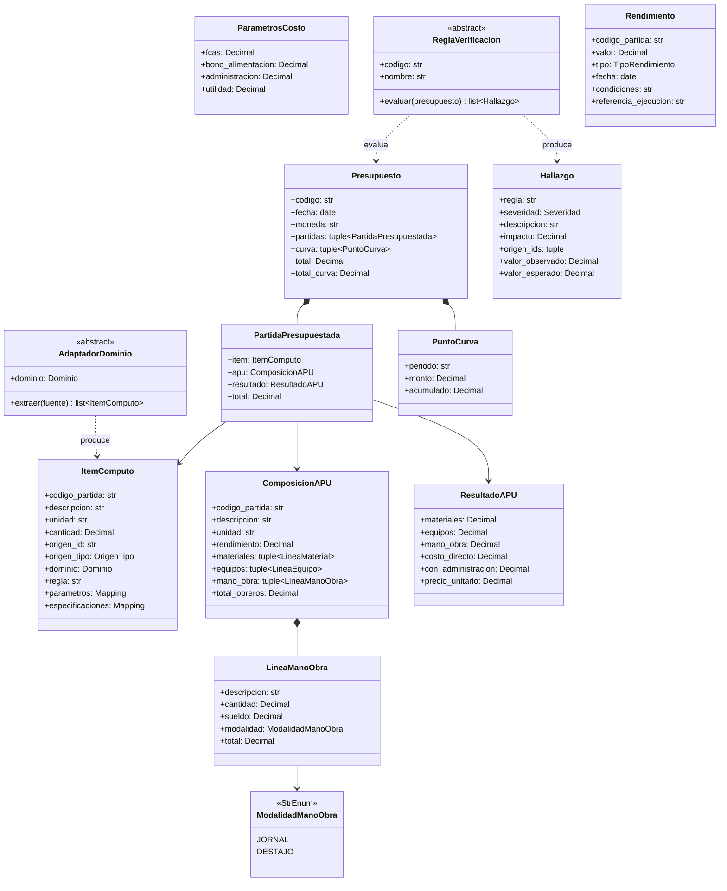
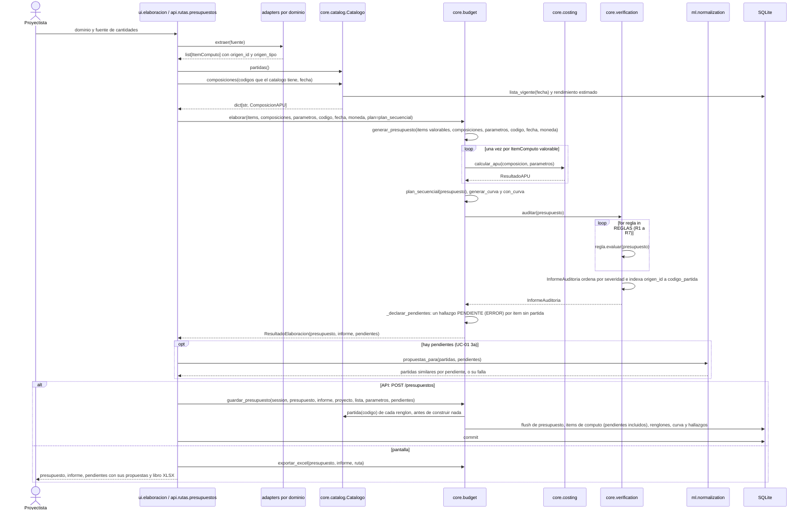
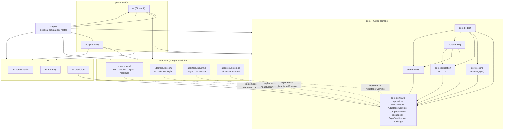
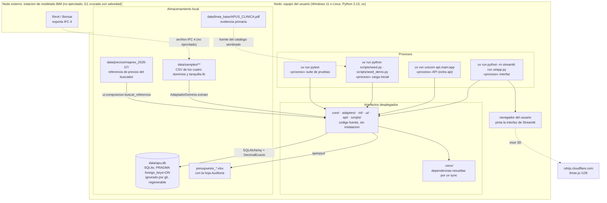

# Arquitectura del sistema (vistas 4+1 de Kruchten)

> Estado: **completo, pendiente de revisión del tutor (compuerta G0,
> [docs/metodologia.md §2.2](metodologia.md#22-compuertas))**. Completado en la Sesión 0.3 de
> [PLAN_DESARROLLO.md](../PLAN_DESARROLLO.md); criterio de cierre exigido: cinco vistas documentadas.
> Regenerado contra el código en la fase C4 del cierre (2026‑09‑28; filas INV‑028, INV‑029, INV‑057,
> INV‑058, INV‑059, INV‑070 e INV‑082 del [inventario](auditoria/2026-09-inventario.md)).
> Las cinco vistas describen **el código que existe** en `main` tras la fase C3 del cierre
> (`ceb6b8e`): las firmas de la vista lógica y los mensajes de la vista de proceso se copiaron de los
> módulos, no se diseñaron aquí. Lo que no está implementado se dice como tal y no se dibuja como si
> existiera. El **estado** de cada caso de uso, paso a paso y con su prueba, no se repite aquí: vive
> solo en [docs/plan_pruebas.md §8](plan_pruebas.md#8-especificación-de-casos-trazabilidad-rf--prueba).
> Este documento no reproduce datos que tienen fuente única: enlaza [CLAUDE.md](../CLAUDE.md),
> [docs/ERS.md](ERS.md), [docs/modelo_datos.md](modelo_datos.md) y
> [docs/linea_base.md](linea_base.md) (principio DRY,
> [metodologia.md §5](metodologia.md#5-dry)).

| Campo | Valor |
|---|---|
| Versión | 1.1 |
| Fecha | 2026‑09‑28 (versión 1.0: 2026‑08‑29) |
| Autor | [tesista] |
| Revisor | [tutor académico] |

## 0. Estilo arquitectónico

Núcleo cerrado con adaptadores de dominio (puertos y adaptadores): `core/contracts/` define los
puertos; `adapters/*` los implementan y `ml.prediction` los consume (`ml.normalization` y
`ml.anomaly` trabajan con datos planos y no importan nada de `core`); `ui/` y `api/` orquestan. El
motor de costos es una función pura; la verificación es independiente del aprendizaje automático.
Las capas de procesamiento (Bases del anteproyecto §9.1) se mapean así:

| Capa | Paquete |
|---|---|
| Modelado paramétrico e intercambio IFC | externo (Revit / Bonsai); la muestra del repositorio, `data/samples/tanquilla.ifc`, la genera `scripts/generar_tanquilla_ifc.py` |
| Extracción de cantidades | `adapters/<dominio>`, uno por dominio (civil: IFC y tabular) |
| Base de datos de APU | `core/models`, `core/catalog` |
| Motor de costos | `core/costing` |
| Presupuesto y curva | `core/budget` |
| Aprendizaje automático | `ml/normalization`, `ml/anomaly`, `ml/prediction` |
| Verificación | `core/verification` |
| Presentación | `ui/` (Streamlit), `api/` (FastAPI) |

## 1. Vista de casos de uso

Actores y casos de uso están definidos en [ERS §2.2](ERS.md#22-funciones-del-producto-casos-de-uso) y
[ERS §2.3](ERS.md#23-características-de-los-usuarios); esta vista **no los redefine**: los dibuja con
sus relaciones y dice qué código realiza cada uno. UC‑09 está vacante (reservado por
[PLAN_ASISTENTE.md](../PLAN_ASISTENTE.md)) y no se dibuja.


**Por qué UC‑05 es `«include»` y no `«extend»`.** No es una decisión de modelado: el código lo impone.
`core.budget.elaborar` llama siempre a `core.verification.auditar` y devuelve un
`ResultadoElaboracion` que lleva presupuesto **e** informe, de modo que no existe forma de obtener uno
sin el otro (principio 7 de [CLAUDE.md §2](../CLAUDE.md#2-principios)). UC‑02
(`core.budget.actualizar_precios`), UC‑04 (quien llama a `adapters.civil.recalculo.recalcular` vuelve a
elaborar) y UC‑08 (`core.budget.generar_escenario`, cuyo `Escenario` lleva su `informe`) producen su
versión por la misma función, así que heredan la inclusión.

Las cuatro relaciones `«extend»` son flujos alternativos del ERS; no todas se realizan igual:

- **UC‑03 → UC‑01 (3a), realizada.** `elaborar` deja fuera del presupuesto el ítem cuya partida no
  tiene composición, lo devuelve en `ResultadoElaboracion.pendientes` y el informe lo declara con un
  hallazgo `CODIGO_PENDIENTE`; después, `ml.normalization.propuestas_para` propone partidas similares
  y `ui.elaboracion.aceptar_propuesta` reasigna el ítem y se vuelve a elaborar. El orden real es
  **elaborar primero y proponer después**, no el que redacta el ERS («propone… y si no se acepta
  ninguna»); la corrección de la redacción es de la ERS (dictamen C3‑10).
- **UC‑06 → UC‑01 (3b), no realizada en el flujo de UC‑01.** Una partida sin rendimiento estimado
  hace que `Catalogo.composicion` lance `CatalogoIncompleto`, y la elaboración lo muestra como error.
  La propuesta del histórico con su dispersión (`core.catalog.proponer_rendimiento`) existe, pero la
  usan la pantalla de componer (UC‑10, UC‑11) y la API de rendimientos, no la de elaborar.
- **UC‑07 → UC‑05 (paso 5), no realizada.** Los precios atípicos (`ml.anomaly.precios_atipicos`) y
  el contraste AACE (`ml.prediction.contrastar_aace`, que devuelve un `Hallazgo`) se muestran en la
  pantalla de componer, pero no entran al `InformeAuditoria`: `core/` no importa `ml` (ADR 5).
- **UC‑11 → UC‑10 (7a), realizada.** `ui.elaboracion.guardar_composicion` decide: si la partida no
  existe, `Catalogo.cargar_composicion` (UC‑10); si existe, `Catalogo.reemplazar_composicion`
  (UC‑11), salvo que `ui.composicion.motivo_para_no_reemplazar` lo impida.

Dos reutilizaciones más que el ERS menciona no se dibujan porque son de un paso, no entre casos de uso
completos: UC‑04 *2a* reimporta el modelo con el paso 2 de UC‑01 (`adapters.civil.recalculo.emparejar`
conserva la correspondencia por `origen_id`), y UC‑08 *2a* usa el mecanismo de precios de UC‑02 sin
persistir la lista. UC‑12 tampoco tiene relaciones: es el recorrido guiado que lleva a las pantallas
de los demás.

| UC | Realizado por | Pantalla (`ui/app.py`, `PAGINAS`) y ruta HTTP |
|---|---|---|
| UC‑01 | `AdaptadorDominio.extraer` del dominio → `ui.elaboracion.elaborar_desde_catalogo` o `api.rutas.presupuestos.crear_presupuesto` → `Catalogo.composiciones` de las partidas existentes → `core.budget.elaborar(..., plan=plan_secuencial)` → `core.budget.exportar_excel`. Persiste (`core.budget.guardar_presupuesto`) la API y los sembradores; la pantalla elabora, muestra y exporta, pero no guarda el presupuesto | «Elaborar un presupuesto» (`ui/paginas/elaborar.py`; civil solo tabular) y «Componer una partida»; `POST /computos/{dominio}` (civil: `.ifc` o tabular) y `POST /presupuestos` |
| UC‑02 | `core.catalog.crear_lista_desde_archivo` → `core.budget.actualizar_precios` → `Comparativo`; 7a: `core.budget.descartar_version` | «Actualizar precios» (`ui/paginas/actualizacion.py`) e «Historico de cambios de precio» (`core.catalog.cambios_precio`); `POST /listas-precios`, `POST /presupuestos/{codigo}/actualizacion`, `GET /cambios-precio` |
| UC‑03 | `ml.normalization` (`NormalizadorPartidas`, `proponedor`, `propuestas_para`) sobre pares código–descripción que la capa de presentación lee de `core.catalog`; la persistencia de la partida nueva es UC‑10 | «Partidas similares» (`ui/paginas/similares.py`, vía `ui.composicion.sugerir_partidas_similares`); dentro de UC‑01 3a en «Elaborar un presupuesto» y en `POST /presupuestos` |
| UC‑04 | `adapters.civil.recalculo` (`recalcular`, `emparejar`) y `core.budget.elaborar` por quien llama. El paso 5 (diferencial, RF‑20) no está implementado | sin pantalla ni ruta HTTP |
| UC‑05 | `core.verification.auditar` sobre un `Presupuesto`, siempre dentro de `core.budget.elaborar` y de `core.budget.cargar_elaboracion`. El hallazgo `PENDIENTE` no lo emite `auditar`: lo agrega la elaboración (`_declarar_pendientes`), así que quien llame a `auditar` directamente no lo ve | el informe acompaña a toda elaboración en pantalla y en la hoja «Auditoria» del libro; `GET /presupuestos/{codigo}/informe`. El archivo de un tercero no tiene pantalla ni ruta de importación: su `Presupuesto` se arma en código (`scripts/seed_telecom.py`, `tests/fixtures/presupuesto_auditado.py`) |
| UC‑06 | `core.catalog.rendimientos` (`registrar_ejecucion`, `registrar_rendimiento`, `dispersion_rendimientos`, `proponer_rendimiento`, `advertencia_rendimiento`) y, con el extra `ml`, `ml.anomaly.evaluar_rendimiento` | propuesta y advertencia en «Componer una partida»; el registro de un rendimiento medido, solo por HTTP: `POST /ejecuciones`, `GET /ejecuciones`, `GET` y `POST /partidas/{codigo}/rendimientos` |
| UC‑07 | `ml.anomaly.precios_atipicos` y `ml.prediction` (`tecnica_para`, `predecir_por_reglas`, `metricas`, `contrastar_aace`) | ayudas 2 y 4 de «Componer una partida» (`ui.composicion.advertencia_precio_atipico`, `ui.composicion.contrastar_precio_con_reglas`); `scripts/generar_resultados_ml.py` escribe `docs/resultados_ml.md`; sin ruta HTTP |
| UC‑08 | `core.budget.escenarios` (`generar_escenario`, `comparar_escenarios`, `comparar_por_partida`). Nada se persiste; el informe de un escenario no declara los pendientes del base (ruling C4‑3 de la bitácora del cierre, a limitaciones) | «Escenarios de sensibilidad» (`ui/paginas/escenarios.py`, que lee el base con `cargar_elaboracion` y avisa de sus pendientes); `POST /presupuestos/{codigo}/escenarios` |
| UC‑10, UC‑11 | `ui.composicion` (`composicion_desde_tablas`; `desglose` → `core.costing.calcular_apu`) y `ui.elaboracion.guardar_composicion` → `Catalogo.cargar_composicion` o `Catalogo.reemplazar_composicion` | «Componer una partida» (`ui/paginas/componer.py`); sin ruta HTTP |
| UC‑12 | `ui.app` (`PAGINAS`, `paginas_visibles`, `marco`), `ui.caso` (`ruta_caso`, `estado_caso`) y `ui.recorridos` (`RECORRIDOS`, `paso_siguiente`); el caso vacío se siembra con `scripts.seed_demo.main` | «Inicio» (`ui/paginas/inicio.py`) y el marco común de las diez pantallas; sin ruta HTTP |

Las pantallas «Catalogo de partidas e insumos», «Simulador de listas» y «Visor 3D del modelo» no
realizan un caso de uso propio: la primera consulta el catálogo, la segunda genera listas de precios
de ensayo (`scripts.simular_lista.simular`) y la tercera muestra el modelo IFC que lee
`AdaptadorCivilIFC`, como apoyo a UC‑01.

## 2. Vista lógica

### 2.1 Contratos (`core/contracts`, estables)

La tabla de módulos y tipos es la de [CLAUDE.md §5](../CLAUDE.md#5-contratos-de-interfaz-corecontracts);
el diagrama muestra sus atributos. El único cambio de los contratos desde la Sesión I0.1 es aditivo:
`ModalidadManoObra` y el campo `LineaManoObra.modalidad`, con `JORNAL` por defecto (decisión D9 de
[dossier_g0.md](dossier_g0.md#d9-modalidad-de-mano-de-obra-por-linea-cambio-a-un-contrato-declarado-estable),
pendiente del aval del tutor; `ComposicionAPU.total_obreros` cuenta solo las líneas a jornal). Las
enumeraciones `Dominio`, `OrigenTipo`, `TipoRendimiento` y `Severidad` se omiten del dibujo.



`LineaMaterial` (`descripcion`, `unidad`, `cantidad`, `precio`) y `LineaEquipo` (`descripcion`,
`cantidad`, `precio`, `depreciacion`) completan `ComposicionAPU` y se omiten por brevedad.

### 2.2 Clases y funciones del núcleo

El núcleo es en su mayor parte **funciones sobre contratos inmutables**, no jerarquías de objetos: los
módulos se dibujan con el estereotipo `<<module>>`; las clases propias son `Catalogo`, las siete reglas,
las entidades de `core.models` y unos pocos resultados congelados (`ResultadoElaboracion`,
`Comparativo`, `Escenario`, `InformeAuditoria`, `ResumenCarga`, `ResumenLista` y los de
`core.catalog.rendimientos`). En los diagramas los genéricos usan la notación de Mermaid (`list~X~`)
y se omiten los valores por defecto; las **firmas literales**, copiadas del código, están en los
listados que siguen a cada diagrama.

#### Cálculo, presupuesto y catálogo

```mermaid
classDiagram
    class costing {
        <<module>>
        +calcular_apu(composicion ComposicionAPU, parametros ParametrosCosto) ResultadoAPU
    }
    class presupuesto {
        <<module>>
        +generar_presupuesto(items, composiciones, parametros, codigo, fecha, moneda) Presupuesto
        +elaborar(items, composiciones, parametros, codigo, fecha, moneda, plan) ResultadoElaboracion
        +exigir_composiciones(items, composiciones) None
        +CODIGO_PENDIENTE: str
        +GeneradorPlan: TypeAlias
    }
    class ResultadoElaboracion {
        <<frozen dataclass>>
        +presupuesto: Presupuesto
        +informe: InformeAuditoria
        +pendientes: tuple~ItemComputo~
    }
    class curva {
        <<module>>
        +generar_curva(presupuesto Presupuesto, plan, cuantizar) tuple~PuntoCurva~
        +con_curva(presupuesto Presupuesto, curva) Presupuesto
        +plan_secuencial(presupuesto Presupuesto, formato str) list~PeriodoPlan~
        +PeriodoPlan: TypeAlias
        +PlanInvalido: ValueError
    }
    class persistencia {
        <<module>>
        +guardar_presupuesto(session, presupuesto, informe, proyecto, lista, parametros, pendientes) models_Presupuesto
        +cargar_presupuesto(session, proyecto_nombre, codigo, catalogo) Presupuesto
        +cargar_elaboracion(session, proyecto_nombre, codigo, catalogo) ResultadoElaboracion
        +TOLERANCIA_RECONSTRUCCION: Decimal
    }
    class actualizacion {
        <<module>>
        +actualizar_precios(session, proyecto_nombre, codigo_presupuesto, lista_nueva, codigo_nuevo, plan) tuple
        +descartar_version(session, proyecto_nombre, codigo_presupuesto, fecha) models_DescarteVersion
        +Comparativo: frozen dataclass
    }
    class escenarios {
        <<module>>
        +generar_escenario(nombre, base, composiciones, parametros, precios) Escenario
        +comparar_escenarios(base, escenarios) DataFrame
        +comparar_por_partida(base, escenario) Comparativo
        +Escenario: frozen dataclass
    }
    class excel {
        <<module>>
        +exportar_excel(presupuesto Presupuesto, informe InformeAuditoria, ruta Path) Path
    }
    class Catalogo {
        +partidas(dominio) list~models_Partida~
        +partida(codigo str) models_Partida
        +insumos(tipo) list~models_Insumo~
        +rendimientos(codigo_partida str) list~Rendimiento~
        +lista_vigente(fecha) models_ListaPrecios
        +composicion(codigo_partida, fecha, lista) ComposicionAPU
        +composiciones(codigos, fecha) dict~str, ComposicionAPU~
        +cargar_composicion(composicion, lista, dominio, fecha_rendimiento, condiciones) ResumenCarga
        +reemplazar_composicion(composicion, lista, dominio, fecha_rendimiento, condiciones) ResumenCarga
        +registrar_rendimiento(rendimiento Rendimiento) models_Rendimiento
    }
    class precios {
        <<module>>
        +leer_lista_precios(ruta Path) list~PrecioLeido~
        +crear_lista_desde_archivo(session, ruta, nombre, moneda, fecha_vigencia, origen) ResumenLista
        +insumos_afectados(session, lista_anterior, lista_nueva) list~CambioDetectado~
        +registrar_cambios(session, lista_anterior, lista_nueva) list~models_CambioPrecio~
        +cambios_precio(session, insumo, desde, hasta) list~models_CambioPrecio~
        +variacion_relativa(anterior Decimal, nuevo Decimal) Decimal
    }
    class rendimientos {
        <<module>>
        +registrar_ejecucion(session, referencia, fecha_inicio, fecha_fin, descripcion, proyecto) models_Ejecucion
        +registrar_rendimiento(session, codigo_partida, valor, tipo, fecha, condiciones, referencia_ejecucion) Rendimiento
        +dispersion_rendimientos(session, codigo_partida) DispersionRendimiento
        +proponer_rendimiento(session, codigo_partida) PropuestaRendimiento
        +advertencia_rendimiento(dispersion, valor) str
    }
    class mapeo {
        <<module>>
        +a_composicion(partida, lista, rendimiento) ComposicionAPU
        +a_rendimiento(rendimiento) Rendimiento
        +lineas_de(composicion ComposicionAPU) list~LineaCatalogo~
        +a_modelo_partida(composicion, dominio) models_Partida
        +a_modelo_insumo(linea, codigo) models_Insumo
        +a_modelo_lineas(lineas, partida, insumos) list~models_ComposicionAPU~
        +a_modelo_rendimiento(rendimiento, partida, ejecucion) models_Rendimiento
        +a_modelo_rendimiento_estimado(composicion, partida, fecha, condiciones) models_Rendimiento
    }
    class sesion {
        <<module>>
        +crear_motor(url str) Engine
        +crear_esquema(motor Engine) None
        +abrir_sesion(motor Engine) Session
        +URL_POR_DEFECTO: str
    }
    class entidades {
        <<module>>
        +Base: DeclarativeBase
        +dieciséis entidades SQLAlchemy
        +TipoInsumo: StrEnum
    }
    class DecimalExacto {
        <<TypeDecorator>>
        +impl: String~40~
        +process_bind_param(value, dialect) str
        +process_result_value(value, dialect) Decimal
    }

    presupuesto ..> costing : calcular_apu por renglon
    presupuesto ..> curva : con_curva + generar_curva
    presupuesto ..> ResultadoElaboracion : construye
    presupuesto ..> InformeAuditoria : auditar siempre y declara pendientes
    curva ..> directivas : etiqueta_con_codigos
    persistencia ..> costing : reconstruye y verifica
    persistencia ..> presupuesto : _declarar_pendientes
    persistencia ..> Catalogo : composicion a fecha
    persistencia ..> directivas : CLAVE_UNIDAD_ORIGINAL
    persistencia ..> entidades : unica frontera del presupuesto
    actualizacion ..> persistencia : cargar, guardar y pendientes guardados
    actualizacion ..> presupuesto : exigir_composiciones + elaborar
    actualizacion ..> precios : registrar_cambios + variacion_relativa
    escenarios ..> actualizacion : Comparativo y su tabla
    escenarios ..> presupuesto : exigir_composiciones + elaborar
    excel ..> InformeAuditoria : hoja Auditoria
    precios ..> Catalogo : lista_vigente
    precios ..> texto : normalizar_texto
    rendimientos ..> Catalogo : registrar_rendimiento y rendimientos
    rendimientos ..> mapeo : a_rendimiento
    Catalogo ..> mapeo : unica frontera modelo-contrato del catalogo
    mapeo ..> entidades : construye models.X
    sesion ..> entidades : Base.metadata.create_all
    entidades ..> DecimalExacto : toda columna monetaria o dimensional
```



`Catalogo` recibe una `Session` ya abierta y **no** importa `core.catalog.sesion`: quien la abre es
`abrir_sesion(motor)`, y quien decide confirmar o deshacer la transacción es siempre el llamador.
Ninguna función del núcleo confirma: `guardar_presupuesto`, `actualizar_precios`,
`descartar_version`, `crear_lista_desde_archivo`, `registrar_cambios` y las cargas del catálogo hacen
`flush` y dejan el `commit` a la pantalla, a la ruta HTTP o al sembrador.

Firmas literales (`core/costing/motor.py`, `core/budget/*.py`, `core/catalog/*.py`,
`core/models/tipos.py`):

```python
# core.costing
def calcular_apu(composicion: ComposicionAPU, parametros: ParametrosCosto) -> ResultadoAPU

# core.budget.presupuesto
MONEDA_POR_DEFECTO = "USD"
CODIGO_PENDIENTE = "PENDIENTE"
GeneradorPlan = Callable[[Presupuesto], Sequence[PeriodoPlan]]

@dataclass(frozen=True, slots=True)
class ResultadoElaboracion:
    presupuesto: Presupuesto
    informe: InformeAuditoria
    pendientes: tuple[ItemComputo, ...] = ()

def generar_presupuesto(
    items: Sequence[ItemComputo],
    composiciones: Mapping[str, ComposicionAPU],
    parametros: ParametrosCosto,
    codigo: str,
    fecha: date,
    moneda: str = MONEDA_POR_DEFECTO,
) -> Presupuesto

def elaborar(
    items: Sequence[ItemComputo],
    composiciones: Mapping[str, ComposicionAPU],
    parametros: ParametrosCosto,
    codigo: str,
    fecha: date,
    moneda: str = MONEDA_POR_DEFECTO,
    plan: Sequence[PeriodoPlan] | GeneradorPlan | None = None,
) -> ResultadoElaboracion

def exigir_composiciones(
    items: Sequence[ItemComputo], composiciones: Mapping[str, ComposicionAPU]
) -> None

# core.budget.curva
PeriodoPlan = tuple[str, Sequence[tuple[str, Decimal]]]

class PlanInvalido(ValueError): ...

def generar_curva(
    presupuesto: Presupuesto,
    plan: Sequence[PeriodoPlan],
    cuantizar: Decimal | None = None,
) -> tuple[PuntoCurva, ...]
def con_curva(presupuesto: Presupuesto, curva: Sequence[PuntoCurva]) -> Presupuesto
def plan_secuencial(presupuesto: Presupuesto, formato: str = FORMATO_PERIODO) -> list[PeriodoPlan]

# core.budget.persistencia
TOLERANCIA_RECONSTRUCCION = Decimal("0.000001")

def guardar_presupuesto(
    session: Session,
    presupuesto: Presupuesto,
    informe: InformeAuditoria,
    proyecto: models.Proyecto,
    lista: models.ListaPrecios,
    parametros: ParametrosCosto,
    pendientes: Sequence[ItemComputo] = (),
) -> models.Presupuesto

def cargar_presupuesto(
    session: Session, proyecto_nombre: str, codigo: str, catalogo: Catalogo
) -> Presupuesto

def cargar_elaboracion(
    session: Session, proyecto_nombre: str, codigo: str, catalogo: Catalogo
) -> ResultadoElaboracion

# core.budget.actualizacion
@dataclass(frozen=True, slots=True, eq=False)
class Comparativo:
    tabla: DataFrame                 # columnas de COLUMNAS_COMPARATIVO, celdas Decimal
    total_anterior: Decimal
    total_nuevo: Decimal
    insumos_afectados: int
    @property
    def variacion(self) -> Decimal
    @property
    def variacion_pct(self) -> Decimal

def actualizar_precios(
    session: Session,
    proyecto_nombre: str,
    codigo_presupuesto: str,
    lista_nueva: models.ListaPrecios,
    codigo_nuevo: str,
    plan: Sequence[PeriodoPlan] | GeneradorPlan | None = None,
) -> tuple[ResultadoElaboracion, Comparativo]

def descartar_version(
    session: Session, proyecto_nombre: str, codigo_presupuesto: str, fecha: date
) -> models.DescarteVersion

# core.budget.escenarios
@dataclass(frozen=True, slots=True)
class Escenario:
    nombre: str
    presupuesto: Presupuesto
    informe: InformeAuditoria
    parametros: ParametrosCosto
    insumos_variados: int = 0

def generar_escenario(
    nombre: str,
    base: Presupuesto,
    composiciones: Mapping[str, ComposicionAPU],
    parametros: ParametrosCosto,
    *,
    precios: Mapping[str, Decimal] | None = None,
) -> Escenario
def comparar_escenarios(base: Presupuesto, escenarios: Sequence[Escenario]) -> DataFrame
def comparar_por_partida(base: Presupuesto, escenario: Escenario) -> Comparativo

# core.budget.excel
def exportar_excel(presupuesto: Presupuesto, informe: InformeAuditoria, ruta: Path) -> Path

# core.catalog.repositorio
@dataclass(slots=True)
class ResumenCarga:
    partida: models.Partida
    insumos_nuevos: list[models.Insumo]
    variantes: list[models.Insumo]

class Catalogo:
    def __init__(self, sesion: Session) -> None
    def partidas(self, dominio: Dominio | str | None = None) -> list[models.Partida]
    def partida(self, codigo: str) -> models.Partida
    def insumos(self, tipo: models.TipoInsumo | str | None = None) -> list[models.Insumo]
    def rendimientos(self, codigo_partida: str) -> list[Rendimiento]
    def lista_vigente(self, fecha: date | None = None) -> models.ListaPrecios
    def composicion(
        self,
        codigo_partida: str,
        fecha: date | None = None,
        lista: models.ListaPrecios | None = None,
    ) -> ComposicionAPU
    def composiciones(
        self, codigos: Iterable[str], fecha: date | None = None
    ) -> dict[str, ComposicionAPU]
    def cargar_composicion(
        self,
        composicion: ComposicionAPU,
        lista: models.ListaPrecios,
        dominio: Dominio,
        fecha_rendimiento: date,
        condiciones: str,
    ) -> ResumenCarga
    def reemplazar_composicion(
        self,
        composicion: ComposicionAPU,
        lista: models.ListaPrecios,
        dominio: Dominio,
        fecha_rendimiento: date,
        condiciones: str,
    ) -> ResumenCarga
    def registrar_rendimiento(self, rendimiento: Rendimiento) -> models.Rendimiento

class CatalogoIncompleto(LookupError): ...   # core.catalog.errores

# core.catalog.precios
@dataclass(frozen=True, slots=True)
class ResumenLista:
    lista: models.ListaPrecios
    desconocidos: tuple[PrecioLeido, ...] = ()

def variacion_relativa(anterior: Decimal, nuevo: Decimal) -> Decimal
def leer_lista_precios(ruta: Path) -> list[PrecioLeido]
def crear_lista_desde_archivo(
    session: Session,
    ruta: Path,
    nombre: str,
    moneda: str,
    fecha_vigencia: date,
    origen: str = "",
) -> ResumenLista
def insumos_afectados(
    session: Session, lista_anterior: models.ListaPrecios, lista_nueva: models.ListaPrecios
) -> list[CambioDetectado]
def registrar_cambios(
    session: Session, lista_anterior: models.ListaPrecios, lista_nueva: models.ListaPrecios
) -> list[models.CambioPrecio]
def cambios_precio(
    session: Session,
    insumo: str | None = None,
    desde: date | None = None,
    hasta: date | None = None,
) -> list[models.CambioPrecio]

# core.catalog.rendimientos
MINIMO_OBSERVADO_PARA_ADVERTIR = 2

def registrar_ejecucion(
    session: Session,
    referencia: str,
    fecha_inicio: date,
    fecha_fin: date | None = None,
    descripcion: str = "",
    proyecto: models.Proyecto | None = None,
) -> models.Ejecucion
def registrar_rendimiento(
    session: Session,
    codigo_partida: str,
    valor: Decimal,
    tipo: TipoRendimiento,
    fecha: date,
    condiciones: str = "",
    referencia_ejecucion: str | None = None,
) -> Rendimiento
def dispersion_rendimientos(session: Session, codigo_partida: str) -> DispersionRendimiento | None
def proponer_rendimiento(session: Session, codigo_partida: str) -> PropuestaRendimiento | None
def advertencia_rendimiento(dispersion: DispersionRendimiento | None, valor: Decimal) -> str | None

# core.catalog.sesion
URL_POR_DEFECTO = "sqlite:///data/apu.db"

def crear_motor(url: str = URL_POR_DEFECTO) -> Engine
def crear_esquema(motor: Engine) -> None      # crea las dieciséis tablas y sus indices
def abrir_sesion(motor: Engine) -> Session

# core.models.tipos
class DecimalExacto(TypeDecorator[Decimal]):
    impl = String(LONGITUD_DECIMAL)           # LONGITUD_DECIMAL = 40
    def process_bind_param(self, value: Any, dialect: Dialect) -> str | None
    def process_result_value(self, value: Any, dialect: Dialect) -> Decimal | None
```

Las dieciséis entidades persistentes (`core/models/entidades.py`) no se repiten aquí: su diagrama
entidad‑relación y la justificación de la normalización están en
[docs/modelo_datos.md §3](modelo_datos.md#3-diagrama-entidadrelación).

#### Verificación

Es la única parte del núcleo con jerarquía de clases: siete reglas que implementan el mismo puerto.

```mermaid
classDiagram
    class ReglaVerificacion {
        <<abstract>>
        +codigo: ClassVar~str~
        +nombre: ClassVar~str~
        +evaluar(presupuesto Presupuesto) list~Hallazgo~
    }
    class TrazabilidadGeometrica {
        +codigo = R1
        +__init__(tolerancia_relativa Decimal)
        +evaluar(presupuesto Presupuesto) list~Hallazgo~
    }
    class CierreCurvaInversion {
        +codigo = R2
        +evaluar(presupuesto Presupuesto) list~Hallazgo~
    }
    class CoherenciaDimensional {
        +codigo = R3
        +evaluar(presupuesto Presupuesto) list~Hallazgo~
    }
    class CorrespondenciaEspecificaciones {
        +codigo = R4
        +evaluar(presupuesto Presupuesto) list~Hallazgo~
    }
    class BalanceVolumetrico {
        +codigo = R5
        +__init__(tolerancia_relativa Decimal)
        +evaluar(presupuesto Presupuesto) list~Hallazgo~
    }
    class CriterioDepreciacion {
        +codigo = R6
        +evaluar(presupuesto Presupuesto) list~Hallazgo~
    }
    class ConciliacionPresupuestoPlan {
        +codigo = R7
        +__init__(tolerancia Decimal)
        +evaluar(presupuesto Presupuesto) list~Hallazgo~
    }
    class informe {
        <<module>>
        +auditar(presupuesto Presupuesto, reglas) InformeAuditoria
        +DECIMALES_PRESENTACION: int
    }
    class InformeAuditoria {
        <<frozen dataclass>>
        +codigo_presupuesto: str
        +hallazgos: tuple~Hallazgo~
        +partida_por_origen: Mapping~str, str~
        +cumple: bool
        +por_severidad() dict~Severidad, int~
        +por_regla() dict~str, Hallazgos~
        +partida_de(hallazgo Hallazgo) str
        +a_markdown() str
    }
    class expresiones {
        <<module>>
        +evaluar(expresion str, valores) Decimal
        +nombres_de(expresion str) frozenset~str~
        +codigos_de(expresion str) tuple~str~
        +sustituir_codigos(expresion str, cantidades) str
        +ExpresionInvalida: ValueError
        +ParametroFaltante: KeyError
    }
    class directivas {
        <<module>>
        +es_directiva(clave str) bool
        +etiqueta_con_codigos(etiqueta str, codigos) str
        +codigos_en_etiqueta(periodo str) tuple~str~
        +CLAVE_BALANCE: str
        +CLAVE_TOLERANCIA: str
        +CLAVE_UNIDAD_ORIGINAL: str
    }
    class texto {
        <<module>>
        +normalizar_texto(texto str) str
        +tokens(texto str) list~str~
        +es_numero(token str) bool
        +pares_numero_unidad(tokens_del_texto) list~tuple~
        +formatear_decimal(valor Decimal, decimales int) str
    }

    ReglaVerificacion <|-- TrazabilidadGeometrica
    ReglaVerificacion <|-- CierreCurvaInversion
    ReglaVerificacion <|-- CoherenciaDimensional
    ReglaVerificacion <|-- CorrespondenciaEspecificaciones
    ReglaVerificacion <|-- BalanceVolumetrico
    ReglaVerificacion <|-- CriterioDepreciacion
    ReglaVerificacion <|-- ConciliacionPresupuestoPlan
    informe ..> ReglaVerificacion : corre REGLAS en orden
    informe ..> InformeAuditoria : construye
    TrazabilidadGeometrica ..> expresiones : reevalua item.regla
    BalanceVolumetrico ..> expresiones : evalua el balance
    BalanceVolumetrico ..> directivas : _balance y _tolerancia
    CoherenciaDimensional ..> directivas : _unidad_original
    CorrespondenciaEspecificaciones ..> directivas : ignora toda clave con prefijo _
    CorrespondenciaEspecificaciones ..> texto : normaliza y compara
    CriterioDepreciacion ..> texto : normaliza descripciones
    ConciliacionPresupuestoPlan ..> directivas : codigos_en_etiqueta
    ConciliacionPresupuestoPlan ..> texto : heuristica textual si no hay codigos
    InformeAuditoria ..> texto : formatear_decimal
```



Firmas literales (`core/verification/*.py`):

```python
# core.verification.informe
DECIMALES_PRESENTACION = 2

@dataclass(frozen=True, slots=True)
class InformeAuditoria:
    codigo_presupuesto: str
    hallazgos: tuple[Hallazgo, ...] = ()
    partida_por_origen: Mapping[str, str] = field(default_factory=dict)

    @property
    def cumple(self) -> bool
    def por_severidad(self) -> dict[Severidad, int]
    def por_regla(self) -> dict[str, list[Hallazgo]]
    def partida_de(self, hallazgo: Hallazgo) -> str | None
    def a_markdown(self) -> str

def auditar(
    presupuesto: Presupuesto, reglas: Sequence[ReglaVerificacion] = REGLAS
) -> InformeAuditoria

# core.verification.reglas  (codigo y nombre son ClassVar[str] en cada clase)
class TrazabilidadGeometrica(ReglaVerificacion):        # R1
    def __init__(self, tolerancia_relativa: Decimal = Decimal("0.001")) -> None
    def evaluar(self, presupuesto: Presupuesto) -> list[Hallazgo]
class CierreCurvaInversion(ReglaVerificacion): ...      # R2
class CoherenciaDimensional(ReglaVerificacion): ...     # R3
class CorrespondenciaEspecificaciones(ReglaVerificacion): ...  # R4
class BalanceVolumetrico(ReglaVerificacion):            # R5
    def __init__(self, tolerancia_relativa: Decimal = Decimal("0.05")) -> None
class CriterioDepreciacion(ReglaVerificacion): ...      # R6
class ConciliacionPresupuestoPlan(ReglaVerificacion):   # R7
    def __init__(self, tolerancia: Decimal = Decimal("0.01")) -> None

REGLAS: tuple[ReglaVerificacion, ...] = (               # el orden del informe
    TrazabilidadGeometrica(), CierreCurvaInversion(), CoherenciaDimensional(),
    CorrespondenciaEspecificaciones(), BalanceVolumetrico(), CriterioDepreciacion(),
    ConciliacionPresupuestoPlan(),
)

# core.verification.expresiones
class ExpresionInvalida(ValueError): ...
class ParametroFaltante(KeyError): ...

def evaluar(expresion: str, valores: Mapping[str, Decimal]) -> Decimal
def nombres_de(expresion: str) -> frozenset[str]
def codigos_de(expresion: str) -> tuple[str, ...]
def sustituir_codigos(expresion: str, cantidades: Mapping[str, Decimal]) -> str

# core.verification.directivas
PREFIJO_DIRECTIVA = "_"
CLAVE_BALANCE = "_balance"
CLAVE_TOLERANCIA = "_tolerancia"
CLAVE_UNIDAD_ORIGINAL = "_unidad_original"

def es_directiva(clave: str) -> bool
def etiqueta_con_codigos(etiqueta: str, codigos: Sequence[str]) -> str
def codigos_en_etiqueta(periodo: str) -> tuple[str, ...]

# core.verification.texto
def normalizar_texto(texto: str) -> str
def tokens(texto: str) -> list[str]
def es_numero(token: str) -> bool
def pares_numero_unidad(tokens_del_texto: list[str]) -> list[tuple[str, str]]
def formatear_decimal(valor: Decimal, decimales: int | None = None) -> str
```

Qué comprueba cada regla y qué hallazgo de la línea base detecta: [CLAUDE.md
§7](../CLAUDE.md#7-siete-reglas-de-verificación-coreverification-sesión-i4) y
[docs/linea_base.md](linea_base.md). Ninguna regla nombra un dominio, una unidad concreta ni un código
del caso de estudio: lo que necesitan saber se lo dice el propio `Presupuesto` (ADR 8).

### 2.3 Los adaptadores

Cinco adaptadores de cuatro dominios implementan el mismo puerto y ninguno aparece en los diagramas
del núcleo, porque el núcleo no los conoce. De `core` importan **solo** `core.contracts`; además
pueden importar su propio paquete, la biblioteca estándar y los terceros que les declara
`TERCEROS_POR_ADAPTADOR` en `tests/unit/test_arquitectura.py`, que es la fuente única de esa lista
(la hace cumplir `test_un_adaptador_solo_importa_contratos_su_paquete_y_sus_terceros`).

| Adaptador | Clase | `dominio` | Fuente | `origen_id` | `origen_tipo` |
|---|---|---|---|---|---|
| `adapters/civil/ifc.py` | `AdaptadorCivilIFC()` | `Dominio.CIVIL` | `data/samples/tanquilla.ifc` (elementos con `Pset_APU`) | `GlobalId` del elemento IFC | `IFC` |
| `adapters/civil/tabular.py` | `AdaptadorCivilTabular(codigos: Mapping[str, str])` | `Dominio.CIVIL` | `data/samples/civil/tanquillas_y_zanja.csv` | columna `id`; el relleno cita todas las filas que balancea | `REGLA` |
| `adapters/telecom` | `AdaptadorTelecom()` | `Dominio.TELECOM` | `data/samples/telecom/topologia_arenaza.csv` | columna `id` | `CSV` (nodo) · `REGLA` (enlace) |
| `adapters/industrial` | `AdaptadorIndustrial()` | `Dominio.INDUSTRIAL` | `data/samples/industrial/activos_planta.csv` | columna `id_activo` | `REGLA` |
| `adapters/sistemas` | `AdaptadorSistemas()` | `Dominio.SISTEMAS` | `data/samples/sistemas/alcance_funcional.csv` | columna `id` | `REGLA` |

Todos exponen la misma operación, la del contrato: `extraer(self, fuente: Path | str) -> list[ItemComputo]`.
`AdaptadorCivilIFC` es la entrada de la compuerta G1, **cruzada con salvedad**: reproduce exacto el
cálculo manual sobre `tanquilla.ifc`, pero ese modelo lo generó `scripts/generar_tanquilla_ifc.py`, no
un modelador BIM real ([bitácora F.1](bitacora/2026-08-31-F1-api-3d.md)). Es el único adaptador con
tercero declarado (`ifcopenshell`, extra `civil`), y la API (`api/rutas/computos.py::_adaptador`) y
el visor (`ui/paginas/visor.py`) lo importan de forma perezosa.

El adaptador civil añade sus reglas paramétricas como texto trazable
(`REGLA_CONCRETO_TANQUILLA`, `REGLA_ENCOFRADO_TANQUILLA`, `REGLA_EXCAVACION_TANQUILLA`,
`REGLA_EXCAVACION_ZANJA`, `REGLA_TUBERIA`, `REGLA_VOLUMEN_TUBERIA`, `REGLA_RELLENO` en
`adapters/civil/reglas.py`) y el recálculo de UC‑04 (`adapters/civil/recalculo.py`: `recalcular`,
`emparejar`). Cada adaptador evalúa sus expresiones con su **propio** `adapters/<dominio>/evaluador.py::evaluar_regla`:
civil e industrial admiten suma, resta, producto, división, potencia y signo negativo; telecom, las
cuatro operaciones; sistemas, solo suma y producto. Son cuatro de las cinco copias del evaluador
declaradas en la ADR 8.

### 2.4 Composición y elaboración en la interfaz (`ui/`, Sesión P2.1 y fase C3)

Debajo de las diez pantallas de `ui/paginas/` hay una capa sin pantalla (INV‑043, fase C3):

| Módulo | Qué hace | Qué no importa (`PROHIBIDOS_EN_UI`) |
|---|---|---|
| `ui/composicion.py` | lógica pura: arma y valida una `ComposicionAPU` a partir de las tablas que teclea el proyectista (`composicion_desde_tablas`, con la modalidad por línea de la decisión D9) y calcula su desglose (`desglose` → `core.costing.calcular_apu`); envuelve las ayudas de `ml/` con importación perezosa | `streamlit`, `pandas`, `ui.caso`, `sqlalchemy`, `core.catalog`, `core.budget` |
| `ui/elaboracion.py` | orquesta «cantidades → elaborar → exportar» (`items_desde_filas`, `elaborar_desde_catalogo`, `libro_excel`), guarda composiciones sin confirmar (`guardar_composicion`) y resuelve UC‑01 3a (`propuestas_de_pendientes`, `aceptar_propuesta`) | `streamlit`, `pandas`, `ui.caso` |
| `ui/resultado.py` | el fragmento de Streamlit que pinta un presupuesto elaborado, su informe y sus pendientes (`mostrar_elaboracion`), compartido por componer y elaborar | `sqlalchemy.orm`, `core.costing`, `core.catalog` |

`ui/paginas/componer.py` **pinta y confirma**: arma las tablas y el formulario, llama a
`ui.composicion` para el cálculo en vivo, a `ui.elaboracion` para guardar y elaborar, y es quien hace
`sesion.commit()` tras un guardado con resultado. En tiempo de ejecución no importa `core.budget`,
`core.costing`, `sqlalchemy.orm` ni `tempfile`: lo vigila
`tests/unit/test_arquitectura.py::test_ui_respeta_sus_importaciones_prohibidas`, parametrizada con
`PROHIBIDOS_EN_UI`. Sí lee el catálogo (`core.catalog`) para precargar tablas, proponer rendimientos
(UC‑06) y mostrar el histórico de precios. `ui/elaboracion.py` es el único módulo de `ui/` sin pantalla
que **escribe filas** en la base (`guardar_composicion`, sin confirmar); `ui.caso.estado_caso` solo
crea el esquema si falta (`crear_esquema`, DDL). El grafo de `ui/` es acíclico:
`ui.app` → `ui.paginas.*` → `ui.elaboracion` → `ui.composicion` → `core`, y `ui.paginas.*` →
`ui.resultado`; ninguna página importa `ui.app`.

El hallazgo `PENDIENTE` de UC‑01 3a vive **fuera** de `auditar`: lo agrega `core.budget.elaborar`
(`_declarar_pendientes`, en `core/budget/presupuesto.py`) y lo repite `core.budget.cargar_elaboracion`
al recargar. Quien llame a `core.verification.auditar` directamente sobre un `Presupuesto` no lo ve,
porque el `Presupuesto` no lleva los ítems pendientes.

Las ayudas de aprendizaje automático (la referencia de precio de mercado sugerida, RF‑35, y las
cuatro ayudas de componer) se invocan **desde `ui/`, con importación perezosa, nunca desde `core/`**:
`ui/composicion.py` las carga con `_importar_normalizacion`, `_importar_anomalia` e
`_importar_prediccion`, y la API hace lo mismo con `ml.anomaly` en `api/rutas/rendimientos.py`
(`docs/bitacora/2026-08-31-sprint-i6.md`). `core/` no importa `ml` (ADR 5, CLAUDE.md §2); si
`ui/composicion.py` llegara a necesitar que el núcleo conociera `ml`, sería un hallazgo para
documentar en `docs/bitacora/`, no un import que se agrega en silencio.

## 3. Vista de proceso

El sistema es de **un solo proceso y un solo hilo**: no hay concurrencia que documentar, y esa es una
decisión (ADR 9). Lo que sí importa es el orden real de las llamadas y dónde empieza y termina una
transacción de base de datos.

### 3.1 UC‑01 con UC‑05 incluido — elaborar y auditar un presupuesto

Mensajes tomados de `ui/elaboracion.py::elaborar_desde_catalogo`,
`api/rutas/presupuestos.py::crear_presupuesto`, `core/budget/presupuesto.py::elaborar`,
`core/verification/informe.py::auditar` y `core/budget/persistencia.py::guardar_presupuesto`. La
pantalla y la API siguen el mismo protocolo hasta el `ResultadoElaboracion`; difieren al final.



Cinco detalles del orden real que el diagrama fija y que conviene no perder:

1. **`auditar` es el último paso del presupuesto, no una llamada aparte del usuario.** El informe
   existe antes de que nadie lo pida; lo único que `elaborar` le agrega después son los hallazgos
   `PENDIENTE` de los ítems sin partida (§2.4).
2. **Ninguna regla aborta el informe.** `auditar` recorre las siete y concatena sus hallazgos; una
   expresión inevaluable produce un `Hallazgo`, no una excepción.
3. **Primero se elabora y después se propone** (UC‑01 3a). Si el usuario acepta una propuesta,
   `ui.elaboracion.aceptar_propuesta` reasigna el ítem y la pantalla vuelve a llamar a
   `elaborar_desde_catalogo`: una elaboración completa nueva, con su informe.
4. **`guardar_presupuesto` hace `flush`, no `commit`**: la transacción pertenece a quien llama, de
   modo que el presupuesto puede formar parte de una operación mayor (la de UC‑02, §3.2). Rechaza con
   `ValueError` un informe cuyo `codigo_presupuesto` no sea el del presupuesto, y exige que los
   `pendientes` y los hallazgos `PENDIENTE` del informe se correspondan uno a uno.
5. **`cargar_presupuesto` es la operación inversa y verifica**: revalora cada renglón con
   `Catalogo.composicion` sobre la lista que el presupuesto referencia, lo pasa por `calcular_apu` y
   compara con la instantánea guardada; si difieren en más de `TOLERANCIA_RECONSTRUCCION`
   (1 × 10⁻⁶) lanza `ValueError` en vez de devolver un documento adulterado. Devuelve la
   **instantánea**, no el recálculo. `cargar_elaboracion` añade los pendientes guardados y reaudita,
   de modo que el informe recargado es el del documento emitido (INV‑080).

### 3.2 UC‑02 — Actualizar masivamente los precios

Mensajes tomados de `ui/paginas/actualizacion.py` (`_actualizar`, `_descartar`),
`core/catalog/precios.py` y `core/budget/actualizacion.py`. La ruta
`POST /presupuestos/{codigo}/actualizacion` recorre la misma secuencia desde `actualizar_precios`,
con una lista ya cargada por `POST /listas-precios`.

```mermaid
sequenceDiagram
    actor Admin as Administrador del catalogo
    participant UI as ui/paginas/actualizacion.py
    participant PRE as core.catalog.precios
    participant ACT as core.budget.actualizacion
    participant PER as core.budget.persistencia
    participant CAT as core.catalog.Catalogo
    participant BUD as core.budget (presupuesto, excel)
    participant VER as core.verification
    participant DB as SQLite

    Admin->>UI: archivo de precios, nombre, moneda, vigencia, proyecto, codigo base y codigo nuevo
    UI->>PRE: crear_lista_desde_archivo(session, ruta, nombre, moneda, fecha_vigencia, origen)
    PRE->>PRE: leer_lista_precios(ruta), Decimal desde el texto, nunca desde float
    PRE->>CAT: lista_vigente(fecha_vigencia)
    PRE->>DB: lista nueva con los precios de la vigente, sobrescritos por los del archivo (flush)
    PRE-->>UI: ResumenLista(lista, desconocidos)
    UI->>ACT: actualizar_precios(session, proyecto_nombre, codigo_presupuesto, lista_nueva, codigo_nuevo)
    ACT->>PER: cargar_presupuesto(session, proyecto_nombre, codigo, catalogo)
    PER-->>ACT: Presupuesto anterior, reconstruido y verificado a su fecha
    ACT->>CAT: composicion(codigo, fecha=vigencia nueva, lista=lista_nueva) por partida
    ACT->>BUD: exigir_composiciones(items, composiciones)
    ACT->>BUD: elaborar(items y pendientes guardados, composiciones, parametros, codigo_nuevo, fecha, moneda, plan)
    BUD->>VER: auditar(presupuesto), UC-05 incluido
    BUD-->>ACT: ResultadoElaboracion(presupuesto nuevo, informe, pendientes)
    ACT->>PER: guardar_presupuesto(session, presupuesto, informe, proyecto, lista_nueva, parametros, pendientes)
    ACT->>PRE: registrar_cambios(session, lista_anterior, lista_nueva)
    PRE->>DB: un CambioPrecio por insumo de insumos_afectados (flush)
    ACT->>DB: una IncidenciaCambio por par cambio-partida (flush)
    ACT-->>UI: (ResultadoElaboracion, Comparativo)
    UI->>BUD: exportar_excel(presupuesto, informe, ruta)
    alt Comparativo.insumos_afectados == 0 (flujo 3a)
        UI-->>Admin: ningun precio cambio; sin commit, se descarta todo, lista incluida
    else algun insumo cambio de precio
        UI->>DB: commit
        UI-->>Admin: comparativo por partida y total, informe, libro XLSX y boton Descartar version
        opt flujo 7a
            Admin->>UI: Descartar version
            UI->>ACT: descartar_version(session, proyecto, version_guardada, fecha)
            ACT->>DB: DescarteVersion de la version guardada (flush)
            UI->>DB: commit, en la base donde se guardo la version
        end
    end
```

Lo que esta secuencia hace evidente: **actualizar precios no edita ninguna composición ni ninguna
lista usada**. Crea una lista nueva con vigencia posterior, revalora el mismo cómputo con ella y emite
una versión nueva del presupuesto; el presupuesto anterior sigue reconstruyéndose a su fecha
(RNF‑02). Es la estrategia de versionado híbrido de
[docs/modelo_datos.md §5](modelo_datos.md#5-estrategia-de-versionado). Tres precisiones:

- **La pantalla decide con `insumos_afectados`, no con `variacion`.** Un cambio de precio en un insumo
  que no participa del presupuesto deja la variación en cero, pero es real y su historial se guarda.
- **Los pendientes se arrastran.** Los ítems que el presupuesto anterior tenía pendientes (UC‑01 3a)
  vuelven a entrar a `elaborar`, siguen pendientes y la versión nueva los guarda (INV‑080).
- **Descartar es marcar, no borrar (7a).** `descartar_version` agrega una fila de `DescarteVersion`
  ([modelo_datos.md §2.2](modelo_datos.md#22-precios-y-su-historial)); la versión sigue cargándose
  como documento y `CambioPrecio` e `IncidenciaCambio` se conservan. Solo se descarta la última
  versión guardada del proyecto, si tiene al menos otra anterior; como el esquema no guarda de qué
  presupuesto salió una versión, la pantalla solo ofrece el botón para la versión que acaba de
  confirmar (expediente C3.2).

## 4. Vista de desarrollo (definitivo)

El diagrama de componentes es el más importante del trabajo: debe hacer evidente que **agregar un
adaptador no toca el núcleo**. Las flechas son dependencias de importación: las que cruzan la
frontera de `core/` las verifica `tests/unit/test_arquitectura.py` en cada ejecución de la suite; las
internas del núcleo y las de la capa de presentación se mantienen por revisión (ver el final de esta
sección), salvo las prohibiciones de `PROHIBIDOS_EN_UI` (§2.4).



Interfaces provistas y requeridas:

| Componente | Provee | Requiere |
|---|---|---|
| `core.contracts` | todos los tipos de intercambio ([CLAUDE.md §5](../CLAUDE.md#5-contratos-de-interfaz-corecontracts)) | biblioteca estándar |
| `core.costing` | `calcular_apu` | `core.contracts` |
| `core.budget` | `generar_presupuesto`, `elaborar`, `ResultadoElaboracion`, `CODIGO_PENDIENTE`, `generar_curva`, `plan_secuencial`, `con_curva`, `guardar_presupuesto`, `cargar_presupuesto`, `cargar_elaboracion`, `exportar_excel`, `actualizar_precios`, `descartar_version`, `Comparativo`, `generar_escenario`, `comparar_escenarios`, `comparar_por_partida`, `Escenario` | `core.contracts`, `core.costing`, `core.verification`, `core.catalog`, `core.models`; `sqlalchemy`, `pandas`, `openpyxl` |
| `core.verification` | R1 … R7, `REGLAS`, `auditar`, `InformeAuditoria`, `directivas`, `evaluar` | `core.contracts` |
| `core.catalog` | `Catalogo`, `crear_motor`, `crear_esquema`, `abrir_sesion`, `CatalogoIncompleto`; listas de precios (`crear_lista_desde_archivo`, `leer_lista_precios`, `insumos_afectados`, `registrar_cambios`, `cambios_precio`); rendimientos (`registrar_ejecucion`, `registrar_rendimiento`, `dispersion_rendimientos`, `proponer_rendimiento`, `advertencia_rendimiento`) | `core.contracts`, `core.models`, `core.verification` (solo `texto.normalizar_texto`); `sqlalchemy`, `pandas`, `openpyxl` |
| `core.models` | las dieciséis entidades, `Base`, `DecimalExacto` | `core.contracts` (solo `TipoRendimiento`); `sqlalchemy` |
| `adapters.<dominio>` | una subclase de `AdaptadorDominio` | de `core`, solo `core.contracts`; además su propio paquete, la biblioteca estándar y los terceros que le declara `TERCEROS_POR_ADAPTADOR` en `tests/unit/test_arquitectura.py` (fuente única de esa lista) |
| `ml.normalization` | `NormalizadorPartidas`, `proponedor`, `propuestas_para`, `Propuesta`, `FALLAS_DE_LA_PROPUESTA` | nada de `core`; `sentence-transformers` (extra `ml`) solo al cargar el modelo |
| `ml.anomaly` | `precios_atipicos`, `evaluar_rendimiento` | nada de `core`; `numpy` y, al ajustar el bosque, `scikit-learn` (extra `ml`) |
| `ml.prediction` | `tecnica_para`, `predecir_por_reglas`, `metricas`, `contrastar_aace` | `core.contracts` (`Hallazgo`, `Severidad`) |
| `ui` | las diez pantallas de `ui/app.py` (§1) | `core`, `adapters`, `ml` (perezoso) y `scripts` |
| `api` | las rutas HTTP de `api/rutas/` (§1; esquema en `docs/api.json`) | `core`, `adapters` (perezoso), `ml` |
| `scripts` | siembra de las bases, simulación de listas, metas de cada sprint, `docs/resultados_ml.md` y `docs/api.json` | `core`, `adapters`, `ml`, `ui` y `api` |

Regla de dependencia: ninguna flecha sale de `core/` hacia `adapters/`, `ml/`, `ui/`, `api/`,
`scripts/` ni `tests/` (`test_el_nucleo_no_conoce_a_los_demas_paquetes`, con la tupla
`PAQUETES_FUERA_DEL_NUCLEO`), y las que entran desde `adapters/` y `ml/` llegan solo a
`core.contracts` (`test_un_adaptador_solo_importa_contratos_su_paquete_y_sus_terceros`,
`test_ml_solo_importa_core_contracts_del_nucleo`). Los contratos solo usan la biblioteca estándar
(`test_los_contratos_solo_usan_la_biblioteca_estandar`).

Las dependencias **internas** de `core/` no son libres de dirección pero sí de capa: `core.budget` es
el orquestador (usa costing, verification, catalog y models), `core.catalog` usa de
`core.verification` solo la normalización de texto, y `core.contracts` es hoja. `test_arquitectura.py`
vigila las fronteras externas, no esta estratificación interna, que se mantiene por revisión.

**Puntos de composición por dominio.** Agregar un adaptador no toca `core/`, pero sí los lugares que
enumeran dominios fuera del núcleo. Son estos, y ninguno más:

| Punto | Qué enumera |
|---|---|
| `api/rutas/computos.py::_adaptador` | el adaptador de cada `Dominio` que acepta `POST /computos/{dominio}` (civil: IFC o tabular según la extensión) |
| `ui/paginas/elaborar.py` (`_ADAPTADORES_SIN_CODIGOS`, `_construir_adaptador`) | los adaptadores que la pantalla de elaborar ofrece; civil entra por `AdaptadorCivilTabular` con los códigos que elige el usuario |
| `tests/unit/test_arquitectura.py::TERCEROS_POR_ADAPTADOR` | una fila por carpeta de `adapters/`; `test_toda_carpeta_de_adapters_tiene_su_regla` falla si falta |
| `scripts/seed_telecom.py`, `scripts/seed_industrial.py`, `scripts/seed_sistemas.py` (y `scripts/seed.py` para civil) | el catálogo y el presupuesto de muestra de cada dominio |
| `core.contracts.Dominio` | los cuatro valores de la enumeración: un **quinto dominio** es un cambio de contrato, no de adaptador |

`ui/paginas/visor.py` es específica del dominio civil (lee IFC con `AdaptadorCivilIFC`), no una lista
de despacho. La guía para cablear un adaptador nuevo está en el
[manual técnico §4](manual_tecnico.md#4-escribir-un-adaptador-de-dominio-nuevo).

`scripts/` es un conjunto de utilidades de siembra, simulación y auditoría de metas, no un componente
del producto; la suite solo vigila que `core/` no lo importe (INV‑010). Tiene dependencia en los dos
sentidos con `ui/`, sin ciclo de módulos: `ui/paginas/actualizacion.py` importa `scripts.seed`
(`sembrar`, para la demo desde la pantalla), `ui/paginas/simulador.py` importa `scripts.simular_lista`
(`simular`) e `ui/paginas/inicio.py` importa `scripts.seed_demo` (`main`, para sembrar el caso vacío
desde el Inicio); en sentido contrario, `scripts/simular_corpus.py` importa `ui.composicion`
(`buscar_referencia`, para sortear insumos del corpus simulado). No hay ciclo porque ninguno de los
módulos importados (`scripts.seed`, `scripts.simular_lista`, `scripts.seed_demo`, `ui.composicion`)
importa de vuelta al paquete que lo importa. `scripts/exportar_openapi.py` importa `api.main` para
escribir `docs/api.json`.

## 5. Vista física

Ejecución **local, sin servidor y sin credenciales** (RNF‑08 de
[ERS §3.3](ERS.md#33-requisitos-no-funcionales-isoiec-25010)): un solo equipo, procesos que arrancan y
terminan con el usuario, y un archivo SQLite como toda la base de datos. Hay dos accesos de red en
tiempo de ejecución, ambos declarados: la descarga inicial del modelo de `sentence-transformers`
(Sesión I2, extra `ml`), que se cachea localmente, y la carga de three.js desde `cdnjs.cloudflare.com`
que hace el navegador cada vez que pinta el «Visor 3D del modelo» (`ui/paginas/visor.py`, versión
fija `r128`).

La **compuerta G1 está cruzada con salvedad**
([CLAUDE.md §8.2](../CLAUDE.md#8-compuertas-y-criterios-de-degradación);
[bitácora F.1](bitacora/2026-08-31-F1-api-3d.md)): `AdaptadorCivilIFC` extrae de
`data/samples/tanquilla.ifc` las cantidades exactas del cálculo manual, pero ese archivo lo genera
`scripts/generar_tanquilla_ifc.py`; ningún modelador BIM real (Revit, Bonsai) forma parte todavía del
despliegue. Lo punteado del diagrama es ese nodo externo, que el sistema admite pero no ha
ejercitado. La entrada tabular (`adapters/civil/tabular.py` sobre
`data/samples/civil/tanquillas_y_zanja.csv`) sigue disponible y es la que usa la pantalla de elaborar.



Decisiones de despliegue y sus consecuencias:

| Aspecto | Decisión | Consecuencia |
|---|---|---|
| Base de datos | SQLite en `data/apu.db`, URL por defecto de `core.catalog.sesion.crear_motor`; la interfaz abre el caso que fija el Inicio (`ui.caso.ruta_caso`) | sin instalación de servidor; `.gitignore` ignora `*.db` (en cualquier carpeta) y la base se regenera con `uv run python scripts/seed.py` o `scripts/seed_demo.py` |
| Integridad referencial | `PRAGMA foreign_keys=ON` en cada conexión SQLite | sin él, el motor ignora las claves foráneas y el esquema deja de ser el documentado |
| Portabilidad del motor | PostgreSQL se activa cambiando la URL y sustituyendo `DecimalExacto` por `Numeric(18, 6)` | ningún modelo cambia (ADR 7) |
| Entorno | `uv sync` (RNF‑07), extras por capa: `ui`, `api`, `civil`, `ml` | el equipo del proyectista no necesita `ifcopenshell` ni `torch` para presupuestar; sin el extra, las ayudas de `ml` y la entrada IFC degradan con un aviso |
| Pruebas | SQLite **en memoria**; ninguna prueba escribe en `data/` salvo con `tmp_path` | la base del usuario nunca se altera al correr la suite |
| Seguridad | sin credenciales y sin datos fuera del equipo; los dos accesos de red declarados arriba | RNF‑08; el respaldo es copiar un archivo |
| Escalado | ninguno: un usuario, un proceso | si el trabajo se colaboriza, `api/` (existe desde F.1) más PostgreSQL es el camino, y solo cambia `crear_motor` |

## 6. Decisiones de arquitectura

| ADR | Decisión | Motivo | Consecuencia |
|---|---|---|---|
| 1 | Procesar IFC, nunca el formato nativo del modelador | independencia tecnológica, reproducibilidad | compuerta G1 vigila la pérdida de información en la exportación |
| 2 | Núcleo cerrado; dominios solo por `AdaptadorDominio` | es la hipótesis central del trabajo | `test_arquitectura.py` y `git diff --stat core/` como evidencia |
| 3 | `Decimal` en todo número del dominio | errores de redondeo invisibles en presupuestos | los adaptadores convierten en la frontera |
| 4 | Motor de costos como función pura | verificable contra la línea base sin infraestructura | persistencia y presentación son capas aparte |
| 5 | Verificación independiente del aprendizaje automático | resultado defendible aunque falten datos para ML | Fase 3 antes que Fase 5 |
| 6 | Tipos de presupuesto y hallazgo dentro de los contratos | las reglas se escriben contra una forma estable en memoria | los modelos SQLAlchemy mapean desde y hacia esos tipos |
| 7 | `DecimalExacto`: los `Decimal` se persisten como **texto** en SQLite (`TypeDecorator` con `impl = String(40)`), no con `Float` ni con `Numeric` | SQLite no tiene decimal nativo: `Numeric` almacena `REAL` y reconvierte **pasando por `float`**, lo que emite `SAWarning` y admite pérdida de precisión, contra el principio 3 | el texto conserva dígitos y escala (`Decimal("0.415")` vuelve idéntico) y la suite corre sin advertencias; a cambio, ordenar o filtrar por importe en SQL sería lexicográfico (ninguna consulta lo hace). El mismo criterio rige los `Decimal` dentro de las columnas JSON‑texto. En PostgreSQL se sustituye por `Numeric(18, 6)` sin tocar los modelos. Detalle en [modelo_datos.md §7.1](modelo_datos.md#71-decimalexacto-el-tipo-monetario-y-dimensional) |
| 8 | **El balance y la regla que produjo una cantidad son datos del ítem, no código del núcleo.** La expresión viaja en `ItemComputo.regla` con sus `parametros`; el balance volumétrico y su tolerancia, en las directivas `_balance` y `_tolerancia` de `especificaciones`; la unidad tal como la escribió el autor, en `_unidad_original` | Si R1 y R5 conocieran las fórmulas del drenaje, el núcleo conocería el dominio civil y la hipótesis central sería falsa. El núcleo solo sabe **evaluar aritmética** (`core.verification.expresiones`) y **leer una convención de claves** (`core.verification.directivas`) | agregar un dominio no añade una rama al núcleo: el adaptador declara sus expresiones y el núcleo las reevalúa. Precio pagado: el evaluador de AST existe en **cinco copias**, `core/verification/expresiones.py` y un `evaluador.py` en cada adaptador (civil e industrial idénticos salvo el docstring; telecom y sistemas con subconjuntos menores de operadores), porque la regla de dependencia impide compartirlo entre adaptadores y con el núcleo. `tests/unit/test_verification.py::test_las_reglas_civiles_son_evaluables_por_el_nucleo` evalúa cada `REGLA_*` civil con los dos evaluadores y exige el mismo `Decimal`; las expresiones de los otros tres dominios las reevalúa R1 con el del núcleo al auditar. El cierre previsto, `core.contracts.expresiones` (INV‑006), cambia un contrato: está **aceptado por decisión de arquitectura registrada**, pendiente del aval del tutor ([expediente C1, §A.3](bitacora/2026-09-23-C1-expedientes.md); [bitácora I4](bitacora/2026-08-29-I4-verificacion.md), hallazgo 1) |
| 9 | El sistema es de un proceso y un hilo; el informe viaja **dentro** del resultado (`ResultadoElaboracion`) | principio 7 de CLAUDE.md §2: el informe se genera siempre. Un tipo que lleva las dos cosas lo hace imposible de omitir | no hay concurrencia que documentar en la vista de proceso; la transacción es responsabilidad del llamador (`flush`, no `commit`) |
| 10 | Versionado híbrido: el presupuesto **referencia** su lista de precios y además **congela** el `ResultadoAPU` de cada renglón | responden preguntas distintas: qué se firmó y cuánto costaría hoy | `cargar_presupuesto` revalora y compara con la instantánea (tolerancia 1 × 10⁻⁶); como el contrato `Presupuesto` no lleva `ParametrosCosto`, los cuatro parámetros se copian en la fila del presupuesto ([bitácora I0.5](bitacora/2026-08-29-I0.5-presupuesto.md), hallazgo 2) |
| 11 | El enlace período → partida viaja en la **etiqueta** del punto de curva, entre corchetes (`"Dia 1 [LB-01-EXC]"`), con `etiqueta_con_codigos` / `codigos_en_etiqueta` como único par inverso | `PuntoCurva` no tiene campo para el código de partida y `core/contracts/` está congelado; R7 necesita ese enlace para conciliar el plan con el presupuesto | funciona sin tocar los contratos, pero R7 depende de una convención textual y, si la etiqueta no la declara, cae a una heurística de contención de descripciones. Un campo `codigos_partida: tuple[str, ...]` en `PuntoCurva` lo eliminaría ([bitácora I4](bitacora/2026-08-29-I4-verificacion.md), hallazgo 3) |
| 12 | La frontera modelo ↔ contrato existe en **exactamente dos** módulos: `core/catalog/mapeo.py` (catálogo) y `core/budget/persistencia.py` (presupuesto) | unirlas habría hecho que `core.catalog` dependiera de `core.verification` por el `InformeAuditoria` | siete nombres coinciden entre modelos y contratos: los modelos se importan **siempre cualificados** (`models.Presupuesto`). Las tablas sin contrato (`ListaPrecios`, `PrecioInsumo`, `CambioPrecio`, `IncidenciaCambio`, `Ejecucion`, `DescarteVersion`) las escriben directamente `core.catalog.precios`, `core.catalog.rendimientos` y `core.budget.actualizacion`, sin cruzar esa frontera. Si aparece una tercera frontera, conviene revisar la partición |

### 6.1 Deuda arquitectónica declarada

Ninguna de estas insuficiencias se parcheó tocando `core/contracts/` (regla de
[CLAUDE.md §9](../CLAUDE.md#9-cómo-trabajar-con-claude-code-en-este-repositorio)); todas están
rodeadas y documentadas, y son entrada de la revisión de contratos posterior a la Fase 1.

| Insuficiencia | Se rodea con | Registro |
|---|---|---|
| Evaluador de expresiones en cinco copias: núcleo y los cuatro adaptadores (INV‑006) | prueba de equivalencia civil–núcleo; R1 reevalúa con el del núcleo las expresiones de todo dominio. Aceptado por decisión de arquitectura registrada, pendiente del aval del tutor | [I3.2](bitacora/2026-08-29-I3.2-civil.md) h.1, [I4](bitacora/2026-08-29-I4-verificacion.md) h.1, bitácoras de I5 ([industrial](bitacora/2026-08-29-I5-industrial.md), [sistemas](bitacora/2026-08-29-I5-sistemas.md), [telecom](bitacora/2026-08-29-I5-telecom.md)), [expediente C1 §A.3](bitacora/2026-09-23-C1-expedientes.md) |
| `Hallazgo` no lleva `codigo_partida` | índice `partida_por_origen` que arma `auditar` y resuelve `InformeAuditoria.partida_de` | [I4](bitacora/2026-08-29-I4-verificacion.md) h.2 |
| `PuntoCurva` no lleva `codigo_partida` | códigos entre corchetes en la etiqueta (ADR 11) | [I4](bitacora/2026-08-29-I4-verificacion.md) h.3 |
| El criterio de amortización no es declarable en `LineaEquipo` | R6 verifica solo la mitad verificable (factor único por insumo) y lo dice en el hallazgo | [I4](bitacora/2026-08-29-I4-verificacion.md) h.4 |
| `Presupuesto` no lleva `ParametrosCosto` | las cuatro columnas de `models.Presupuesto` (ADR 10) | [I0.5](bitacora/2026-08-29-I0.5-presupuesto.md) h.2 |
| Insumos homónimos con dos precios el mismo día | variantes de insumo con sufijo `-B`; candidata a regla R8, a decidir con el tutor | [I0.4](bitacora/2026-08-29-0.2-I0.4-persistencia.md) h.1, [modelo_datos.md §6](modelo_datos.md#6-insumos-homónimos-con-precio-distinto-hallazgo-de-datos-de-la-sesión-i04) |
| Las líneas de `ComposicionAPU` no tienen vigencia temporal | limitación declarada: los presupuestos emitidos están congelados y no se ven afectados | [modelo_datos.md §5](modelo_datos.md#5-estrategia-de-versionado) |
