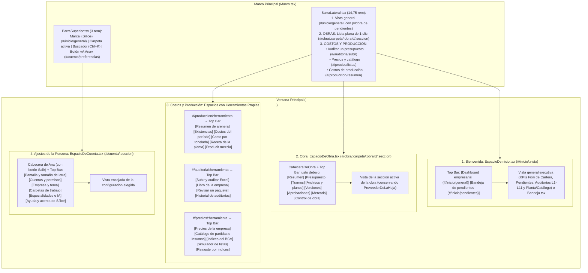

# Plan de Rediseño F6: Dashboard Empresarial de Bienvenida y Espacios Enrutados con Top Bars Propias
**Para revisión de Eugenio y ejecución por Claude Code (Orquestador)**

> [!IMPORTANT]
> **Modo de trabajo:** Documento de **investigación y diseño arquitectónico** (solo lectura, cero archivos del repositorio modificados). Respeta íntegramente `NORMAS.md`, `DESIGN.md` (IBM Carbon `g10` oficial, cero Tailwind en el proyecto, cero morado fuera de anomalías ML) y las guardias automáticas de [`sinJergaInterna.test.ts`](file:///c:/Users/euger/OneDrive/Escritorio/TESIS/frontend-desktop/src/paginas/sinJergaInterna.test.ts).

---

## 1. Visión Arquitectónica Unificada: Los 4 Espacios Enrutados de Sílice

Toda la ventana principal (`<main className="silice-contenido">`) sigue un **único patrón estructural**: cada espacio tiene su propia familia de rutas en el enrutador, una **Cabecera contextual arriba**, una **Top Bar horizontal con sus herramientas/vistas propias justo debajo** y el lienzo que encaja la vista de la sub-ruta elegida.

Además, esto **rescata las 14 pantallas reales de la tesis que en F4/F5 habían quedado ocultas en `sueltas` (alcanzables solo por `Ctrl+K`)**, integrándolas en la Top Bar de su respectivo dominio.

---

## 2. Detalle de los 4 Espacios y Qué Pantallas Existentes Encajan en Cada Uno

### Espacio 1: Ruta de Bienvenida — Dashboard Empresarial SaaS (`#/inicio/:vista`)

#### Benchmark de Dashboards y Gráficos en SaaS del Sector (Construcción, Costos y Finanzas B2B)
| Referente SaaS | Patrón de Dashboard y Gráficos que utiliza | Cómo se aterriza en Sílice (con `@carbon/charts-react` y `DESIGN.md`) |
|---|---|---|
| **SAP Fiori Overview Page (OVP)** *(Referencia obligatoria RS-6)* | **Estructura en 3 franjas horizontales:** 1) *KPI Header Cards* (valor actual, meta y desviación $\Delta / \Delta\%$). 2) *Analytical Chart Cards* en rejilla de 12 columnas. 3) *Actionable List Cards* con micro-acciones para ir directo al documento o excepción. | **Fila 1 (4 KPIs Fiori):** Cartera vigente vs. estimado, Pendientes (`bloquean` vs. `advertencias`), Desviación forense detectada en libros Excel (L1–L11) y Costo promedio $/t de planta + atípicos ML (`purple-60` `#8a3ffc`). |
| **Procore** (*Portfolio Financials & Executive Dashboard*) | **Barras Horizontales Comparativas por Obra (*Budget vs. Forecast & Variance*):** cada obra muestra su barra de monto vigente frente a su presupuesto base y resalta en rojo/verde el tramo de sobrecosto o ahorro, permitiendo hacer clic en la barra para entrar a la obra. | **Gráfico 1 (Barras comparativas IBCS por Obra):** Relleno sólido oscuro (`#161616`) para el monto vigente/real dentro de un marco de contorno (`#8d8d8d`) para la meta/plan, marcando la variación favorable (`#198038`) o desfavorable (`#da1e28`). |
| **InEight** (*Project Controls & EVM*) & **Primavera Unifier** | **Curva S de Valor Ganado y Ejecución Acumulada (*Time-Phased S-Curve*):** superpone la curva planificada, el avance real ejecutado y la proyección al cierre (EAC). | **Gráfico 2 ([`CurvaPlanAvance.tsx`](file:///c:/Users/euger/OneDrive/Escritorio/TESIS/frontend-desktop/src/comun/CurvaPlanAvance.tsx)):** Ya existe en Sílice y distingue los 3 roles sin depender solo del color: **Plan** (trazo fino `1.5 px` `#8d8d8d`), **Real** (trazo grueso `3 px` `#161616`) y **Pronóstico** (trazo discontinuo `6 4` `#007d79`). |
| **Autodesk Construction Cloud (ACC Insight)** & **IBM Carbon Charts** | **Anillo de Composición de Costos (*Donut Chart con total central*) + Matriz de Riesgo/Auditoría (*Construction IQ*):** anillo para la estructura de recursos (Materiales, Equipos, Mano de Obra) y lista priorizada de hallazgos/alertas operativas. | **Gráfico 3 ([`GraficoCarbon.tsx`](file:///c:/Users/euger/OneDrive/Escritorio/TESIS/frontend-desktop/src/comun/GraficoCarbon.tsx) `tipo="anillo"` con [`PALETA_GRAFICOS`](file:///c:/Users/euger/OneDrive/Escritorio/TESIS/frontend-desktop/src/comun/paletaGraficos.ts)):** Desglose de costos directos (Materiales `#161616`, Equipos `#007d79`, Mano de obra `#8d8d8d`) + **Fila 3 accionable** con `UltimasAuditorias.tsx` (reglas L1–L11) y `PanelArenera.tsx` (existencias en toneladas y $/t). |

#### Estructura de la Top Bar de Inicio (`#/inicio/:vista`):
1. **`#/inicio/general` («Dashboard empresarial»):**
   - **Fila 1:** Los 4 KPIs Fiori/IBCS de la empresa.
   - **Fila 2:** Los 3 gráficos ejecutivos (`Barras IBCS por Obra`, `Curva S Plan/Real/Pronóstico` y `Anillo Donut de Desglose APU`).
   - **Fila 3:** Los 2 paneles operativos accionables (`Últimas auditorías forenses L1–L11` y `Existencias y costos de cantera/arenera`).
2. **`#/inicio/pendientes` («Bandeja de pendientes»):**
   - Encaja íntegramente el componente existente [`Bandeja.tsx`](file:///c:/Users/euger/OneDrive/Escritorio/TESIS/frontend-desktop/src/paginas/pendientes/Bandeja.tsx) (y redirige `#/pendientes` → `#/inicio/pendientes` para compatibilidad total).

---

### Espacio 2: Obras con Top Bar Justo Debajo de sus Datos (`#/obra/:carpeta/:obraId/:seccion`)
- **En [`BarraLateral.tsx`](file:///c:/Users/euger/OneDrive/Escritorio/TESIS/frontend-desktop/src/marco/BarraLateral.tsx):**
  - La lista de `Obras` queda completamente plana (1 nivel, sin desplegar sub-secciones verticales).
  - Hacer clic en cualquier obra navega a `#/obra/:carpeta/:obraId/:seccionActiva` (manteniendo enfocada la sección que estabas viendo).
- **En [`CabeceraDeObra.tsx`](file:///c:/Users/euger/OneDrive/Escritorio/TESIS/frontend-desktop/src/marco/CabeceraDeObra.tsx):**
  - Arriba: los datos de la obra (`Muro perimetral (prueba en vivo)`, `Estado`, `Versión`, `Moneda` y `Lista para armar`).
  - **Justo debajo:** la Top Bar horizontal con todas las secciones de la obra (`Resumen`, `Presupuesto`, `Tramos`, `Archivos y planos`, `Versiones`, `Aprobaciones`, `Mercado`, `Control de obra` — y opcionalmente `Tablero` y `Riesgo` cuando el módulo está activo).

---

### Espacio 3: `Costos y producción` — Rutas Propias con sus Herramientas Propias en Top Bar
En la barra lateral, debajo de `Obras`, la zona **`Costos y producción`** tiene 3 entradas; cada una abre su propia ruta de espacio con una **Top Bar horizontal que reúne todas las herramientas de ese dominio** (que ya existen en [`src/shell/rutas.ts`](file:///c:/Users/euger/OneDrive/Escritorio/TESIS/frontend-desktop/src/shell/rutas.ts)):

1. **`Costos de producción` (`#/produccion/:herramienta` — `EspacioDeProduccion.tsx`):**
   - **Top Bar de herramientas propias de Producción y Cantera:**
     - `#/produccion/resumen` → [`paginas/produccion/index.tsx`](file:///c:/Users/euger/OneDrive/Escritorio/TESIS/frontend-desktop/src/paginas/produccion/index.tsx) (*Resumen de arenera*)
     - `#/produccion/existencias` → [`paginas/existencias/index.tsx`](file:///c:/Users/euger/OneDrive/Escritorio/TESIS/frontend-desktop/src/paginas/existencias) (*Existencias de la arenera*)
     - `#/produccion/costos` → [`paginas/produccion/CostosDelPeriodo.tsx`](file:///c:/Users/euger/OneDrive/Escritorio/TESIS/frontend-desktop/src/paginas/produccion/CostosDelPeriodo.tsx) (*Costos del período*)
     - `#/produccion/costo-tonelada` → [`paginas/produccion/CostoPorTonelada.tsx`](file:///c:/Users/euger/OneDrive/Escritorio/TESIS/frontend-desktop/src/paginas/produccion/CostoPorTonelada.tsx) (*Costo por tonelada*)
     - `#/produccion/receta` → [`paginas/produccion/RecetaPlanta.tsx`](file:///c:/Users/euger/OneDrive/Escritorio/TESIS/frontend-desktop/src/paginas/produccion/RecetaPlanta.tsx) (*Receta de la planta*)
     - `#/produccion/mezcla` → [`paginas/produccion/ProducirMezcla.tsx`](file:///c:/Users/euger/OneDrive/Escritorio/TESIS/frontend-desktop/src/paginas/produccion/ProducirMezcla.tsx) (*Producir mezcla*)
2. **`Auditar un presupuesto` (`#/auditoria/:herramienta` — `EspacioDeAuditoria.tsx`):**
   - **Top Bar de herramientas propias de Auditoría Forense:**
     - `#/auditoria/subir` → [`paginas/auditoria/index.tsx`](file:///c:/Users/euger/OneDrive/Escritorio/TESIS/frontend-desktop/src/paginas/auditoria/index.tsx) (*Subir y auditar Excel*)
     - `#/auditoria/libros` → [`paginas/libros/index.tsx`](file:///c:/Users/euger/OneDrive/Escritorio/TESIS/frontend-desktop/src/paginas/libros) (*Libro de la empresa*)
     - `#/auditoria/revisar` → [`paginas/revisar/index.tsx`](file:///c:/Users/euger/OneDrive/Escritorio/TESIS/frontend-desktop/src/paginas/revisar/index.tsx) (*Revisar un paquete*)
     - `#/auditoria/historial` → [`paginas/historial/index.tsx`](file:///c:/Users/euger/OneDrive/Escritorio/TESIS/frontend-desktop/src/paginas/historial) (*Historial de auditorías*)
3. **`Precios y catálogo` (`#/precios/:herramienta` — `EspacioDePrecios.tsx`):**
   - **Top Bar de herramientas propias de Precios y Catálogo:**
     - `#/precios/listas` → [`paginas/precios_empresa/index.tsx`](file:///c:/Users/euger/OneDrive/Escritorio/TESIS/frontend-desktop/src/paginas/precios_empresa/index.tsx) (*Precios de la empresa y atípicos ML*)
     - `#/precios/catalogo` → [`paginas/catalogo/index.tsx`](file:///c:/Users/euger/OneDrive/Escritorio/TESIS/frontend-desktop/src/paginas/catalogo) (*Catálogo de partidas e insumos*)
     - `#/precios/indices` → [`paginas/indices/index.tsx`](file:///c:/Users/euger/OneDrive/Escritorio/TESIS/frontend-desktop/src/paginas/indices) (*Índices del BCV*)
     - `#/precios/simulador` → [`paginas/simulador/index.tsx`](file:///c:/Users/euger/OneDrive/Escritorio/TESIS/frontend-desktop/src/paginas/simulador/index.tsx) (*Simulador de listas*)
     - `#/precios/reajuste` → [`paginas/reajuste/index.tsx`](file:///c:/Users/euger/OneDrive/Escritorio/TESIS/frontend-desktop/src/paginas/reajuste/index.tsx) (*Reajuste de precios*)

*(Nota: Cada pestaña de la Top Bar se filtra automáticamente con `usable(pagina, acciones, modoEntrega, modulosApagados)` para mostrar solo las herramientas permitidas al rol del usuario).*

---

### Espacio 4: Ajustes y Configuración de la Persona (`#/cuenta/:seccion` — `EspacioDeCuenta.tsx`)
Al hacer clic en el botón del usuario (`A Ana`) en la esquina superior derecha de [`BarraSuperior.tsx`](file:///c:/Users/euger/OneDrive/Escritorio/TESIS/frontend-desktop/src/marco/BarraSuperior.tsx), navega a la ruta `#/cuenta/preferencias` (sin menú desplegable flotante):
- **Cabecera del Espacio de Cuenta:** Avatar con iniciales, nombre completo, rol activo y botón **`Salir de la sesión`**.
- **Top Bar horizontal con las sub-rutas de configuración de la persona y de la instalación:**
  1. **`#/cuenta/preferencias` («Pantalla y tamaño de letra»):** Encaja el selector de **Tamaño de letra (`Normal 100 %`, `Grande 125 %`, `Muy grande 150 %`)** con muestra en vivo de partida y cifra tabular (`1.586,61 USD/m³`), además de los datos de la cuenta activa.
  2. **`#/cuenta/cuentas` («Cuentas y permisos»):** Encaja [`Cuentas.tsx`](file:///c:/Users/euger/OneDrive/Escritorio/TESIS/frontend-desktop/src/paginas/administracion/Cuentas.tsx) y [`Accesos.tsx`](file:///c:/Users/euger/OneDrive/Escritorio/TESIS/frontend-desktop/src/paginas/administracion/Accesos.tsx) (si tiene `administrar_cuentas`).
  3. **`#/cuenta/empresa` («Empresa y tema»):** Encaja [`Empresa.tsx`](file:///c:/Users/euger/OneDrive/Escritorio/TESIS/frontend-desktop/src/paginas/administracion/Empresa.tsx) con [`AvisosDelTema.tsx`](file:///c:/Users/euger/OneDrive/Escritorio/TESIS/frontend-desktop/src/paginas/administracion/AvisosDelTema.tsx) y [`EmpresasRegistradas.tsx`](file:///c:/Users/euger/OneDrive/Escritorio/TESIS/frontend-desktop/src/paginas/administracion/EmpresasRegistradas.tsx).
  4. **`#/cuenta/carpetas` («Carpetas de trabajo»):** Encaja [`CarpetasDeTrabajo.tsx`](file:///c:/Users/euger/OneDrive/Escritorio/TESIS/frontend-desktop/src/paginas/administracion/CarpetasDeTrabajo.tsx) (si tiene `cambiar_caso`).
  5. **`#/cuenta/sistema` («Especialidades, IA e instalación»):** Encaja [`Especialidades.tsx`](file:///c:/Users/euger/OneDrive/Escritorio/TESIS/frontend-desktop/src/paginas/administracion/Especialidades.tsx), [`Asistente.tsx`](file:///c:/Users/euger/OneDrive/Escritorio/TESIS/frontend-desktop/src/paginas/administracion/Asistente.tsx), [`ClavesApi.tsx`](file:///c:/Users/euger/OneDrive/Escritorio/TESIS/frontend-desktop/src/paginas/administracion/ClavesApi.tsx) e [`Instalacion.tsx`](file:///c:/Users/euger/OneDrive/Escritorio/TESIS/frontend-desktop/src/paginas/administracion/Instalacion.tsx).
  6. **`#/cuenta/ayuda` («Ayuda y acerca de Sílice»):** Encaja [`PaginaAcerca`](file:///c:/Users/euger/OneDrive/Escritorio/TESIS/frontend-desktop/src/paginas/acerca/index.tsx) y el inicio de recorridos guiados.

---

## 3. Plan de Ejecución TDD para Claude Code (`feature/f6-espacios-enrutados`)

1. **Tarea F6-1 — Pieza común `BarraDeEspacio.tsx` y tabla de rutas en `secciones.ts` / `oferta.ts`:**
   - Crear `src/marco/BarraDeEspacio.tsx` (barra horizontal de pestañas de ruta con `aria-current="page"`, raya inferior de `3 px` `--silice-complementario` y `flex-wrap: wrap`).
   - Declarar en `secciones.ts` las 4 familias de rutas (`/inicio/:vista`, `/obra/:carpeta/:obraId/:seccion`, `/produccion/:herramienta` + `/auditoria/:herramienta` + `/precios/:herramienta`, y `/cuenta/:seccion`) manteniendo redirecciones limpias desde las rutas viejas (`/pendientes`, `/empresa/:entrada`, `/<paginaId>`).
2. **Tarea F6-2 — Top Bar en `CabeceraDeObra.tsx` y lista plana en `BarraLateral.tsx`:**
   - Integrar `BarraDeEspacio` justo debajo de los datos de la obra en `CabeceraDeObra.tsx`.
   - Simplificar `BarraLateral.tsx` quitando el sub-árbol vertical de secciones por obra y renombrando el bloque inferior a `Costos y producción`.
3. **Tarea F6-3 — Espacios enrutados de `Costos y producción` (`Producción`, `Auditoría`, `Precios`) con sus herramientas propias:**
   - Crear el contenedor enrutado que pinta la cabecera del dominio + `BarraDeEspacio` con las herramientas de `PAGINAS` que pertenecen a ese dominio y encaja la pantalla activa debajo.
4. **Tarea F6-4 — Espacio enrutado de `Ajustes de la persona` (`#/cuenta/:seccion`) y limpieza de `BarraSuperior.tsx`:**
   - Crear `EspacioDeCuenta.tsx` con su Top Bar de configuraciones (`preferencias` con `<TamanoLetra />`, `cuentas`, `empresa`, `carpetas`, `sistema`, `ayuda`) y botón `Salir`.
   - En `BarraSuperior.tsx`, quitar `<TamanoLetra />`, quitar migas redundantes y convertir `A Ana` en enlace de ruta a `/cuenta/preferencias`.
5. **Tarea F6-5 — Dashboard Empresarial de Bienvenida (`#/inicio/general` y `#/inicio/pendientes`):**
   - Crear `EspacioDeInicio.tsx` como ruta inicial por defecto al entrar a la app, combinando los 4 KPIs empresariales Fiori, la tabla resumen de la cartera de obras (`useObras`), el resumen de auditorías (`UltimasAuditorias`), el estado de arenera (`PanelArenera`) y la pestaña hermana `Bandeja de pendientes` (`Bandeja.tsx`).
6. **Tarea F6-6 — Actualización de `DESIGN.md` y Compuertas:**
   - Ejecutar `npm run lint` y `npx vitest run --maxWorkers=3` (verificando especialmente `sinJergaInterna.test.ts` y cero scroll horizontal a 1056 px, 1366 px y 1920 px en las 3 escalas de letra).
