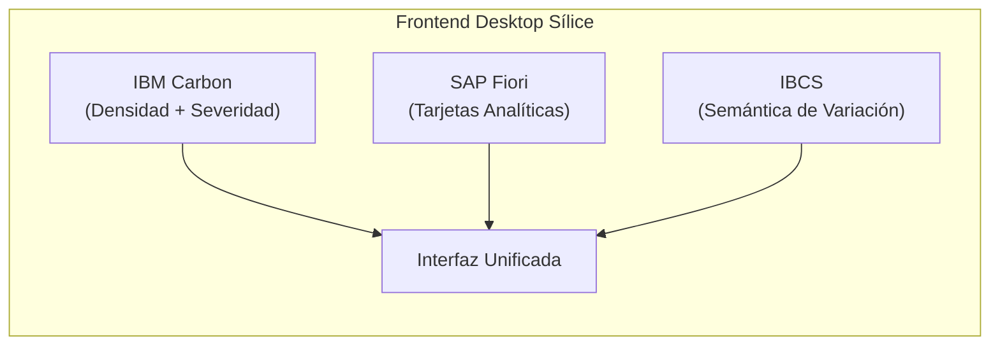

# MANUAL MAESTRO DE ORQUESTACIÓN Y OPTIMIZACIÓN INTEGRAL
## Para el Orquestador Claude y el Enjambre de Subagentes de Sílice

> **Documento:** `docs/manual_orquestador_optimizacion.md`  
> **Versión:** 1.0.0-PRODUCCION  
> **Fecha:** 18 de Octubre de 2026  
> **Destinatario Principal:** Orquestador Claude, Subagentes Especializados y Auditores de Tesis  
> **Garantía Fundamental:** Inviolabilidad absoluta de `core/` (`git diff origin/main -- core/` == vacío)

---

## 1. Propósito del Manual y Rol del Orquestador

Este manual constituye la **norma canónica y guía de ejecución** para que el Orquestador Claude y los subagentes especializados desarrollen, optimicen y auditen los subsistemas pendientes de Sílice:
1. **Frontend Desktop:** Tauri v2 + React 19 + Univer Canvas Grid con estándares de diseño IBM Carbon, SAP Fiori e IBCS.
2. **Backend & IPC:** FastAPI local sobre Named Pipes de Windows (`\\.\pipe\silice-ipc-local`) preservando la pureza de `core/`.
3. **Persistencia & Migraciones:** SQLite multi-caso (`casos/*.db`), `instalacion.db` y `produccion.db` con migraciones Alembic y respaldos automáticos.
4. **Calidad & Pruebas:** Suite pytest bajo `-W error`, cobertura $\ge 80\%$ (RNF-06) y cero pruebas omitidas.
5. **Asistente de IA & ML:** Integración dual Claude / Ollama (offline RNF-08), embeddings multilingües y detección de outliers con Isolation Forest.
6. **Réplica Documental:** Parser dual con `openpyxl` (`data_only=False` vs `True`), detección de celdas quemadas y lienzo Univer a 60 FPS.
7. **Auditoría Forense:** Reglas de sobreprecio, popovers contextuales de 1 clic y parches Delta inmutables sin tocar el archivo fuente.
8. **Gestor de Producción:** Bounded Context de canteras de extracción (arena, piedra picada, gravas), costos horarios de maquinaria pesada Caterpillar/USBR y conectores de báscula camionera.

---

## 2. Especificación Mandatoria del Frontend (Carbon + Fiori + IBCS)

Todo agente o desarrollador que implemente componentes de interfaz en `frontend-desktop/` debe acatar estrictamente la combinación de tres estándares internacionales:

### 2.1. IBM Carbon Design System (Densidad y Severidad)
* **Densidades de Tabla:**
  * **24px (`compact`):** Matriz de la réplica de Excel (Univer Canvas Grid) y desglose de recursos de APU.
  * **32px (`short`):** Bandeja de hallazgos de auditoría y catálogos de partidas.
  * **48px (`tall`):** Formularios táctiles de campo y tarjetas de maquinaria de cantera.
* **Paleta de Severidad:**
  * 🟢 `Green-50` (`#24a148`): Verificado y conforme a la norma.
  * 🟡 `Yellow-30` (`#f1c21b`): Advertencia menor o desvío no crítico.
  * 🔴 `Red-60` (`#da1e28`): Error crítico, violación de fórmula o sobreprecio severo.
  * 🔵 `Blue-60` (`#0f62fe`): Nota informativa o metadato externo.
  * 🟣 **Morado Carbon `Purple-60` (`#8a3ffc`):** **Reservado exclusivamente para precios unitarios y rendimientos atípicos** detectados por el modelo de Machine Learning (*Isolation Forest*).

### 2.2. SAP Fiori (Tarjetas de Indicadores Analíticos)
Cada tarjeta de métrica en los encabezados de proyectos y tableros de planta debe desglosar tres componentes:
1. **Valor Actual:** En tipografía grande y destacada (`text-2xl font-bold font-mono`).
2. **Meta / Benchmark:** Valor de referencia (Costo de cantera, tabulador oficial CIV o línea base del proyecto).
3. **Desviación Absoluta y Porcentual ($\Delta$ y $\Delta\%$):** Cálculo explícito de la diferencia monetaria o de rendimiento.

### 2.3. IBCS (Semántica de Variación de Negocio)
> [!CAUTION]
> **NUNCA colorear verde por signo positivo (+) ni rojo por signo negativo (-).**
> La coloración se rige por la **conveniencia económica para el presupuesto o la obra**:

* **Costos e Insumos:**
  * Si el precio es más alto que el tabulador ($\Delta > 0$): **DESFAVORABLE $\rightarrow$ Rojo (`#da1e28`)**.
  * Si el precio es menor al tabulador ($\Delta < 0$): **FAVORABLE $\rightarrow$ Verde (`#24a148`)**.
* **Rendimientos y Avance:**
  * Si la cuadrilla produce más m³/día ($\Delta > 0$): **FAVORABLE $\rightarrow$ Verde (`#24a148`)**.
  * Si el tiempo de ciclo del camión de cantera disminuye ($\Delta < 0$): **FAVORABLE $\rightarrow$ Verde (`#24a148`)**.
* **Representación Gráfica:**
  * Valores Reales / Medidos: Rellenos **sólidos**.
  * Presupuestos y Metas: Rellenos con **contorno o achurado**.

---

## 3. Matriz de Ejecución y Asignación de Subagentes

El Orquestador Claude debe coordinar el trabajo distribuyendo las cargas entre 5 subagentes concurrentes en worktrees aislados:

| Subagente | Rol | Directorio Exclusivo | Skill Asociada |
|---|---|---|---|
| **SA1** | Ingeniero de Dominio de Cantera | `produccion/`, `tests/unit/test_produccion_*.py` | `gestor-produccion-aridos`, `back-clean-arch` |
| **SA2** | Auditoría Forense y Parser Dual | `adapters/excel_visual/`, `api/rutas/auditorias_visuales.py` | `replicacion-excel`, `auditoria-forense` |
| **SA3** | Frontend Canvas Grid y Popovers | `frontend-desktop/src/components/`, `frontend-desktop/src/stores/` | `front-carbon-fiori-ibcs` |
| **SA4** | Integración Desktop Tauri v2 | `desktop/src-tauri/`, `scripts/construir_desktop.py` | `back-clean-arch`, `pruebas-cobertura` |
| **SA5** | Conectores de Báscula y Partes | `produccion/conectores/`, `frontend-desktop/src/components/Dropzone*` | `gestor-produccion-aridos` |

---

## 4. Protocolo de Verificación del Orquestador

Antes de autorizar la fusión de cualquier cambio a `main`, el Orquestador Claude debe comprobar:
1. `git diff origin/main -- core/` debe ser **estrictamente vacío**.
2. `uv run pytest tests/ -W error` debe completar con **cero fallos y cero warnings**.
3. `uv run python scripts/verificar_omitidas.py reporte-pruebas.xml` debe confirmar **cero omitidas**.
4. La compilación de Tauri v2 debe generar un paquete $\le 150\text{ MB}$ cumpliendo **RNF-19**.
5. Ningún componente debe realizar llamadas salientes a internet sin autorización explícita (**RNF-08**).

---

## 5. Protocolo de Entrevista de Comprensión y Alineación Técnica

> [!IMPORTANT]
> **Instrucción al Orquestador:** Al culminar la lectura de este manual y antes de lanzar las tareas de implementación, el agente debe declarar formalmente su comprensión de las directrices y someterse a una entrevista interactiva con el usuario para verificar que todos los subagentes estén alineados en las decisiones críticas de arquitectura, diseño visual y modelos de negocio.
