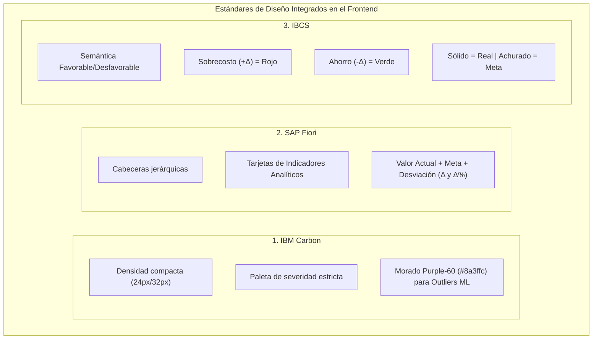

# MANUAL MAESTRO DE ORQUESTACIÓN Y OPTIMIZACIÓN INTEGRAL
## Para el Orquestador Claude y el Enjambre de Subagentes de Sílice

> **Artefacto:** `MANUAL_MAESTRO_OPTIMIZACION_ORQUESTADOR.md` (copia única versionada; la de `docs/manual_orquestador_optimizacion.md` era un duplicado y no se versiona)  
> **Orden de trabajo, subagentes y modelos:** [RUTA_SESIONES.md](./RUTA_SESIONES.md) (prevalece sobre §3 de este manual)  
> **Versión:** 1.0.0-PRODUCCION  
> **Fecha:** 18 de Octubre de 2026  
> **Garantía Fundamental:** Inviolabilidad absoluta de `core/` (`git diff origin/main -- core/` == vacío)

---

## 1. Visión y Alcance

Este manual constituye la norma canónica para que el **Orquestador Claude** coordine a los subagentes (ocho constructores, seis revisores y un escriba; [ruta §3](./RUTA_SESIONES.md#3-subagentes-modelo-y-esfuerzo)) en la construcción y optimización de los subsistemas pendientes de Sílice, cubriendo:

1. **Frontend Desktop:** Tauri v2 + React 19 + Univer Canvas Grid con estándares **IBM Carbon**, **SAP Fiori** e **IBCS**.
2. **Backend & IPC:** FastAPI local sobre **Named Pipes de Windows** (`\\.\pipe\silice-ipc-local`) preservando la pureza de `core/`.
3. **Persistencia & Migraciones:** SQLite multi-caso (`casos/*.db`), `instalacion.db` y `produccion.db` con Alembic y respaldos atómicos.
4. **Calidad & Pruebas:** Suite pytest bajo `-W error`, cobertura $\ge 80\%$ (RNF-06) y cero pruebas omitidas.
5. **Asistente de IA & ML:** Integración dual Claude / Ollama (offline RNF-08), embeddings multilingües y detección de outliers con Isolation Forest.
6. **Réplica Documental:** Parser dual con `openpyxl` (`data_only=False` vs `True`), detección de celdas quemadas y lienzo Univer a 60 FPS.
7. **Auditoría Forense:** Reglas de sobreprecio, popovers contextuales de 1 clic y parches Delta inmutables sin tocar el archivo fuente.
8. **Gestor de Producción:** Canteras de áridos (arena, piedra picada, gravas), costos horarios de maquinaria Caterpillar/USBR y básculas camioneras.

---

## 2. Especificaciones de Diseño del Frontend

### 2.1. IBM Carbon Design System
* **Densidades de Tabla:**
  * `compact` (24px): Para la réplica de hojas de cálculo de Excel (Univer Canvas) y desgloses de APU densos.
  * `short` (32px): Para listados de auditoría, catálogos de partidas y balances de planta.
  * `tall` (48px): Para formularios táctiles de partes de maquinaria en campo.
* **Paleta de Severidad y Estados:**
  * 🟢 **Verificado / Cumple:** `Green-50` (`#24a148`).
  * 🟡 **Advertencia Menor:** `Yellow-30` (`#f1c21b`).
  * 🔴 **Error Crítico / Falla:** `Red-60` (`#da1e28`).
  * 🔵 **Informativo / Metadato:** `Blue-60` (`#0f62fe`).
  * 🟣 **Precios y Rendimientos Atípicos (ML Outliers):** **`Purple-60` (`#8a3ffc`)**. Todo valor atípico detectado por el modelo Isolation Forest se resalta exclusivamente con este token morado y un tooltip explicativo.

### 2.2. SAP Fiori
* **Tarjetas KPI Analíticas:** Cada métrica de encabezado presenta de forma obligatoria:
  1. *Valor Actual* (cifra grande y destacada).
  2. *Meta / Benchmark* (línea base, costo de cantera o tabulador oficial).
  3. *Desviación* ($\Delta$ absoluta y $\Delta\%$ porcentual).

### 2.3. IBCS (International Business Communication Standards)
* **Semántica Favorable vs. Desfavorable:**
  * En costos y presupuestos: si el costo medido es mayor a la meta ($\Delta > 0$), es **Desfavorable $\rightarrow$ Rojo (`#da1e28`)**.
  * Si el costo medido es menor a la meta ($\Delta < 0$), es **Favorable $\rightarrow$ Verde (`#24a148`)**.
  * En rendimientos y producción: mayor producción ($\Delta > 0$) es **Favorable $\rightarrow$ Verde**.
* **Representación Gráfica:** Datos reales en relleno **sólido**; metas y presupuestos en **contorno o achurado**.

---

## 3. Matriz de Asignación Concurrente para Subagentes

> **Reemplazada** por la [ruta §3](./RUTA_SESIONES.md#3-subagentes-modelo-y-esfuerzo) (un subagente por skill, con modelo y esfuerzo). Se conserva como antecedente.

| Subagente | Rol | Área de Código | Skill Aplicada |
|---|---|---|---|
| **SA1** | Ingeniero de Cantera | `produccion/`, `tests/unit/test_produccion_*.py` | `gestor-produccion-aridos`, `back-clean-arch` |
| **SA2** | Auditoría Forense y Parser Dual | `adapters/excel_visual/`, `api/rutas/auditorias_visuales.py` | `replicacion-excel`, `auditoria-forense` |
| **SA3** | Frontend Canvas Grid y Popovers | `frontend-desktop/src/components/`, `frontend-desktop/src/stores/` | `front-carbon-fiori-ibcs` |
| **SA4** | Integración Desktop Tauri v2 | `desktop/src-tauri/`, `scripts/construir_desktop.py` | `back-clean-arch`, `pruebas-cobertura` |
| **SA5** | Conectores de Báscula y Partes | `produccion/conectores/`, `frontend-desktop/src/components/Dropzone*` | `gestor-produccion-aridos` |

---

## 4. Skills Creadas en el Sistema

Las siguientes 8 skills operativas están instaladas y disponibles en `.agents/skills/`:
1. [front-carbon-fiori-ibcs](../../.agents/skills/front-carbon-fiori-ibcs/SKILL.md): Diseño de alta densidad, tarjetas analíticas y semántica IBCS.
2. [back-clean-arch](../../.agents/skills/back-clean-arch/SKILL.md): Clean architecture, Named Pipes y protección de `core/`.
3. [pruebas-cobertura](../../.agents/skills/pruebas-cobertura/SKILL.md): Pytest `-W error`, cobertura $\ge 80\%$ y cero omitidas.
4. [base-datos-migraciones](../../.agents/skills/base-datos-migraciones/SKILL.md): SQLite multi-caso, Alembic y respaldos automáticos.
5. [asistente-ia](../../.agents/skills/asistente-ia/SKILL.md): Claude, Ollama offline, keyring y Isolation Forest.
6. [replicacion-excel](../../.agents/skills/replicacion-excel/SKILL.md): Parser dual `openpyxl` y Univer Canvas Grid.
7. [auditoria-forense](../../.agents/skills/auditoria-forense/SKILL.md): Popovers de 1 clic y parches Delta inmutables.
8. [gestor-produccion-aridos](../../.agents/skills/gestor-produccion-aridos/SKILL.md): Canteras de arena/piedra, costo horario Caterpillar y básculas.

---

## 5. Instrucción de Entrevista al Usuario

El orquestador Claude y los subagentes deben confirmar formalmente su comprensión técnica y someterse a la entrevista con el usuario para validar los parámetros críticos del proyecto antes de ejecutar las fases de código.
