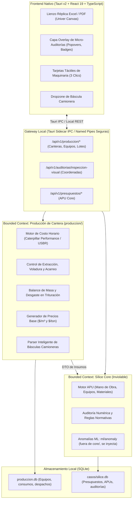
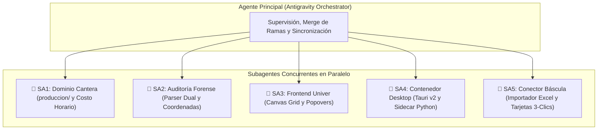
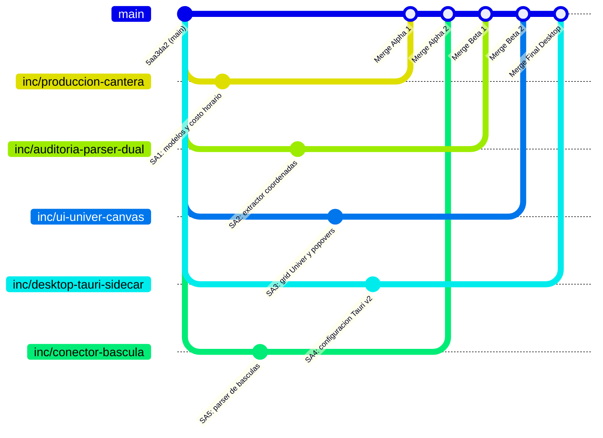

# PLAN INTEGRAL: GESTOR DE PRODUCCIÓN DE ÁRIDOS Y AUDITORÍA VISUAL INTERACTIVA

> **Proyecto:** Sílice / Sistema de Estimación y Auditoría de Presupuestos Multiespecialidad  
> **Fecha de Actualización:** 15 de Octubre de 2026  
> **Metodologías:** Clean Architecture / DDD (Bounded Contexts), SOLID, DRY, Cascada (fases de análisis) y Scrum (sprints de entrega con subagentes concurrentes).  
> **Stack Ratificado:** **Tauri v2** + React 19 + TypeScript + Vite + **Univer Canvas Grid** + Sidecar Headless en Python (FastAPI + SQLite).

---

## 0. Enmiendas del 2026-10-18 (prevalecen sobre el resto del documento)

El orden de construcción, los subagentes y el modelo/esfuerzo de cada tarea viven en
[**RUTA_SESIONES.md**](./RUTA_SESIONES.md) (fuente única). Las cifras y fórmulas de cantera se rigen por
[**PLAN_FUENTES_DATOS_CANTERA.md**](./PLAN_FUENTES_DATOS_CANTERA.md). Lo que cambia aquí:

| # | Enmienda | Afecta a |
|---|---|---|
| E-1 | **Orden:** asistente de IA → cambio visual (visor de solo lectura) → auditoría en el visor (Delta) → arenera → Tauri → auditoría y release (ruta §5, decisión RS-4 de Eugenio). | §9 (el checklist de fases queda reemplazado por la ruta) |
| E-2 | **La interfaz nueva la sirve primero el FastAPI existente en `/app`**; Tauri v2 la envuelve en la sesión 5 sobre el Python que ya instala Inno Setup (RT-2, RT-3). | §1 decisión 1; SA4 |
| E-3 | **Transporte:** bucle local con puerto efímero y clave por sesión; Named Pipes solo como endurecimiento posterior (RT-5). | §2, §7 |
| E-4 | **Sin `adapters/excel_visual/`:** la réplica extiende `adapters/hoja_empresa/` (`visual.py` para el aspecto); la lectura dual y las reglas ya existen en `lector.py` y `reglas.py` (RT-6). `HallazgoVisualDTO` se construye a partir de las filas de hallazgo existentes (`FilaHallazgo`: código, severidad, celda `HOJA!CELDA`, impacto). | SA2, §6.2, §8 |
| E-5 | **Arenera = primero existencias** (cuánto hay, cuánto queda); el costo horario espera fuentes verificadas (RT-7). | §3, SA1, SA5 |
| E-6 | **Subagentes:** ocho constructores (uno por skill), seis revisores y un escriba, con modelo y esfuerzo fijados (ruta §3); reemplazan a SA1–SA5. El orquestador es Claude (Opus), no Antigravity. | §5, §8 |
| E-7 | **Pruebas obligatorias** en todas las tareas (RS-2). | todo |
| E-8 | **Cifras:** las de §3–§6 son **ejemplos construidos** o están **a cotejar** según PLAN_FUENTES; ninguna entra en un cálculo sin estado VERIFICADO o DATO DE LA EMPRESA. Corregidos: el ejemplo del ticket (C-6) y la densidad por defecto del DTO (C-5). | §3, §4.1, §6 |
| E-9 | **Diseño:** halos = severidad (con ícono), rojo/verde IBCS = variación; plan con contorno y pronóstico achurado (skill `front-carbon-fiori-ibcs` §1.3 y §3.2). | §4.1 |

---

## 1. Visión Ejecutiva y Objetivos Estratégicos

El plan expande la plataforma Sílice integrando la cadena de valor completa: desde la extracción física y procesamiento de áridos en canteras (arena, piedra picada, gravas, sub-bases) hasta la fiscalización forense visual de presupuestos de obra.

```mermaid
flowchart LR
    subgraph P["1. Gestor de Producción (Canteras y Áridos)"]
        direction TB
        E["Extracción y Voladura"] --> T["Transporte Interno"]
        T --> C["Trituración y Cribado"]
        C --> L["Acopio y Ensayos"]
        L --> Costo["Costo Unitario Real ($/m³ o $/ton)"]
    end

    subgraph Core["2. Núcleo Sílice (APU y Presupuestos)"]
        direction TB
        Costo --> Insumo["Insumo Material Cantera"]
        Insumo --> APU["Composición de APU"]
        APU --> Presupuesto["Presupuesto de Obra"]
    end

    subgraph Aud["3. Auditoría Visual Interactiva (UI Réplica)"]
        direction TB
        Presupuesto -.-> Doc["Carga de Archivo (Excel/PDF)"]
        Doc --> Replica["Réplica Visual en Canvas (Univer)"]
        Replica --> Micro["Micro-auditorías y Acciones en Celdas"]
    end
```



### Decisiones Arquitectónicas Ratificadas:
1. **Contenedor Desktop:** **Tauri v2** con React + Vite. Utiliza el motor nativo **WebView2** preinstalado en Windows 10/11, garantizando un instalador ultraligero que añade menos de 15 MB (cumpliendo con la restricción **RNF-19** $\le 150\text{ MB}$), con un consumo en reposo de solo 35-50 MB de RAM.
2. **Lienzo de Réplica Documental:** **Univer (`@univerjs/sheets`)** sobre `<canvas>` acelerado por hardware en modo **"Auditoría Asistida"**. El documento fuente se preserva como evidencia forense inalterada (solo lectura interactiva); las correcciones se proyectan mediante **popovers flotantes contextuales** y se registran en una **Capa Delta (Patch)** sin manipular el archivo original.
3. **Ingreso de Datos de Cantera (Enfoque Híbrido en 2 Vías):**
   - *Vía 1 (Despacho / Producción Real):* Zona de arrastre (*Dropzone*) para importación directa de reportes diarios/mensuales de **báscula camionera** (`.xlsx`, `.csv`).
   - *Vía 2 (Costos de Maquinaria y Planta):* **Tarjetas táctiles de 3 clics** para operadores de equipo pesado (horómetro diario, galones de diésel e incidencias de mantenimiento).

---

## 2. Arquitectura de Software: Bounded Contexts y Coexistencia con `core/`

Para mantener la estricta inviolabilidad del núcleo (`core/` permanece 100% puro e inmutable, sin dependencias de UI ni de base de datos) y aplicar los principios **SOLID y DRY**:



---

## 3. Especificación del Dominio: Canteras y Producción de Áridos

### 3.1. Proceso de Planta y Distribución de Coproductos
En una planta de trituración y clasificación, una tonelada de roca bruta (*Run-of-Mine* / ROM) ingresa a la tolva y se fracciona según el ajuste de la chancadora y las mallas de la zaranda vibratoria:

$$\text{Rendimiento de Planta} = \frac{\sum \text{Volumen de Coproductos Despachados}}{\text{Volumen Bruto Alimentado}} \times 100$$

* Fracciones típicas obtenidas:
  1. **Arena Lavada (0 a 4 mm):** Para morteros y concretos estructurales.
  2. **Piedra Picada 1/2" (12.5 mm):** Concretos bombeables y losas delgadas.
  3. **Piedra Picada 3/4" (19 mm):** Vigas, columnas y pavimentos rígidos.
  4. **Piedra Picada 1" (25 mm):** Cimentaciones masivas y muros de contención.
  5. **Sub-base granular y Polvillo:** Rellenos compactados y bases de carreteras.

### 3.2. Modelo de Costo Horario de Maquinaria Pesada
El costo horario total de posesión y operación ($C_H$) para retroexcavadoras, cargadores y trituradoras sigue la formulación del *Caterpillar Performance Handbook*:

$$C_H = \underbrace{\frac{V_a - V_r}{V_u} + \frac{V_a \cdot (i + s + t)}{H_a}}_{\text{Posesión}} + \underbrace{(Q_{\text{diésel}} \cdot P_{\text{comb}}) + C_{\text{lub}} + C_{\text{desgaste}} + C_{\text{operador}}}_{\text{Operación}}$$

* **Factor de Desgaste:** Monitorea la vida útil en horas de:
  - Muelas de mandíbula y conos trituradores (acero al manganeso).
  - Mallas de alambre de zarandas vibratorias.
  - Llantas de cargadores frontales o zapatas de orugas.

---

## 4. Especificación de la Auditoría Visual Interactiva (Univer + Canvas)

### 4.1. Flujo de Experiencia de Usuario (UX)
1. **Dropzone:** El usuario suelta el presupuesto en Excel (`.xlsx`/`.xlsm`).
2. **Extracción Dual en Backend:** El backend lee el archivo con `openpyxl` en dos modalidades:
   - `data_only=False`: Lee las fórmulas literales (ej. `=SUM(E5:E20)*1.16`).
   - `data_only=True`: Lee el valor calculado en caché por Excel.
   - Detecta si una fórmula fue omitida o si se escribió un número fijo para forzar un monto.
3. **Renderizado en Lienzo Univer:**
   - La réplica se dibuja en `<canvas>` con fidelidad exacta a la hoja original.
4. **Capa Superior de Micro-Auditorías:**
   - Celdas con hallazgos resaltadas con un halo translúcido sutil:
     - 🟢 **Verde:** Verificado, coincide con APU y tabuladores.
     - 🟡 **Amarillo:** Alerta de rendimiento fuera de rango o precio atípico.
     - 🔴 **Rojo:** Error de fórmula, sobreprecio crítico o partida no trazable.
5. **Popover Contextual y Capa Delta:**
   - Clic en una celda roja: *"La partida declara arena a \$42/m³. El costo de producción en Cantera Las Mercedes es \$18/m³ + \$9/m³ flete. Sobreprecio detectado: +55.5%."*
   - Botón: `[Adoptar Costo de Cantera]` $\rightarrow$ Registra el cambio en la Capa Delta (el archivo original permanece intacto) y recalcula el presupuesto al instante.

---

## 5. Plan de Asignación Concurrente para Subagentes (Multi-Agent Swarm)

Para lograr un avance simultáneo, ultra-rápido y sin colisiones de código, el trabajo se divide en **5 subagentes especializados**. Cada subagente tiene un rol estricto, archivos exclusivos y criterios de prueba independientes.



---

### 🤖 Subagente 1: Ingeniero de Dominio de Canteras / Backend (`produccion/`)
* **Misión:** Construir el motor de persistencia y cálculo de costos de cantera sin tocar `core/`.
* **Archivos Asignados (Exclusivos):**
  - `produccion/__init__.py`
  - `produccion/modelos.py` (Entidades SQLAlchemy: `Maquinaria`, `ParteDiario`, `Coproducto`, `DesgastePieza`)
  - `produccion/costo_horario.py` (Algoritmo de posesión y operación Caterpillar/USBR)
  - `produccion/balance_planta.py` (Distribución de masa en trituración y derivación de $/m³)
  - `api/rutas/produccion.py` (Endpoints FastAPI para maquinaria, partes y costos vigentes)
  - `tests/unit/test_produccion_cantera.py`
* **Entregables y Criterios de Aceptación:**
  1. Modelo de base de datos `produccion.db` completamente funcional con SQLite.
  2. Cálculo de costo horario con precisión de centavos para posesión, combustible y repuestos.
  3. Endpoint `GET /api/v1/produccion/costos-actuales` que devuelve el DTO de precios de áridos listo para ser consumido por el catálogo de APUs.
  4. Cobertura de pruebas unitarias $\ge 90\%$ (`uv run pytest tests/unit/test_produccion_cantera.py -W error`).

---

### 🤖 Subagente 2: Ingeniero de Auditoría Forense y Extracción de Coordenadas (`adapters/`, `api/`)
* **Misión:** Desarrollar el extractor de coordenadas celda/hoja y la reconciliación con el motor de auditoría existente.
* **Archivos Asignados (Exclusivos):**
  - `adapters/excel_visual/extractor.py` (Parser dual `data_only=False` y `data_only=True`)
  - `adapters/excel_visual/esquemas.py` (Modelos Pydantic `CoordenadaVisual`, `HallazgoVisual`, `DeltaPatch`)
  - `api/rutas/auditorias_visuales.py` (Endpoints de carga de presupuesto y emisión de mapa de anomalías)
  - `tests/unit/test_extractor_coordenadas.py`
  - `tests/unit/test_auditoria_visual_api.py`
* **Entregables y Criterios de Aceptación:**
  1. Parser capaz de procesar archivos `.xlsx` y extraer en menos de 2 segundos: valor, fórmula, color de relleno, fuente y coordenadas `(hoja, fila, columna)`.
  2. Detección automática de "fórmulas rotas" (fórmulas que ignoran celdas intermedias o redondeos alterados).
  3. Endpoint `POST /api/v1/auditorias/inspeccionar-archivo` que devuelve la réplica JSON del documento + lista de `HallazgoVisual` clasificados por severidad.
  4. Cero modificaciones dentro del directorio `core/`.

---

### 🤖 Subagente 3: Ingeniero de Frontend & Canvas Grid (`frontend-desktop/` - React + Univer)
* **Misión:** Implementar el visor interactivo de la réplica de hojas de cálculo con capa flotante de micro-auditorías.
* **Archivos Asignados (Exclusivos):**
  - `frontend-desktop/src/components/UniverGrid.tsx` (Componente de hoja de cálculo en `<canvas>`)
  - `frontend-desktop/src/components/AuditOverlay.tsx` (Capa de halos y badges de severidad sobre coordenadas)
  - `frontend-desktop/src/components/AuditPopover.tsx` (Tarjeta flotante contextual con explicación forense y botón de acción)
  - `frontend-desktop/src/components/DeltaHistory.tsx` (Historial de ajustes aplicados sobre el presupuesto)
  - `frontend-desktop/src/stores/auditStore.ts` (Estado global con Zustand: celdas activas, filtros y deltas)
* **Entregables y Criterios de Aceptación:**
  1. Renderizado a 60 FPS de hojas de cálculo de hasta 50.000 filas utilizando Univer.
  2. Superposición perfecta de los badges y alertas en las coordenadas de celda correspondientes, manteniéndose alineados durante el scroll y zoom.
  3. Popover con micro-auditoría interactiva que permite ejecutar la corrección en 1 clic y actualizar el estado visual de la celda de rojo a verde.

---

### 🤖 Subagente 4: Ingeniero de Integración Desktop & Sidecar (`desktop/` - Tauri v2 + IPC)
* **Misión:** Configurar el contenedor Tauri v2, la integración del sidecar en Python y el pipeline de empaquetado ligero.
* **Archivos Asignados (Exclusivos):**
  - `desktop/src-tauri/tauri.conf.json` (Configuración de ventana, permisos, CSP y WebView2)
  - `desktop/src-tauri/src/main.rs` (Ciclo de vida de la aplicación y gestión del proceso hijo Python)
  - `desktop/src-tauri/Cargo.toml`
  - `scripts/construir_desktop.py` (Script de automatización para compilar frontend y empaquetar con Tauri)
* **Entregables y Criterios de Aceptación:**
  1. Configuración de Tauri v2 que lanza automáticamente el backend FastAPI de Sílice en un puerto localhost efímero y seguro.
  2. Comunicación fluida mediante Tauri IPC / HTTP local sin abrir puertos externos hacia la red local (respetando **RNF-08**).
  3. Generación del ejecutable `.msi` / `.exe` verificando que el overhead añadido por Tauri sea $\le 20\text{ MB}$, preservando el cumplimiento de **RNF-19** ($\le 150\text{ MB}$ total).

---

### 🤖 Subagente 5: Ingeniero de Datos y Conectores de Báscula (`produccion/conectores/`)
* **Misión:** Implementar el importador inteligente de reportes de báscula camionera y los formularios táctiles de 3 clics.
* **Archivos Asignados (Exclusivos):**
  - `produccion/conectores/bascula_excel.py` (Parser heurístico de tickets de báscula Toledo, Cardinal y genérico)
  - `produccion/conectores/detector_columnas.py` (Mapeo automático de columnas: Ticket, Material, Bruto, Tara, Neto)
  - `frontend-desktop/src/components/DropzoneBascula.tsx` (Componente visual de arrastre de archivos de báscula)
  - `frontend-desktop/src/components/TarjetaMaquinaria.tsx` (Formulario táctil de 3 clics: Horómetro, Diésel, Mantenimiento)
  - `tests/unit/test_conector_bascula.py`
* **Entregables y Criterios de Aceptación:**
  1. Parser de báscula capaz de identificar automáticamente la estructura del archivo sin requerir que el usuario configure las columnas manualmente.
  2. Detección automática de inconsistencias de pesaje (ej. tara mayor que peso bruto o densidades anómalas de áridos).
  3. Componente de UI táctil minimalista optimizado para carga rápida de partes diarios desde tablet o laptop de campo.

---

## 6. Especificación Formal de Contratos de Datos (DTOs & Schemas)

Para garantizar que los subagentes trabajen de manera perfectamente desacoplada, se definen a continuación los esquemas de datos exactos:

### 6.1. Contrato de Insumos de Cantera (`InsumoCanteraDTO`)
Permite conectar los costos reales del subsistema de producción con el catálogo de materiales del Core de APU:

```python
from datetime import date
from decimal import Decimal
from pydantic import BaseModel, Field


class InsumoCanteraDTO(BaseModel):
    codigo_material: str = Field(..., example="MAT-ARIDO-01")
    nombre: str = Field(..., example="Arena Lavada de Río")
    unidad: str = Field(default="m3", example="m3")
    costo_produccion_directo: Decimal = Field(..., ge=0, example=18.50)
    costo_posesion_maquinaria: Decimal = Field(..., ge=0, example=4.20)
    costo_operacion_combustible: Decimal = Field(..., ge=0, example=6.80)
    costo_desgaste_plantas: Decimal = Field(..., ge=0, example=1.30)
    costo_total_en_patio: Decimal = Field(..., ge=0, example=30.80)
    densidad_ton_m3: Decimal = Field(..., gt=0, example=1.65)  # dato de la empresa por ensayo; sin valor por defecto (PLAN_FUENTES C-5)
    fecha_vigencia: date
    cantera_origen_id: str = Field(..., example="CANTERA-LOMAS-01")
```

### 6.2. Contrato de Réplica y Hallazgos Visuales (`HallazgoVisualDTO` y `DeltaPatchDTO`)
Estructura que el backend envía a Univer para iluminar celdas y recibir correcciones:

```python
from enum import Enum
from uuid import UUID
from pydantic import BaseModel, Field


class NivelSeveridad(str, Enum):
    INFO = "info"
    ADVERTENCIA = "advertencia"
    CRITICO = "critico"


class CoordenadaVisual(BaseModel):
    hoja: str  # Nombre de la pestaña de Excel
    fila: int  # 1-indexed (ej: 5)
    columna: int  # 1-indexed (ej: 3 para columna C)
    rango: str | None = None  # Notación A1 (ej: "C5")


class AccionCorreccion(BaseModel):
    id: str  # "ADOPTAR_CANTERA" | "AJUSTAR_TABULADOR" | "RECALCULAR_FORMULA"
    etiqueta: str  # "Adoptar costo real de cantera ($18.50/m³)"
    nuevo_valor: float | str
    impacto_total_presupuesto: float  # Variación en $ sobre el monto total


class HallazgoVisualDTO(BaseModel):
    id: UUID
    coordenada: CoordenadaVisual
    regla_id: str  # "SOBREPRECIO_ARIDO", "FORMULA_DESCALZADA", "RENDIMIENTO_ATIPICO"
    titulo: str
    descripcion: str
    valor_declarado: str | float
    valor_referencia: str | float | None
    desviacion_porcentual: float | None
    severidad: NivelSeveridad
    acciones_disponibles: list[AccionCorreccion]


class DeltaPatchDTO(BaseModel):
    id: UUID
    archivo_original_hash: str  # SHA256 del presupuesto original inalterado
    coordenada: CoordenadaVisual
    valor_anterior: str | float
    valor_nuevo: str | float
    motivo: str
    usuario_firma: str
```

### 6.3. Contrato de Despacho de Báscula (`TicketBasculaDTO`)

```python
from datetime import datetime
from decimal import Decimal
from pydantic import BaseModel, Field


class TicketBasculaDTO(BaseModel):
    numero_ticket: str = Field(..., example="TCK-98421")
    fecha_hora: datetime
    placa_transporte: str = Field(..., example="A45BB8C")
    cliente: str = Field(..., example="Constructora del Valle C.A.")
    producto_codigo: str = Field(..., example="PIEDRA_034")
    peso_bruto_ton: Decimal = Field(..., gt=0, example=42.50)
    tara_camion_ton: Decimal = Field(..., gt=0, example=14.20)
    peso_neto_ton: Decimal = Field(..., gt=0, example=28.30)
    volumen_estimado_m3: Decimal = Field(..., gt=0, example=17.15)  # 28,30 t / 1,65 t/m³ (ejemplo construido, PLAN_FUENTES C-6)
```

---

## 7. Arquitectura de Resiliencia, Seguridad y Casos Borde

Para garantizar la estabilidad en obra y evitar bloqueos en el software:

| Escenario Borde | Riesgo Potencial | Estrategia de Mitigación Implementada |
|---|---|---|
| **Excel con macros (`.xlsm`) o fórmulas externas (`[Libro2.xlsx]`)** | Fallo al evaluar fórmulas externas inexistentes en el equipo local. | Modo de evaluación en aislamiento: `openpyxl` lee los valores cacheados por Excel sin intentar resolver el libro externo remoto; la celda se marca con badge informativo `[Fórmula Externa No Verificable]`. |
| **Hojas de cálculo protegidas con contraseña** | Imposibilidad de leer celdas directamente. | Detección previa de cifrado. Si el libro tiene contraseña de lectura, el visor solicita la clave en un modal seguro antes de abrir el flujo de auditoría. |
| **Inconsistencias en reportes de báscula** | Tara superior al peso bruto o fecha futura por reloj descalibrado. | El validador heurístico rechaza filas inconsistentes, alertando al usuario en una bandeja de *"Pesajes sospechosos"* para corrección manual. |
| **Antivirus corporativo bloquea puertos localhost** | Falsos positivos que impiden a la UI comunicarse con el backend por HTTP `127.0.0.1`. | Implementación de **Named Pipes de Windows** (`\\.\pipe\silice-ipc-local`) como protocolo primario de transporte IPC entre Tauri y el sidecar de Python, eliminando por completo la apertura de sockets de red. |
| **Caída o terminación inesperada del proceso Python** | Pantalla congelada en el frontend. | Tauri implementa un **Watchdog** en Rust (`std::process::Child`): si el subproceso en Python muere, Tauri lo relanza en menos de 1 segundo sin cerrar la ventana ni perder las anotaciones en pantalla. |

---

## 8. Estrategia de Ramas Git y Despliegue de Worktrees para Subagentes

Para que los subagentes trabajen concurrentemente en el repositorio local sin pisarse entre sí ni generar bloqueos de archivos en Windows:



### Distribución de Carpetas y Worktrees:
1. `c:\Users\euger\OneDrive\Escritorio\TESIS\.worktrees\cantera` $\rightarrow$ Rama `inc/produccion-cantera` (SA1)
2. `c:\Users\euger\OneDrive\Escritorio\TESIS\.worktrees\parser` $\rightarrow$ Rama `inc/auditoria-parser-dual` (SA2)
3. `c:\Users\euger\OneDrive\Escritorio\TESIS\.worktrees\ui-univer` $\rightarrow$ Rama `inc/ui-univer-canvas` (SA3)
4. `c:\Users\euger\OneDrive\Escritorio\TESIS\.worktrees\tauri` $\rightarrow$ Rama `inc/desktop-tauri-sidecar` (SA4)
5. `c:\Users\euger\OneDrive\Escritorio\TESIS\.worktrees\bascula` $\rightarrow$ Rama `inc/conector-bascula` (SA5)

---

## 9. Checklist Operativo Paso a Paso (Hoja de Ruta Ejecutable)

> **Reemplazado** por [RUTA_SESIONES.md](./RUTA_SESIONES.md) (enmienda E-1). Se conserva como antecedente.

### Fase 0: Saneamiento de Base y Creación de Entornos (Agente Orquestador)
- [ ] 1. Asegurar que `origin/main` esté sincronizado y el fix de alias `ARENIA_*` en [`ui/entorno.py`](file:///C:/Users/euger/OneDrive/Escritorio/TESIS/.worktrees/auditoria/ui/entorno.py) esté aplicado para tener la suite base en 6.120 / 6.120 verde.
- [ ] 2. Crear las 5 ramas de trabajo y configurar los 5 `git worktree` aislados en disco.
- [ ] 3. Generar el archivo central de contratos [`adapters/excel_visual/esquemas.py`](file:///C:/Users/euger/OneDrive/Escritorio/TESIS/adapters) y [`produccion/contratos.py`](file:///C:/Users/euger/OneDrive/Escritorio/TESIS/produccion) en `main` como punto de partida común.

### Fase 1: Lanzamiento de Backend y Datos (SA1 + SA5)
- [ ] 4. **Lanzar Subagente 1:** Implementa `produccion.db`, cálculo de costos horarios de maquinaria pesada, balance de trituración y tests unitarios.
- [ ] 5. **Lanzar Subagente 5:** Implementa el parser inteligente de planillas de báscula camionera y los componentes táctiles de 3 clics.
- [ ] 6. **Punto de Control Alpha:** Verificar que `uv run pytest tests/unit/test_produccion_cantera.py tests/unit/test_conector_bascula.py -W error` pase al 100%.

### Fase 2: Lanzamiento de Auditoría Forense y Lienzo Visual (SA2 + SA3)
- [ ] 7. **Lanzar Subagente 2:** Desarrolla el parser dual de Excel (`openpyxl`), extractor de coordenadas y generador de `HallazgoVisual`.
- [ ] 8. **Lanzar Subagente 3:** Monta el lienzo Univer en `<canvas>`, implementa los halos de color según severidad y los popovers contextuales de corrección en 1 clic.
- [ ] 9. **Punto de Control Beta:** Probar con un archivo Excel real (`.xlsx`) que las coordenadas del backend coincidan exactamente con la posición de los popovers en la UI.

### Fase 3: Integración Desktop y Empaquetado Ligero (SA4 + Orquestador)
- [ ] 10. **Lanzar Subagente 4:** Configura Tauri v2, enlaza el sidecar de Python mediante Named Pipes o localhost seguro, y genera el script de empaquetado `scripts/construir_desktop.py`.
- [ ] 11. **Punto de Control Gamma:** Verificar que el instalador final generado pese menos de 150 MB (cumplimiento **RNF-19**) y pase la prueba de humo silenciosa.

### Fase 4: Auditoría Final, Documentación y Cierre de Release
- [ ] 12. Fusionar las ramas en `main` siguiendo el orden: Backend Cantera $\rightarrow$ Parser Visual $\rightarrow$ UI Univer $\rightarrow$ Desktop Tauri.
- [ ] 13. Ejecutar la suite completa de pruebas: `uv run pytest -W error` (verificar $\ge 6.150$ pruebas pasando sin omitidas).
- [ ] 14. Generar el manual de usuario con capturas del módulo de cantera y del visor visual de auditoría.
